<div align="center">

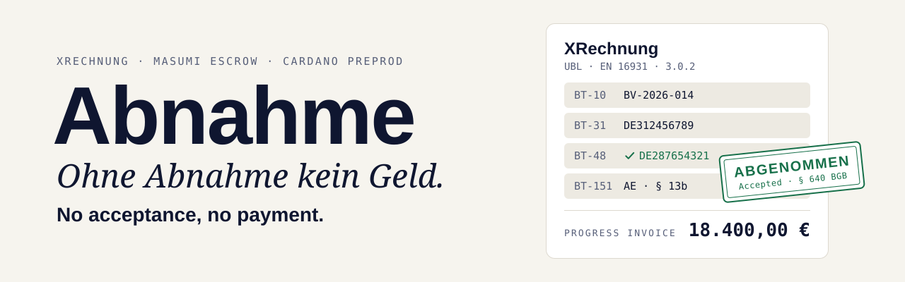

### Ohne Abnahme kein Geld. No acceptance, no payment.

Abnahme is a **buyer-run acceptance test for German e-invoices, enforced by a Masumi escrow on Cardano**.
An agent that converts invoices into XRechnung gets paid only after the buyer's agent has run the KoSIT validator and the client's own acceptance profile on the result.
A defect freezes the converter's money on chain until the converter fixes it.

[](https://github.com/omurbc/abnahme/actions/workflows/ci.yml)
[](SECURITY.md)
[](https://preprod.cardanoscan.io)
[](https://github.com/masumi-network/masumi-payment-service)
[](https://preprod.sokosumi.com)
[](https://developers.cardano.org/templates/x402-express/)
[](https://github.com/itplr-kosit/validator-configuration-xrechnung)
[](https://github.com/itplr-kosit/validator)
[](https://nodejs.org)
[](https://www.masumi.network/tum-hackathon)

</div>

---

> [!IMPORTANT]
> **Build status, Fri 30 Oct 2026 (hackathon day 1, afternoon).** All three agents are built and run on Cardano preprod. The refuse → cure → accept loop ran end to end through the Masumi V2 escrow (8 min 9 s from payment request to `Withdrawn`), with both inspections paid to the x402 Gutachter. A paid Sokosumi Task settled on chain and e-mailed an accepted XRechnung to the Mailpit inbox. These are separate recorded runs, each labelled under [Recorded runs](#recorded-runs). Every hash under [On-chain evidence](#on-chain-evidence) is a confirmed preprod transaction.
> `npm test` runs 261 tests (260 pass, 1 opt-in Claude test is skipped), and [CI](https://github.com/omurbc/abnahme/actions/workflows/ci.yml) runs them against a live KoSIT validator on every push. A two-part internal [security review](#security-review) (not a third-party audit) was followed by two fix rounds. Pins and accepted risks are in [SECURITY.md](SECURITY.md). What is still open is under [Status](#status), and what is mocked is under [What this proves](#what-this-proves-and-what-it-doesnt).

## Contents

- [The customer](#the-customer)
- [The problem](#the-problem)
- [The idea: Abnahme, as German law already defines it](#the-idea-abnahme-as-german-law-already-defines-it)
- [What we don't build](#what-we-dont-build)
- [Architecture](#architecture)
- [How a job runs: four stories](#how-a-job-runs-four-stories)
- [The acceptance test](#the-acceptance-test)
- [Four invoices, four verdicts](#four-invoices-four-verdicts)
- [The Gutachter: inspection paid per call over x402](#the-gutachter-inspection-paid-per-call-over-x402)
- [Why Cardano, why Masumi](#why-cardano-why-masumi)
- [What this proves, and what it doesn't](#what-this-proves-and-what-it-doesnt)
- [Reality check](#reality-check)
- [Technical details](#technical-details)
- [Run it yourself](#run-it-yourself)
- [Repo map](#repo-map)
- [Tech stack](#tech-stack)
- [On-chain evidence](#on-chain-evidence)
- [Upstream contribution](#upstream-contribution-a-refund-bug-in-the-masumi-payment-service)
- [Security review](#security-review)
- [Status](#status)
- [Credits](#credits)

---

## The customer

**Toni Huber Elektrotechnik GmbH** is an electrical contractor in Munich. Toni is a **composite persona**: he stands for a Munich finishing-trade subcontractor that sends monthly progress invoices (*Abschlagsrechnungen*) to general contractors. The working assumption is 8 people and about EUR 1.1M turnover. These numbers are not from a real firm's books.

**Frau Berger** runs Toni's office part-time. She writes the invoices in a word processor, has no crypto wallet, and should never need one. She is the person who uses Abnahme.

Two recipients, both fictional, appear in the fixtures and recipient profiles:

| Recipient | Profile | What its accounts payable expects |
|---|---|---|
| **Bau Isar Generalunternehmer GmbH**, a general contractor | [`bau-isar.json`](verifier/profiles/empfaenger/bau-isar.json) | §13b reverse charge (VAT category AE, its own VAT ID `DE287654321` in BT-48), a project number like `BV-2026-014` in BT-10, its own name and postcode as buyer, Toni's VAT ID and IBAN from its supplier master data |
| **Hausverwaltung Giesing GmbH**, a property manager | [`hv-giesing.json`](verifier/profiles/empfaenger/hv-giesing.json) | Standard 19 % VAT, no category AE, a property number like `OBJ-GIE-0417` in BT-10, its own name and postcode as buyer, Toni's VAT ID and IBAN |

Why now:

- **The e-invoice deadline.** For domestic B2B supplies from **1 January 2027**, a German business whose turnover in the previous year was above **EUR 800,000** can no longer send paper or PDF invoices. From 1 January 2028 the transition ends for everyone ([§27 Abs. 38 UStG](https://www.gesetze-im-internet.de/ustg_1980/__27.html)). With the assumed turnover, Toni is above the threshold.
- **§13b reverse charge.** When a subcontractor supplies construction work to a contractor that itself supplies construction work, the recipient owes the VAT ([§13b Abs. 2 Nr. 4, Abs. 5 UStG](https://www.gesetze-im-internet.de/ustg_1980/__13b.html)). The invoice shows no VAT and must carry the note "Steuerschuldnerschaft des Leistungsempfängers" ([§14a Abs. 5 UStG](https://www.gesetze-im-internet.de/ustg_1980/__14a.html)). In EN 16931 it carries VAT category `AE`, and rule **BR-AE-02** then requires the buyer's VAT ID (BT-48) or the buyer's legal registration identifier (BT-47). Bau Isar's accounts payable, as its recipient profile pins it, wants its VAT ID in BT-48. A progress invoice without it is our demo defect.
- **VOB/B 21 days.** Under VOB/B, "Ansprüche auf Abschlagszahlungen werden binnen 21 Tagen nach Zugang der Aufstellung fällig" ([§16 Abs. 1 Nr. 3 VOB/B](https://dejure.org/gesetze/VOB-B/16.html)): a progress payment is due 21 days after the statement arrives. An invoice the contractor's accounts payable cannot book has, in practice, not arrived. On our [18,400 EUR fixture](fixtures/b-abschlag-13b-bau-isar.txt), a bounce means three more weeks without the money. (Our reading, not legal advice.)

## The problem

1. **The deadline is close.** Small trades have to send structured e-invoices (XRechnung or another EN 16931 format) to their business clients, and most have never produced one.
2. **The receiver's rules decide.** A general contractor's accounts payable system rejects what it cannot validate or book. "Valid XRechnung" is necessary but not enough: the contractor also wants its own project number in BT-10, its own VAT ID in BT-48, and the IBAN from its supplier master data.
3. **Converters grade themselves.** Converters exist, and some promise "no charge if invalid". In that promise the converter grades its own work. Nothing stops it from deciding that its output was fine.
4. **Agent buyers have the same trust gap.** An agent that hires an unknown converter agent from an open registry has no reason to trust its output, and paying up front leaves the buyer without leverage.

## The idea: Abnahme, as German law already defines it

German contract-for-work law (*Werkvertrag*, §§631 ff. BGB) already has a protocol for "you get paid when I accept the work": the **Abnahme**. Every German tradesperson knows it. Masumi's V2 escrow on Cardano happens to have the same states. Abnahme maps the law onto the escrow, one transition at a time:

| Masumi V2 transition | Who signs | Contract law | Source |
|---|---|---|---|
| `SubmitResult` → `ResultSubmitted` | seller | Completion: the work is delivered | |
| `SetRefundRequested` → `Disputed` | buyer | **Refusal of acceptance citing a defect** (*Mängelrüge*) | [§640 Abs. 2 BGB](https://www.gesetze-im-internet.de/bgb/__640.html): deemed acceptance applies only if the buyer did not refuse "unter Angabe mindestens eines Mangels" |
| `SubmitResult` while `Disputed` (new result hash) | seller | **Right to cure** (*Nacherfüllung*) | [§635 Abs. 1 BGB](https://www.gesetze-im-internet.de/bgb/__635.html): the contractor may remove the defect or make a new work |
| `AuthorizeWithdrawal` → `WithdrawAuthorized` | buyer | **Acceptance** (*Abnahme*) | [§640 Abs. 1 BGB](https://www.gesetze-im-internet.de/bgb/__640.html) |
| `Withdraw` → `Withdrawn` | seller | **Payment falls due on acceptance** | [§641 Abs. 1 BGB](https://www.gesetze-im-internet.de/bgb/__641.html): "Die Vergütung ist bei der Abnahme des Werkes zu entrichten." |
| `Withdraw` from `ResultSubmitted` after `unlock_time` | seller | **Deemed acceptance**: the buyer stayed silent | §640 Abs. 2 BGB |
| KoSIT `warning` / `information` are "minor" in [`acceptance-v1.json`](verifier/profiles/acceptance-v1.json), except four rules the profile escalates | | **Minor defects cannot justify refusal** | §640 Abs. 1 S. 2 BGB: "Wegen unwesentlicher Mängel kann die Abnahme nicht verweigert werden." |
| `WithdrawDisputed` after `external_dispute_unlock_time` | Masumi admins | Arbitration when the parties cannot agree | |

There are three agents. One produces the invoice, one checks it, and the buyer holds the veto:

- **RechnungsMeister** (seller, runs on preprod): a Masumi MIP-003 agent ([`rechnungsmeister/server.mjs`](rechnungsmeister/server.mjs)) that turns pasted invoice text into XRechnung UBL with the conversion core in [`einvoice/`](einvoice). It checks its own output with KoSIT, delivers through the escrow and cures on a dispute.
- **Büro-Agent** (buyer, runs on preprod): Frau Berger's agent behind the Sokosumi Coworker *Abnahme-Büro* ([`worker.mjs`](worker.mjs), [`buero/`](buero)). It hires RechnungsMeister through the Masumi escrow, runs the acceptance test, and either refuses or accepts.
- **Gutachter** (inspector, paid on preprod): an x402 seller that runs the KoSIT validator for 1 tADA per inspection. The code is in [`gutachter/`](gutachter).

---

## What we don't build

Abnahme writes as little as possible itself. Rule checking, XML rendering, escrow, registry and payments all come from existing pieces:

| Concern | What we use | What we write |
|---|---|---|
| EN 16931 + XRechnung business rules (BR-*, BR-DE-*) | [KoSIT validator](https://github.com/itplr-kosit/validator) 1.6.3 with the official [XRechnung configuration](https://github.com/itplr-kosit/validator-configuration-xrechnung) 2026-08-31, published by KoSIT (Koordinierungsstelle für IT-Standards), the body behind the XRechnung standard | none. We pin both by sha256 and pin the matched scenario |
| UBL serialization | [`@e-invoice-eu/core`](https://github.com/gflohr/e-invoice-eu) 3.4.2, format `XRECHNUNG-UBL` | the mapping from about 30 flat fields to UBL ([`einvoice/build.mjs`](einvoice/build.mjs)) |
| Escrow | Masumi V2 `vested_pay` validator (Aiken, Plutus V3), driven by the [Masumi Payment Service](https://github.com/masumi-network/masumi-payment-service) 0.29.0 | none. We deploy no smart contract |
| Agent identity and job API | Masumi registry (agent NFT) and MIP-003 (`/start_job`, `/status`, `/availability`, `/input_schema`) from the template's `agent-api.mjs` | [`rechnungsmeister/server.mjs`](rechnungsmeister/server.mjs), plus `POST /dispute`, which is not part of MIP-003 |
| Human front door and billing | [Sokosumi](https://preprod.sokosumi.com) Coworker and credits, through the template's `worker.mjs` and `paid-task.mjs` | [`worker.mjs`](worker.mjs) and [`buero/sokosumi.mjs`](buero/sokosumi.mjs): the free PRÜFEN and paid SENDEN Tasks |
| Pay per inspection | x402 with the Cardano Foundation [x402-express template](https://developers.cardano.org/templates/x402-express/) and its hosted preprod facilitator | the `/inspect` handler, its verdict mapping and replay ledger ([`gutachter/`](gutachter)) |
| Field extraction from free text | Claude through [`@anthropic-ai/sdk`](https://github.com/anthropics/anthropic-sdk-typescript) structured outputs | the prompt and JSON schema ([`einvoice/extract.mjs`](einvoice/extract.mjs)) |

**What we write ourselves** is the part none of these pieces provide: an acceptance profile that is hashed and pinned before money moves, the semantic checks against the recipient's own master data, the German defect texts, and the buyer loop that turns a verdict into an on-chain refusal or acceptance.

**Cut on purpose** (from [`plan/BUILD_PLAN.md`](plan/BUILD_PLAN.md)): a web dashboard (this README and explorer links replace it), a custom Aiken validator, a second payment service with our own arbitrators, ZUGFeRD/Factur-X hybrid PDFs, and a live VIES VAT-ID check.

---

## Architecture

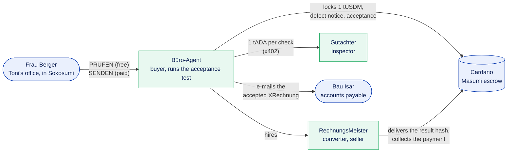

<sub>Green: our agents. Blue: people and outside systems. In the demo, Mailpit stands in for Bau Isar's inbox. The full diagram with every process, port and service is under [Technical details](#technical-details).</sub>

There are two payment rails, and the hiring agent decides on acceptance in both:

1. **Büro-Agent hires RechnungsMeister on Masumi.** The Büro-Agent calls RechnungsMeister's MIP-003 API at a configured URL (`RM_URL`, default `http://127.0.0.1:21950`), then MPS `POST /purchase` from the Büro-Agent's purchasing wallet into the V2 escrow. Buyer and seller are separate registrations with separate wallets on one payment service. Both agents are registered on chain, but their registered `api_base_url` is `127.0.0.1`, so only this machine can hire them (see [Reality check](#reality-check)).
2. **Büro-Agent hires the Gutachter over x402.** Each inspection is one HTTP request and one 1 tADA payment. There is no account and no subscription.

Frau Berger pays only for sending. PRÜFEN is free. SENDEN is a paid Sokosumi Task: Sokosumi books her credits, and Sokosumi's own preprod wallet locks 1 tUSDM in a Masumi escrow for the *Abnahme-Büro* selling wallet. Recorded: Task `01a18c2a…`, FundsLocked `d9c69f50…`, Withdrawn `5d61bf3f…`, seller receipt `settled: true` (rows 12 and 13 under [On-chain evidence](#on-chain-evidence)).

---

## How a job runs: four stories

Each story is one path through the code, with the same cast. Toni and Frau Berger are one composite demo persona (see [The customer](#the-customer)), not a real firm.

- **Toni** (Huber Elektrotechnik) sends the invoice. **Frau Berger** runs his office and uses Sokosumi. She has no wallet.
- **Büro-Agent** is Frau Berger's agent, the buyer.
- **RechnungsMeister** is the converter agent, the seller.
- **Gutachter** is the inspector, paid 1 tADA per check over x402.
- **Cardano** is the Masumi escrow that holds the money.
- **Bau Isar** is the general contractor's accounts payable, which receives the e-invoice.

The notes in each diagram say where the money is. The *release time* is the escrow's `unlock_time`: from then on, a result nobody objected to pays the seller.

### 1. The invoice that bounced once (Toni → Bau Isar)

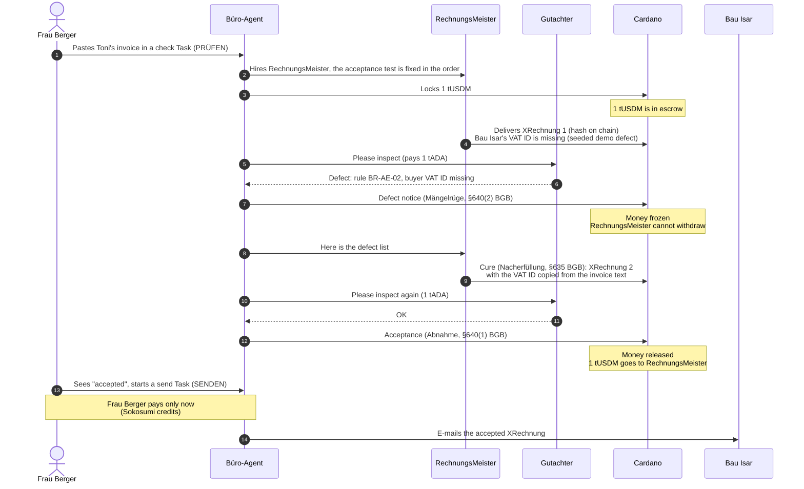

The code runs all 14 steps, but no single recorded run covers them: steps 2-12 ran on preprod from the command line (escrow runs 09:06 and 11:50), a Sokosumi PRÜFEN ran steps 1-12 with its inspections falling back to local KoSIT (10:13), and steps 13-14 ran as a separate paid SENDEN Task into Mailpit, which stands in for Bau Isar's inbox (see [Recorded runs](#recorded-runs)).

### 2. The converter cannot fix it

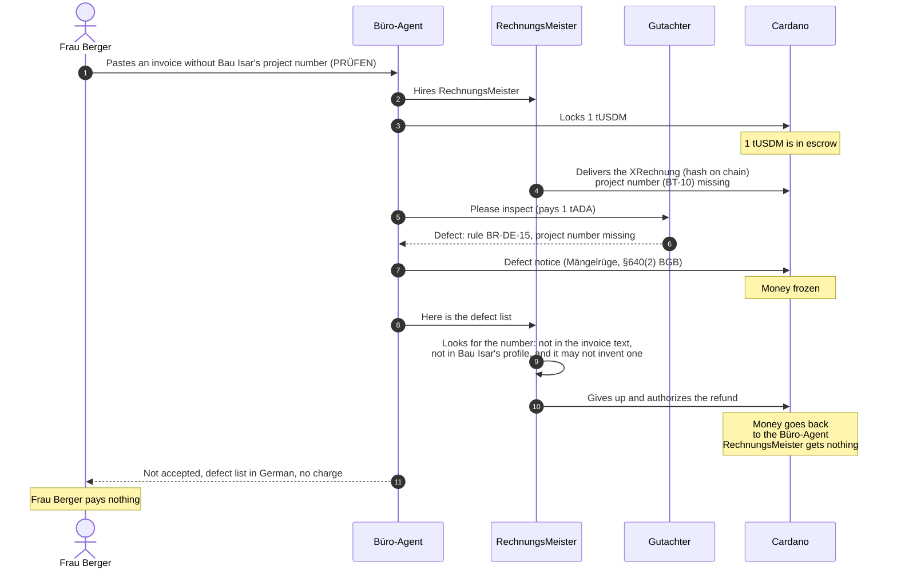

No recorded run has this exact defect: the 09:17 refusal run reached the same refund with a forged result hash (`CHEAT=1`), and with MPS 0.29.0 the refunded 1 tUSDM reaches the Büro-Agent only after an operator `request-repair` ([#1327](https://github.com/masumi-network/masumi-payment-service/issues/1327)).

### 3. The converter goes silent

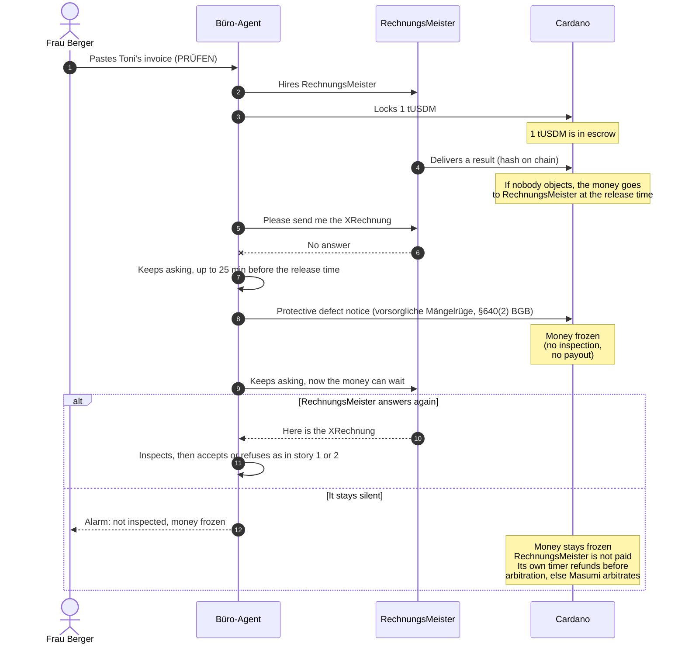

This is the fail-closed rule, and a live campaign run on preprod took it with injected HTTP 500 errors, ending with RechnungsMeister's own refund (run `2026-10-30T13-48-25-176Z-a678b5` in [`plan/EVIDENCE.md`](plan/EVIDENCE.md), unit test ESCROW-1 in [`buero/abnahme.test.mjs`](buero/abnahme.test.mjs)).

### 4. Right the first time

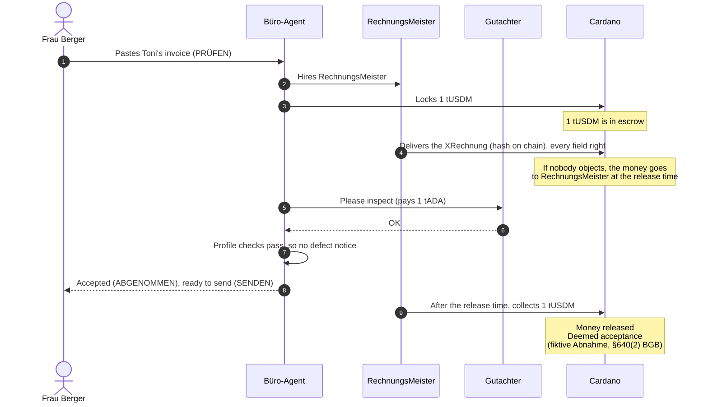

Recorded on preprod in the 11:46 audit run with Toni's repair invoice to Hausverwaltung Giesing and local KoSIT in place of the Gutachter (RechnungsMeister was paid about 10 min after the release time); in demo mode (`DEMO_SEED_DEFECT=1`) a Bau Isar invoice always takes story 1 instead.

Four properties carry the design:

- **The test is fixed before money moves.** The profile hash goes into the MIP-004 `input_hash` that sits in the escrow datum. Every state-continuing redeemer of `vested_pay` requires `new_datum.input_hash == input_hash`, so the seller cannot swap the acceptance test after the lock. (Checked in `smart-contracts/payment-v2/validators/vested_pay.ak` of MPS 0.29.0.) Checked on chain by the audit: datum field 10 of `470f87f0…` equals `sha256(nonce;JCS(input_data))` with `acceptanceProfileHash` `64a8294c…`. The `input_hash` pins whichever profile was current at lock time.
- **A refusal has teeth.** From `Disputed` the seller cannot `Withdraw`. That redeemer accepts only `ResultSubmitted` after `unlock_time`, or `WithdrawAuthorized`.
- **No inspection, no payout.** In `ResultSubmitted` the escrow pays the seller at `unlock_time` without asking the buyer. So the Büro-Agent stops waiting for an inspection 25 min before unlock, files a protective defect notice (Mängelrüge) that must be on chain by unlock − 15 min, and the money waits in `Disputed` while it keeps inspecting.
- **Acceptance is explicit and final.** On V2, MPS's `cancel-refund-request` asks for `AuthorizeWithdrawal`, and only from `Disputed` (checked in MPS 0.29.0 `src/routes/api/purchases/cancel-refund-request`). The V2 README calls that transition "intentionally irrevocable". The Büro-Agent sends it only if the escrow still holds the result hash it inspected.

The full call sequence, the escrow state machine with its redeemers, and the escrow deadlines are under [Technical details](#technical-details).

---

## The acceptance test

The acceptance test is two JSON files and a pipeline. The files are hashed into one `profileHash` before the job starts. The pipeline runs on every delivery.

The diagram of both parts, the pinned profile and the pipeline, is under [Technical details](#technical-details).

What each piece does, and where it lives:

| Step | File | Detail |
|---|---|---|
| Profile hash | [`verifier/profile.mjs`](verifier/profile.mjs) | `profileHash = sha256(canonicalJson({acceptance, recipient}))`. JCS sorts keys by UTF-16 code units, so key order cannot change the hash. A test pins both hashes, so any change to a profile file is deliberate. The hashes changed in `a1a4f73`, when six checks were added (bau-isar `0d799b13…` → `64a8294c…`, hv-giesing → `a9c6f943…`), while the profile id stayed `abnahme-xrechnung-v1`. The hash, not the id, says which test graded an invoice. |
| Extraction | [`einvoice/extract.mjs`](einvoice/extract.mjs) | Claude with a strict JSON schema of flat fields (`invoiceNumber`, `buyerVatId`, `buyerReference`, `lines`, `reverseCharge`, ...). The prompt says to copy values as printed and return `null` for missing ones. Text over 16,000 characters is refused before any model call. The call times out after 120 s and is retried once. `EXTRACT_MODE=fixed` uses a deterministic parser for our own fixed-layout format instead ([`parse-fixed.mjs`](einvoice/parse-fixed.mjs)). |
| Build | [`einvoice/build.mjs`](einvoice/build.mjs) | Computes line, tax and total amounts in cents. Sets VAT category `AE` with exemption code `VATEX-EU-AE` for §13b. Leaves `cbc:CustomizationID` out so the library writes the XRechnung 3.0 ID. A plain EN 16931 ID would skip every BR-DE rule. |
| KoSIT client | [`verifier/kosit.mjs`](verifier/kosit.mjs) | `accepted` needs HTTP 200, a KoSIT `accept` assessment **and** the matched scenario `EN16931 XRechnung (UBL Invoice)`. A report from another engine or XRechnung release counts as "not inspected". A 5xx means the invoice was not inspected, never that it is defective. XML over 5 MB is a `KOSIT-SIZE` defect and is never posted. |
| XML reader | [`verifier/xml.mjs`](verifier/xml.mjs) | A strict, namespace-aware parser. The checks read each fact by exact path from the `Invoice` root, so comments, processing instructions, CDATA, other prefixes or copies inside UBL extensions cannot show the checks a different IBAN, total or VAT ID than the one KoSIT and the ERP read. DOCTYPE and encodings other than UTF-8 are refused. |
| Semantic checks | [`verifier/checks.mjs`](verifier/checks.mjs) | Eleven checks, named in the acceptance profile and run against the recipient profile. An unknown check id in a profile throws an error. |
| German texts | [`verifier/messages-de.mjs`](verifier/messages-de.mjs) | KoSIT reports BR-DE-* in German but EN 16931 rules (BR-AE-02 and others) in English. A lookup table gives Frau Berger a German defect list. |

Codes the semantic checks emit: `ABN-BETRAG` (payable amount vs the expected total), `ABN-USTID` (seller VAT ID not in master data), `ABN-IBAN` (IBAN differs from master data), `ABN-13B` (wrong VAT category for the recipient), `ABN-BT48` (buyer VAT ID missing or wrong under §13b), `ABN-BT10` (buyer reference missing or wrong pattern), `ABN-WAEHRUNG` (not EUR), `ABN-RECHNUNGSART` (type not 380 or 875), `ABN-13B-HINWEIS` (§14a Abs. 5 wording missing), `ABN-UST` (VAT arithmetic), `ABN-KAEUFER` (buyer name or postcode), `ABN-DATUM` (invoice or due date), `ABN-XML` (XML cannot be read safely). The Büro-Agent adds `ABN-HASH` (delivered bytes vs the on-chain `result_hash`), `ABN-MANIFEST` (malformed delivery), `ABN-BT1` (invoice number it could not send), and `ABN-LIEFERUNG`, `ABN-PRUEFUNG` and `ABN-FRIST` for a delivery it could not inspect or that came too late.

---

## Four invoices, four verdicts

The [`fixtures/`](fixtures) folder has four invoices from Toni. Each comes as free text (`*.txt`, what Frau Berger would paste) and in our fixed layout (`*.fixed.txt`, the deterministic demo fallback). These results come from `EXTRACT_MODE=fixed node einvoice/cli.mjs <fixture>.fixed.txt <recipient> <betrag>` against KoSIT 1.6.3, with the expected gross totals 527.17 (a, d) and 18400.00 (b, c). The round-trip tests in [`einvoice/roundtrip.test.mjs`](einvoice/roundtrip.test.mjs) and the CI job assert the same results.

| Fixture | Recipient profile | Invoice | KoSIT | Defects | Verdict |
|---|---|---|---|---|---|
| [`a-reparatur-hv-giesing`](fixtures/a-reparatur-hv-giesing.txt) | `hv-giesing` | repair, 19 % VAT, 527,17 € | HTTP 200 | none | **ABGENOMMEN** |
| [`b-abschlag-13b-bau-isar`](fixtures/b-abschlag-13b-bau-isar.txt) | `bau-isar` | §13b progress invoice (type 875), 18.400,00 € | HTTP 200 | none | **ABGENOMMEN** |
| [`c-abschlag-13b-ohne-ustid`](fixtures/c-abschlag-13b-ohne-ustid.txt) | `bau-isar` | same §13b invoice, buyer VAT ID missing | HTTP 406 | `BR-AE-02`, `ABN-BT48` | **ABGELEHNT** |
| [`d-reparatur-ohne-bt10`](fixtures/d-reparatur-ohne-bt10.txt) | `hv-giesing` | same repair invoice, no buyer reference | HTTP 406 | `BR-DE-15`, `ABN-BT10` | **ABGELEHNT** |

In all four runs KoSIT matched the pinned scenario `EN16931 XRechnung (UBL Invoice)`. Fixture **c** is the demo's first delivery. This is the CLI output, as Frau Berger would read it:

```text
Abnahme: ABGELEHNT
Rechnung AR-2026-0087 vom 2026-10-28 – Toni Huber Elektrotechnik GmbH an Bau Isar Generalunternehmer GmbH
Zahlbetrag laut XRechnung: 18.400,00 € (erwartet: 18.400,00 €)
KoSIT 1.6.3 / Konfiguration 2026-08-31: HTTP 406, Szenario „EN16931 XRechnung (UBL Invoice)“
Prüfprofil: abnahme-xrechnung-v1 + bau-isar, Hash 64a8294cadfaca2383bd7f944cdf016cb7683e904e99b938b39c4001c6cedc10
Mängel:
 - [BR-AE-02] Bei Steuerschuldnerschaft des Leistungsempfängers (Kategorie „AE“) müssen beim Verkäufer die USt-IdNr. (BT-31), die Steuernummer (BT-32) oder die USt-IdNr. des Steuervertreters (BT-63) und beim Käufer die USt-IdNr. (BT-48) oder die Registernummer (BT-47) angegeben sein.
 - [ABN-BT48] Die USt-IdNr. des Käufers (BT-48) fehlt; bei § 13b muss DE287654321 angegeben sein.
```

Exit codes: `0` = abgenommen, `1` = abgelehnt, `2` = error or missing argument. The cure for **c** is fixture **b**: the same invoice with `DE287654321` in BT-48. That value is in the invoice text and in the pinned recipient profile, so the converter can cure without inventing anything.

---

## The Gutachter: inspection paid per call over x402

The Gutachter (German for an appointed expert inspector) sells one thing: a KoSIT inspection of raw XRechnung XML for **1 tADA** (`{amount: '1000000', asset: 'lovelace'}`) on `cardano:preprod`. It is built from the Cardano Foundation x402-express template and settles through the CF hosted preprod facilitator.

The payment sequence (402, verify, inspect, settle, resend) is drawn under [Technical details](#technical-details).

| Gutachter answer | Meaning | Charged? |
|---|---|---|
| 200 `{verdict: 'ACCEPTABLE', httpStatus: 200, report, …}` | KoSIT accepted under the pinned XRechnung UBL scenario | yes |
| 200 `{verdict: 'REJECT', httpStatus: 406, report, …}` | KoSIT rejected, or accepted under another scenario. The inspection is complete. | yes |
| 400 | body is not XML | no |
| 503 | KoSIT unreachable | no |
| 502 | KoSIT answered something other than 200 or 406, or its report is not from the pinned validator or not about this body (`rep:documentHash`) | no |
| 409 | this payment was already used for a different body | no |

A REJECT is a finished, paid inspection, so it comes back as HTTP 200. `@x402/express` runs the handler after `/verify` and before `/settle`, buffers the response, and cancels settlement when the handler answers 400 or higher (from [`gutachter/README.md`](gutachter/README.md)). A KoSIT outage therefore costs the buyer nothing. Every response carries `Cache-Control: no-store`. The verdict mapping, the replay ledger, the resend logic and the budget are unit-tested in [`gutachter/`](gutachter) without chain or KoSIT.

Two limits:

- **A facilitator timeout can still charge without an answer.** If the facilitator stops waiting before the block lands, the buyer gets no report for a payment that may be on chain. `buy.mjs` therefore resends the same signed payment for up to 3 minutes and never signs a second one. On 30 Oct, before that fix (`72dee3a`), two inspections during the Sokosumi PRÜFEN escrow run were paid on chain without a report reaching the buyer (`9d022f95…`, `8f4755d3…`), and the Büro-Agent fell back to its local KoSIT. An entry the payment log leaves `unknown` must be checked on the explorer before paying again.
- **The Gutachter checks only what KoSIT checks.** ACCEPTABLE needs HTTP 200 and the pinned XRechnung UBL scenario. The semantic checks against the recipient profile run on the buyer's side ([`buero/abnahme.mjs`](buero/abnahme.mjs) with [`verifier/`](verifier)), not in the Gutachter.

---

## Why Cardano, why Masumi

- **The acceptance test can be pinned in the escrow.** The V2 datum carries `input_hash` and `result_hash`, and the validator keeps `input_hash` fixed through every state change. A commitment to "this is the test you will be graded by" becomes part of the payment itself, not a promise in a terms page.
- **The escrow already has an Abnahme lifecycle.** Refuse (`SetRefundRequested` → `Disputed`), cure (`SubmitResult` while `Disputed`), accept (`AuthorizeWithdrawal`), deemed acceptance (`Withdraw` after `unlock_time`), arbitration (`WithdrawDisputed`). We only had to map it to German law. We wrote no validator.
- **The buyer, not the seller, releases the money early.** After a refusal the seller cannot withdraw. Only the buyer's `AuthorizeWithdrawal` can pay the seller before the dispute window ends. A converter that grades its own work cannot do that here.
- **Agents need an identity and a job API.** The Masumi registry gives each agent an on-chain NFT and MIP-003 gives a standard job API. In a real deployment any buyer agent could find RechnungsMeister in the registry and hire it, and any converter could sell into the same acceptance test. In this demo both registry entries point to `127.0.0.1`.
- **Inspection should cost per call, not per contract.** x402 on Cardano lets the Gutachter charge 1 tADA per inspection to anyone who sends a request. There are no accounts, and a failed inspection is not settled.
- **The human needs no wallet.** Sokosumi lets Frau Berger hire the *Abnahme-Büro* Coworker with credits. Everything on chain happens between agents.

---

## What this proves, and what it doesn't

| Leg | Status |
|---|---|
| XRechnung build, KoSIT verdict and semantic checks for the four fixtures | **real**, reproducible against KoSIT 1.6.3 (`npm test` and the CLI commands under [Run it yourself](#run-it-yourself)). CI runs both on every push. |
| Scenario pin blocks the CustomizationID downgrade | **real**, tested against the live validator ([`verifier/kosit.test.mjs`](verifier/kosit.test.mjs)) |
| Profile hash is canonical, order-independent and stable | **real**, tested ([`verifier/profile.test.mjs`](verifier/profile.test.mjs)) |
| Profile hash inside the escrow `input_hash` | **real, checked on chain**: datum field 10 of `470f87f0…` equals `sha256(nonce;JCS(input_data))` with profile `64a8294c…`. Rows 4-11 under [On-chain evidence](#on-chain-evidence) pin the earlier profile `0d799b13…`. |
| Claude extraction from free text | **runs in every escrow run**: RechnungsMeister extracts the free-text fixture with Claude. The opt-in comparison test (`RUN_LLM_TESTS=1`) is skipped by default. |
| x402 inspection, 1 tADA | **works on preprod**: rows 1, 6 and 9, and the 11:50Z run |
| Masumi V2 refuse → cure → accept | **works on preprod**: `a57c43ee…` → `8f21ca18…`, and under the current profile `470f87f0…` → `49fa546b…` |
| Sokosumi Coworker *Abnahme-Büro*, paid Task | **works on preprod**: PRÜFEN Task with escrow `01a18c4b…`, paid SENDEN Task `01a18c2a…` (`d9c69f50…` → `5d61bf3f…`) |
| E-mail to the GC's accounts payable | **works**, into Mailpit (`<1bc07905…@abnahme.local>`), sent by a separate paid SENDEN Task |

The protections, in plain words (each landed with a regression test, see [Security review](#security-review)):

- **The buyer engine fails closed.** If the inspection cannot finish (the seller, Blockfrost, KoSIT or the Gutachter is down, or the result is late), the Büro-Agent files a protective Mängelrüge by unlock − 15 min and keeps inspecting from `Disputed`, where the money waits for it. It releases only the result hash it inspected. If money ever reaches the seller without acceptance, the protocol says so; it never says "keine Kosten" when money moved.
- **Disputes need the job's own token.** `/start_job` returns a per-job token, and `/dispute` and the delivered result in `/status` require it (401 otherwise). Nobody else can push RechnungsMeister into an `AuthorizeRefund`.
- **The seller does not leave money frozen.** RechnungsMeister authorizes the refund itself when an escrow is still `Disputed` at `external_dispute_unlock_time` − 10 min, when a cure is not confirmed within 20 min, or when a cure submit fails.
- **The acceptance test reads the XML by exact path.** Comments, CDATA or UBL extensions cannot show the checks a different IBAN, total or VAT ID than the one KoSIT reads.
- **x402 reports are bound to the inspected document.** The Gutachter refuses (502, no charge) a report from another validator or about other bytes. The Büro-Agent counts a Gutachter verdict only with a settled payment receipt, and re-checks the validator and `rep:documentHash` against its own bytes.
- **A replayed x402 payment buys nothing new.** A resend of a settled payment with the same body gets the cached report, with no KoSIT call and no second settlement; a different body gets 409. Tested live on preprod with one on-chain payment (`96d84abd…`).
- **The Gutachter binds 127.0.0.1 by default**, and the buyer calls `127.0.0.1`, not `localhost` (which tries `::1` first).
- **Each process holds only its own secrets.** `scripts/env-split.mjs` writes one env file per process, and `scripts/env-guard.mjs` refuses to start a process that holds another process's secret. The buyer never holds `ADMIN_KEY`; it reads purchases with a read-only MPS key.
- **One SENDEN, one charge.** A SENDEN reserves its invoice before the payment request, so a second SENDEN for the same invoice fails for free.

What the demo does not prove, stated plainly:

- **KoSIT checks format and rules, not truth.** A well-formed invoice for work that was never done passes KoSIT. Our semantic checks catch only what the recipient profile pins: payable amount, seller VAT ID, IBAN, §13b category and BT-48, the BT-10 pattern, currency, invoice type, the §14a wording, VAT arithmetic, buyer name and postcode, and dates. A pass does not prove that the GC's ERP will book the invoice, that the measured work is reviewable, or that the GC received the e-mail.
- **Sokosumi credits are not on-chain refunds.** When an escrow refunds on chain, Sokosumi does not give the credits back. "Pay only after acceptance" is enforced on the **agent-to-agent** hop (Büro-Agent → RechnungsMeister), not on Frau Berger's credits.
- **The team runs every agent.** Büro-Agent, RechnungsMeister, the Gutachter, KoSIT and one Masumi Payment Service run on one machine. Buyer and seller are different wallets on the same MPS, both registry entries point to `127.0.0.1`, and the x402 payer and payee are both team wallets. One paid hop crosses an ownership boundary: Sokosumi's own preprod wallet locked 1 tUSDM for the Abnahme-Büro (`d9c69f50…`), which withdrew it after `unlock_time` (`5d61bf3f…`, deemed acceptance).
- **The first-pass defect is seeded.** The demo runs RechnungsMeister with `DEMO_SEED_DEFECT=1`: its first delivery drops the buyer VAT ID (BT-48). Only a §13b recipient (bau-isar) rejects that; a hv-giesing invoice passes on the first try even in demo mode. The cure restores the VAT ID from RechnungsMeister's own first extraction, where it appears verbatim in the invoice text. The refusal demo uses `CHEAT=1`, which submits a result hash that does not match the delivered bytes. `/status` reports both switches as `demo`.
- **The recorded evidence comes from several runs.** No single recorded run goes from Sokosumi through the escrow and x402 to the e-mail. The e-mailed invoice was accepted by a PRÜFEN in local mode (no escrow). The byte-identical XML passed the escrow 46 minutes later, in a separate Sokosumi run whose inspections fell back to local KoSIT. See [Recorded runs](#recorded-runs).
- **Follow-up comments are not answered.** The worker posts progress and queue comments only. A comment on a finished Task gets no reply.
- **Mailpit stands in for the accounts-payable inbox.** No real general contractor receives anything.
- **People and firms are fictional.** Toni Huber and Frau Berger are composite personas. Bau Isar and Hausverwaltung Giesing are invented. All e-mail domains in the fixtures end in `.example`.
- **Testnet only.** tUSDM and tADA on Cardano preprod. No real money moves.
- **An LLM can be wrong.** The pinned checks catch errors only in the fields they cover. The fixed-layout parser is the deterministic fallback for the demo.

---

## Reality check

These findings come from building it, from the validator itself, from reading the MPS 0.29.0 source in the running container, and from our live preprod runs. Each row says which.

| Finding | How we know |
|---|---|
| An invoice with the plain EN 16931 `CustomizationID` makes KoSIT match the scenario `EN16931 (UBL Invoice)` and answer **HTTP 200**, even though it skips every German BR-DE rule. Checking "200 = valid" is not enough. | Run against KoSIT 1.6.3 in [`verifier/kosit.test.mjs`](verifier/kosit.test.mjs). This is why `acceptance-v1.json` pins the scenario. |
| KoSIT reports BR-DE-* in German but EN 16931 rules such as BR-AE-02 in English. A German small business needs a lookup table. | Raw validator output: fixture **c** gives `[BR-AE-02]-An Invoice that contains an Invoice line (BG-25) where …`, fixture **d** gives `[BR-DE-15] Das Element "Buyer reference" (BT-10) muss übermittelt werden.` |
| On V2, MPS `cancel-refund-request` asks for `AuthorizeWithdrawal` and returns 400 unless the purchase is `Disputed`. | MPS 0.29.0 `src/routes/api/purchases/cancel-refund-request/index.ts` |
| `AuthorizeWithdrawal` cannot be undone. The V2 README says integrators "MUST surface this irrevocability in the buyer-facing UI". In Abnahme the acceptance profile, pinned in `input_hash` before the lock, is the buyer's standing consent: the Büro-Agent signs `AuthorizeWithdrawal` with no human step, and Frau Berger never signs. | MPS 0.29.0 `smart-contracts/payment-v2/README.md`, [`buero/abnahme.mjs`](buero/abnahme.mjs) |
| The seller can rotate `result_hash` while `Disputed` until `external_dispute_unlock_time`. That is the cure window. | Same README, `SubmitResult` |
| MPS's V2 CI job does not run the `cancel-refund-request` flow, so the refuse → cure → accept loop on V2 has no upstream test. We ran it on preprod ([Recorded runs](#recorded-runs)). | [`plan/MPS.md`](plan/MPS.md), [`plan/EVIDENCE.md`](plan/EVIDENCE.md) |
| One payment service can buy from its own registered agent. The MPS V2 e2e suite does exactly that, and so do our runs (`a57c43ee…`). | [`plan/MPS.md`](plan/MPS.md) |
| MPS batches several escrows into one tx: two concurrent purchases had both locks and both `SubmitResult`s in one tx each. A buyer must read its own escrow output, picked by the datum's `input_hash`. Reading output #0 gave a false `ABN-HASH` in the audit's live run (fixed in `c39f6a9`). | [`plan/EVIDENCE.md`](plan/EVIDENCE.md) (audit scenario 5), [`buero/escrow.mjs`](buero/escrow.mjs) |
| MPS 0.29.0 builds a refund request only while `unlock_time` is more than 3 min away. A later request still gets HTTP 200, and the tx is never built. The Büro-Agent therefore sends none in the last 5 min and raises an alarm if a dispute is not confirmed 3 min before unlock. | [`plan/EVIDENCE.md`](plan/EVIDENCE.md) (audit scenario 6), [`buero/abnahme.mjs`](buero/abnahme.mjs) |
| Measured on preprod (block times): dispute → cure → accept took 8 min 9 s from payment request to `Withdrawn`. A deemed acceptance waits for `unlock_time`: the paid Sokosumi Task took 44 min from FundsLocked to `Withdrawn`. The refusal run reached `RefundAuthorized` after 22 min; its refund came only after a manual repair, 78 min after FundsLocked. | [`plan/EVIDENCE.md`](plan/EVIDENCE.md), [`audit/raw/part2-claims.md`](audit/raw/part2-claims.md) |
| Both registry NFTs carry an `api_base_url` on `127.0.0.1` (ports 21950 and 21951), so no agent outside this machine can reach them. | [`plan/MPS.md`](plan/MPS.md), [`audit/raw/part2-claims.md`](audit/raw/part2-claims.md) |
| Preprod has two tUSDM tokens: `16a55b2a…` (Masumi dispenser, used by the template) and `e675b46e…` (x402 SDK default). The Gutachter prices in lovelace to avoid the mix-up. | [`plan/BUILD_PLAN.md`](plan/BUILD_PLAN.md), [`gutachter/seller.mjs`](gutachter/seller.mjs) |
| The MPS 0.29.0 image cannot seed its own database. A one-shot setup container builds the same release from source to do it. | [`mps/docker-compose.yml`](mps/docker-compose.yml) |

---

## Technical details

The stories above leave out the calls, redeemers, deadlines and hashes. Each block below opens to the full version.

<details>
<summary><b>Full architecture: every process, port and service</b></summary>

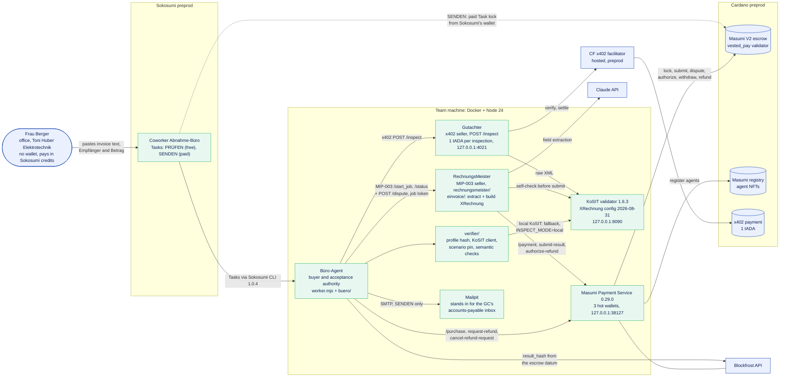

<sub>Green: our code, Coworker and containers, all running against preprod. Blue: people and external services.</sub>

</details>

<details>
<summary><b>One job, end to end: every call (target flow)</b></summary>

This is the flow the code implements, drawn as one job: a §13b progress invoice to Bau Isar whose first delivery is missing the buyer's VAT ID. **No single recorded run covers all of it.** The recorded runs cover it in parts. For example, the e-mailed invoice was accepted by a PRÜFEN in local mode, without an escrow. Each run is listed under [Recorded runs](#recorded-runs).

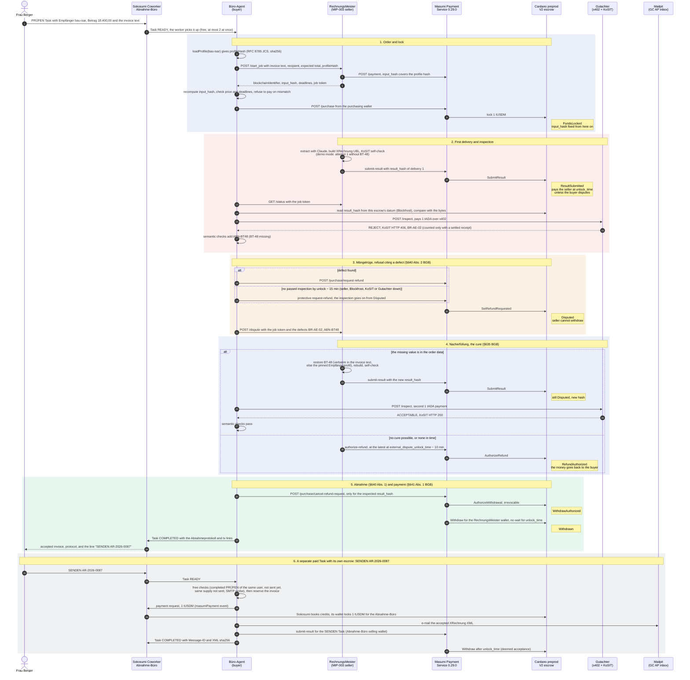

</details>

<details>
<summary><b>The escrow as a contract-law state machine</b></summary>

These are the Masumi V2 states we use, with the German law each transition stands for. State and action names come from MPS 0.29.0 (`OnChainState` enum, `payment-v2/README.md`). `Withdrawn`, `RefundWithdrawn` and `DisputedWithdrawn` are MPS states for an escrow UTxO that has been spent.

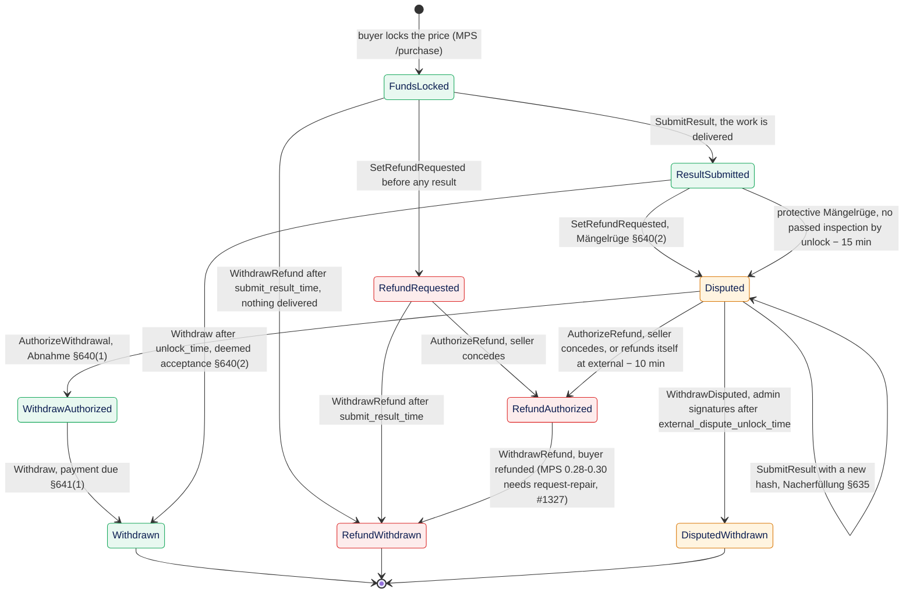

Abnahme's demo path is **FundsLocked → ResultSubmitted → Disputed → Disputed (cure) → WithdrawAuthorized → Withdrawn**. A first delivery that passes stays in `ResultSubmitted`, and the seller is paid by deemed acceptance after `unlock_time` (recorded: the hv-giesing run and the paid SENDEN Task). The refund branch covers defects that cannot be cured, for example when neither the source text nor the recipient profile has the missing BT-10. Then the seller concedes with `AuthorizeRefund` and the buyer withdraws the refund. RechnungsMeister also authorizes the refund by itself if the escrow is still `Disputed` at `external_dispute_unlock_time` − 10 min, so a refusal never leaves the buyer's money frozen. With MPS 0.28.0 to 0.30.0 the refund withdrawal needs an operator `request-repair` first ([#1327](https://github.com/masumi-network/masumi-payment-service/issues/1327)). Our refusal run was refunded that way in `becff7ad…`. Contract facts from the V2 README:

- `SetRefundRequested` must happen **before `unlock_time`**. It goes to `RefundRequested` when no result exists and to `Disputed` when one does.
- `SubmitResult` is allowed before `submit_result_time`, or **before `external_dispute_unlock_time` when a result already exists**. That second window is what makes the cure possible.
- `AuthorizeWithdrawal` needs `Disputed` and a non-empty result hash. After it, the seller can `Withdraw` without waiting for `unlock_time`.
- `WithdrawDisputed` needs weighted admin signatures and starts no earlier than `external_dispute_unlock_time`. Masumi's admins, not we, arbitrate a buyer who refuses in bad faith.

</details>

<details>
<summary><b>The escrow clock: deadlines for one job</b></summary>

These are the deadlines RechnungsMeister quotes for a job (`deadlines()` in [`rechnungsmeister/server.mjs`](rechnungsmeister/server.mjs)), in minutes after the quote, with the rules each agent adds.

```mermaid
gantt
    title Escrow windows for one RechnungsMeister job (time after the quote)
    dateFormat HH:mm
    axisFormat %H:%M
    section Buyer
    Lock funds before pay_by_time                        :b1, 00:00, 00:10
    Inspection passes, else protective Mängelrüge by unlock − 15 :b2, 00:00, 00:30
    Refuse (SetRefundRequested) until unlock − 5, Büro rule :b3, 00:00, 00:40
    Accept while Disputed, AuthorizeWithdrawal, no deadline :b4, 00:25, 01:15
    section Seller
    First result before submit_result_time               :s1, 00:00, 00:25
    Cure while Disputed, until external − 30             :s2, 00:25, 00:35
    Refund a dispute still open, at external − 10        :milestone, s3, 00:55, 0m
    Withdraw if undisputed, after unlock_time            :s4, 00:45, 01:15
    section Fallbacks
    Buyer refund if no result                            :f1, 00:25, 01:15
    Admin arbitration, WithdrawDisputed                  :f2, 01:05, 01:15
```

<sub>RechnungsMeister values: `payByTime` +10 min, `submitResultTime` +25, `unlockTime` +45, `externalDisputeUnlockTime` +65. Büro-Agent rules ([`buero/abnahme.mjs`](buero/abnahme.mjs)): no inspection starts later than unlock − 25 min, a protective Mängelrüge goes out by unlock − 15 min, and no refund request is sent after unlock − 5 min (MPS itself builds none within 3 min of unlock). It refuses a quote whose windows are longer than 30 min each. RechnungsMeister cures only until external − 30 min and refunds an escrow that is still `Disputed` at external − 10 min. The cure and accept bars start at the result deadline for readability; both are possible as soon as the escrow is `Disputed`. Bars that reach the right edge have no upper time bound. The paid Sokosumi Task (`paid-task.mjs`) has its own deadlines.</sub>

</details>

<details>
<summary><b>The acceptance test: profile hash and pipeline</b></summary>

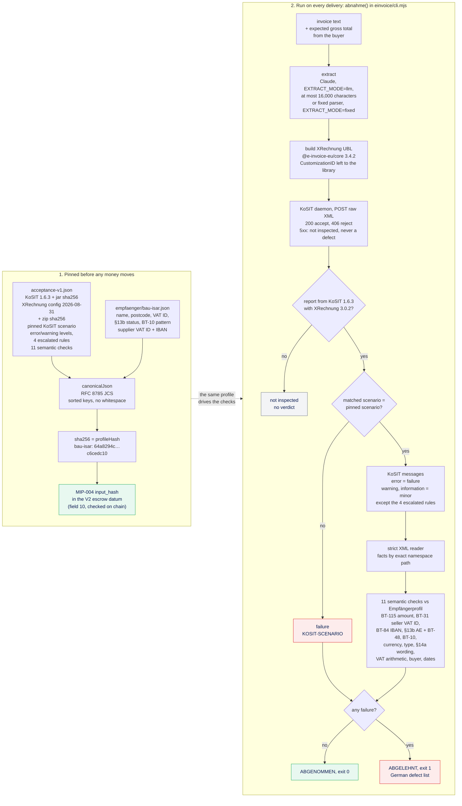

</details>

<details>
<summary><b>The Gutachter: one paid inspection over x402</b></summary>

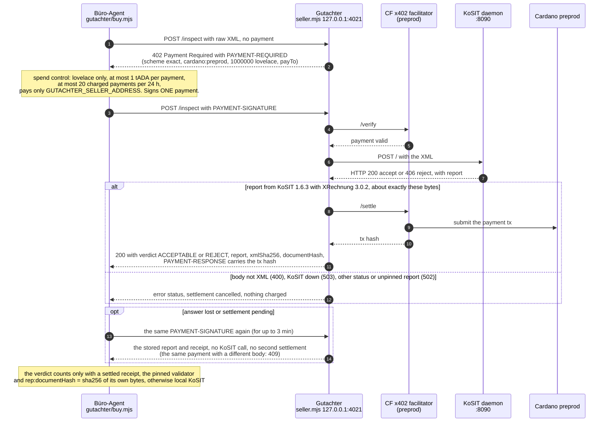

</details>

---

## Run it yourself

Requires Node.js 24.2 or newer and Docker. `npm ci` refuses older Node versions (`engine-strict`). On the build machine the default `node` is 18, so put Node 24 first on `PATH`:

```sh
export PATH="/opt/homebrew/opt/node@24/bin:$PATH"
git clone https://github.com/omurbc/abnahme.git
cd abnahme
npm ci
npm ci --prefix gutachter
```

### 1. The acceptance test (no wallet, no keys)

```sh
kosit/start.sh
# downloads validator 1.6.3 and the XRechnung configuration 2026-08-31, checks both sha256 values, and starts
# eclipse-temurin:21-jre (pinned by digest) as container "abnahme-kosit" on 127.0.0.1:8090:
# non-root, read-only root filesystem, no capabilities, no-new-privileges, memory and process limits

npm test
# every suite that needs no secrets: 230 root tests (229 pass, 1 opt-in Claude test skipped) and 31 Gutachter tests.
# Without a reachable KoSIT, 11 KoSIT tests are skipped; CI fails the job if that happens.

EXTRACT_MODE=fixed node einvoice/cli.mjs fixtures/c-abschlag-13b-ohne-ustid.fixed.txt bau-isar 18400.00   # ABGELEHNT, exit 1
EXTRACT_MODE=fixed node einvoice/cli.mjs fixtures/b-abschlag-13b-bau-isar.fixed.txt bau-isar 18400.00     # ABGENOMMEN, exit 0
EXTRACT_MODE=fixed node einvoice/cli.mjs fixtures/a-reparatur-hv-giesing.fixed.txt hv-giesing 527.17      # ABGENOMMEN, exit 0
EXTRACT_MODE=fixed node einvoice/cli.mjs fixtures/d-reparatur-ohne-bt10.fixed.txt hv-giesing 527.17       # ABGELEHNT, exit 1
```

The CLI is `node einvoice/cli.mjs <rechnung.txt> <empfaenger-id> <betrag>`. The third argument is the agreed gross total, and it comes from the buyer, never from the invoice text.

`kosit/start.sh` is safe to rerun. It leaves a running validator alone after checking that its rules still match the verified zip, and prints a note if that container's image differs from the pin. `kosit/start.sh --replace` recreates it, with about 15 s of downtime. If a validator from another checkout already uses the name or port, the script stops without touching it. Start a second one with `KOSIT_NAME=abnahme-kosit-2 KOSIT_PORT=18090 kosit/start.sh` and point clients at it with `KOSIT_URL=http://127.0.0.1:18090/`.

**Secrets and env files.** No process loads the whole `.env`. Put your keys in `.env` (start from `.env.example`), then run `node scripts/env-split.mjs`. It writes one file per process under `.local/env/` (directory 700, files 600) with every non-secret setting plus only that process's secrets, and prints names, never values. Rerun it after every change to `.env` or a key file. Long-running processes start with their own file and the guard, which refuses to start when a secret of another process is present:

```sh
node --env-file=.local/env/<process>.env --import=./scripts/env-guard.mjs <entry>.mjs
```

The profiles and their secrets are listed in [`plan/MPS.md`](plan/MPS.md) ("Env files per process").

With Claude extraction from the free-text invoice (needs `ANTHROPIC_API_KEY` in `.env`, then `node scripts/env-split.mjs`):

```sh
node --env-file=.local/env/buero-local.env einvoice/cli.mjs fixtures/b-abschlag-13b-bau-isar.txt bau-isar 18400.00
RUN_LLM_TESTS=1 node --env-file=.local/env/buero-local.env --test einvoice/extract.test.mjs
```

### 2. The Gutachter (x402)

```sh
cd gutachter
npm test                                        # 31 pass: verdicts, replay ledger, resend, budget, bind host (no chain, no KoSIT)
npm run wallet                                  # once: appends GUTACHTER_* wallets to ../.env, prints addresses only, reruns env-split
npm run balance                                 # buyer balance via Blockfrost (needs BLOCKFROST_API_KEY_PREPROD in ../.env)
npm run seller                                  # terminal 1: Gutachter on 127.0.0.1:4021 (../.local/env/gutachter-seller.env, no secrets)
npm run buy -- fixtures/xrechnung-ok.xml        # terminal 2: pays 1 tADA, prints ACCEPTABLE and the tx hash
npm run buy -- fixtures/xrechnung-no-bt10.xml   # pays 1 tADA, prints REJECT (BR-DE-15)
```

Fund the buyer address with preprod tADA first ([`plan/FUNDING.md`](plan/FUNDING.md)). Without KoSIT, `GUTACHTER_STUB=1 npm run seller` answers every paid inspection with a fixed ACCEPTABLE. The two XML fixtures come from the official [itplr-kosit/xrechnung-testsuite](https://github.com/itplr-kosit/xrechnung-testsuite). Details are in [`gutachter/README.md`](gutachter/README.md).

### 3. Masumi Payment Service

The compose file needs private files that are not in the repo. Generate the two keys with a private umask, so the files are created with mode 600:

```sh
(umask 077; mkdir -p .local
 printf 'ADMIN_KEY=%s\n' "$(openssl rand -hex 24)" > .local/mps.env                # 48 hex characters
 printf 'ENCRYPTION_KEY=%s\n' "$(openssl rand -hex 32)" > .local/mps-secrets.env)  # 64 hex characters
```

Then add `PURCHASE_WALLET_PREPROD_MNEMONIC` and `SELLING_WALLET_PREPROD_MNEMONIC` (two fresh preprod mnemonics you generate yourself) to `.local/mps-secrets.env`, and `BLOCKFROST_API_KEY_PREPROD` to `.env`.

```sh
mps/mps.sh up -d                                  # MPS 0.29.0 + Postgres; the first start builds the setup image from the pinned commit
mps/mps.sh ps -a                                  # abnahme-mps-setup "Exited (0)", payment-service "healthy"
mps/mps.sh rm -f payment-setup                    # remove it: the exited setup container still holds ADMIN_KEY, ENCRYPTION_KEY and the mnemonics
curl -s http://127.0.0.1:38127/api/v1/health
node scripts/env-split.mjs
node --env-file=.local/env/mps-admin.env mps/wallets.mjs   # roles, addresses, preprod balances
```

- **Keep one MPS checkout per host.** The compose project name, the container names and the volume `abnahme_mps_pgdata` are fixed, so `mps/mps.sh` from any checkout drives the same stack.
- **Never run `mps/mps.sh down -v`.** It deletes the encrypted wallets.

Wallet funding is described in [`plan/FUNDING.md`](plan/FUNDING.md). The RechnungsMeister selling wallet, the wallet-scoped runtime keys for each process (`mps/buyer-key.mjs`, `mps/read-key.mjs`) and the setup in general are in [`plan/MPS.md`](plan/MPS.md). Both agents are registered on preprod (rows 2 and 3 under [On-chain evidence](#on-chain-evidence)). To register your own, set `AGENT_AUTHOR` in `.env` and fund the selling wallets, then:

```sh
node --env-file=.local/env/mps-admin.env mps/rechnungsmeister-registration.mjs register
node --env-file=.local/env/mps-admin.env payment-registration.mjs register      # Abnahme-Büro
```

### 4. Agents, Coworker and e-mail

Each process runs in its own terminal, from the repo root, after `node scripts/env-split.mjs`. KoSIT (section 1) and MPS (section 3) must be running.

```sh
mail/start.sh                                     # Mailpit, pinned and hardened: SMTP 127.0.0.1:1025, inbox http://127.0.0.1:8025
(cd gutachter && npm run seller)                  # x402 Gutachter (section 2)
DEMO_SEED_DEFECT=1 node --env-file=.local/env/rechnungsmeister.env --import=./scripts/env-guard.mjs rechnungsmeister/server.mjs
node --env-file=.local/env/buero.env --import=./scripts/env-guard.mjs worker.mjs   # exactly one worker
```

- `DEMO_SEED_DEFECT=1` is the demo mode (see [What this proves](#what-this-proves-and-what-it-doesnt)). Without it, RechnungsMeister delivers its best attempt first.
- **Stopping the worker.** The first Ctrl-C starts nothing new, and the worker waits for every running PRÜFEN before it exits. A second Ctrl-C exits at once. The journals in `.local/` let the next start resume.
- **What the worker needs.** The Sokosumi CLI 1.0.4 installed globally (`npm install --global @masumi_network/sokosumi@1.0.4`), a Coworker with its runtime key in the OS vault, and `COWORKER_ID`, `SOKOSUMI_ORGANIZATION_ID` and `SOKOSUMI_ORGANIZATION_SLUG` in `.env` ([`plan/SOKOSUMI.md`](plan/SOKOSUMI.md)). Paid SENDEN also needs the Abnahme-Büro registration and `PAID_TASKS_ENABLED=true`.
- **Without escrow.** `ABNAHME_IMPL=local node --env-file=.local/env/buero-local.env --import=./scripts/env-guard.mjs worker.mjs` runs the real acceptance test with no escrow purchase and no tx hashes.

One escrow job from the command line, without Sokosumi:

```sh
node --env-file=.local/env/buero.env --import=./scripts/env-guard.mjs buero/run.mjs fixtures/b-abschlag-13b-bau-isar.txt bau-isar 18400.00
# prints the Abnahmeprotokoll and the tx table and appends both to plan/EVIDENCE.md.
# --follow keeps watching until the escrow pays out. INSPECT_MODE=local skips x402 and uses the local KoSIT.
# Rerunning the same command resumes an unfinished job from .local/abnahme-journal/ instead of buying again.
```

#### Sokosumi Tasks

A PRÜFEN Task description looks like this:

```text
PRÜFEN
Empfänger: bau-isar
Betrag: 18.400,00
<the invoice text, as pasted>
```

- **Line 1** is `PRÜFEN` or `SENDEN <Rechnungsnummer>`.
- **`Empfänger:` and `Betrag:` go directly below line 1.** `Empfänger` is `bau-isar` or `hv-giesing`, and `Betrag` is the agreed gross total. A line inside the invoice text can neither set nor hide them, and a duplicate control line is refused.
- **A Task holds at most 16,000 characters.**
- **PRÜFEN is free.** At most 2 run at once; the others wait in a queue and get a comment saying so. Progress goes into Task comments. The Task completes with the Abnahmeprotokoll, the tx table and, for an accepted invoice, the line `SENDEN <Rechnungsnummer>`.
- **SENDEN is paid.** Sokosumi books credits, and an escrow of 1 tUSDM pays the Abnahme-Büro. It runs only after a COMPLETED PRÜFEN of the same Sokosumi user accepted that invoice. Otherwise it is refused for free, before any payment request. It is also refused for free in these cases:
  - **Doppelversand:** the invoice was already sent, matched by invoice number or XML sha256.
  - Another SENDEN for it is running.
  - The same supply was already sent under another invoice number (same inbox, lines and Leistungsdatum).
  - A later PRÜFEN refused it.
  - The SMTP outbox does not answer a probe.

  The invoice is reserved before the payment request, so two SENDEN for one invoice cannot both be charged.
- **A FAILED SENDEN says whether credits were booked.** Before the payment request it says "Es wurde nichts berechnet". After it, it says that Sokosumi booked credits that are not refunded automatically.
- **Follow-up comments are not answered.** The worker does not read comments.

The CLI commands to create Tasks and read their events and receipts are in [`plan/SOKOSUMI.md`](plan/SOKOSUMI.md).

---

## Repo map

| Path | What it is | Status |
|---|---|---|
| [`einvoice/`](einvoice) | `extract.mjs` (Claude structured output), `parse-fixed.mjs` (deterministic fallback), `build.mjs` (XRechnung UBL), `cli.mjs` (`abnahme()` and the German summary) | built, tested |
| [`verifier/`](verifier) | `kosit.mjs` (daemon client, scenario and validator pin, document hash), `xml.mjs` (strict XML reader), `checks.mjs` (semantic checks), `messages-de.mjs` (German rule texts), `profile.mjs` (JCS + profile hash) | built, tested |
| [`verifier/profiles/`](verifier/profiles) | `acceptance-v1.json` and the recipient profiles `empfaenger/bau-isar.json` and `empfaenger/hv-giesing.json` | hashes pinned in tests |
| [`rechnungsmeister/`](rechnungsmeister) | `server.mjs` (MIP-003 seller plus `POST /dispute`, job tokens, self-refund), `mip004.mjs` (input and result hashes), `cure.mjs` (provenance-checked cure) | runs on preprod |
| [`buero/`](buero) | `abnahme.mjs` (escrow engine with journal), `escrow.mjs` (MPS and Blockfrost client), `sokosumi.mjs` (PRÜFEN and SENDEN, send ledger), `abnahme-local.mjs` (mode without escrow), `run.mjs` (one job from the CLI) | runs on preprod |
| [`worker.mjs`](worker.mjs), [`paid-task.mjs`](paid-task.mjs), [`settlement.mjs`](settlement.mjs) | Sokosumi worker, paid SENDEN adapter, seller receipt check (forked from the template) | runs on preprod |
| [`gutachter/`](gutachter) | x402 seller (`seller.mjs`), buyer (`buy.mjs`), verdict mapping (`inspect.mjs`), replay ledger (`ledger.mjs`), wallet and balance helpers | built, tested, paid on preprod |
| [`mail/`](mail) | `start.sh` (Mailpit, pinned and hardened), `smtp.mjs` (SMTP client with probe), `recipients.mjs` (AP inboxes, all `.example`) | runs locally |
| [`kosit/start.sh`](kosit/start.sh) | Downloads, sha256-checks and starts the KoSIT daemon in Docker | built, tested |
| [`mps/`](mps) | Docker Compose for MPS 0.29.0 (pinned by digest), `mps.sh` wrapper, wallet listing, RechnungsMeister registration, buyer and read-only runtime keys | running locally; both agents registered |
| [`scripts/`](scripts) | `env-split.mjs` (per-process env files), `env-guard.mjs` (refuses another process's secrets) | built, tested |
| [`fixtures/`](fixtures) | Four invoices from Toni, each as free text and in fixed layout | |
| [`.github/workflows/ci.yml`](.github/workflows/ci.yml) | CI: pins, `npm ci`, KoSIT, `npm test`, CLI verdicts, clean checkout | green on `main` |
| [`SECURITY.md`](SECURITY.md) | What is pinned, accepted risks for the demo, upgrade paths | |
| [`audit/`](audit) | `abnahme-audit.md` (compiled report, lands Sat 31 Oct) and `raw/` (the auditors' own reports) | |
| [`plan/`](plan) | `BUILD_PLAN.md` (scope, gates), `MPS.md` (payment service), `SOKOSUMI.md` (Coworker runbook), `FUNDING.md` (wallets), `EVIDENCE.md` (every recorded run), `AUDIT_PLAN.md` | |
| Root `*.mjs`, [`agent/`](agent) | The rest of the Masumi TUM quickstart template: `agent-api.mjs` (the Abnahme-Büro's MIP-003 API, not needed for Sokosumi), `payment-registration.mjs`, the Eve agent (`start.mjs`, not used) | template |
| [`docs/masumi-quickstart.md`](docs/masumi-quickstart.md) | The template's original README | |
| [`assets/hero.svg`](assets/hero.svg) | The banner above | |

---

## Tech stack

| Layer | Choice (exact versions from `package.json`, `package-lock.json` and the scripts) |
|---|---|
| Runtime | Node.js `>=24.2.0`, enforced by `engine-strict` (tested on v24.22.2), ES modules, `node:test` |
| E-invoice | `@e-invoice-eu/core` 3.4.2, format `XRECHNUNG-UBL` (XRechnung 3.0) |
| Validation | KoSIT validator 1.6.3 standalone jar, `validator-configuration-xrechnung` 2026-08-31 (XRechnung 3.0.2), in `eclipse-temurin:21-jre` 21.0.13+9 pinned by digest. The long-running demo container predates the pin and still runs an older JRE ([`SECURITY.md`](SECURITY.md) §2). |
| Extraction | `@anthropic-ai/sdk` 1.3.0, model `claude-opus-5-5`, JSON-schema structured output |
| Escrow and registry | Masumi Payment Service 0.29.0 (`ghcr.io/masumi-network/masumi-payment-service:0.29.0`, pinned by digest), `postgres:15` (pinned by digest), payment source `Web3CardanoV2` on Cardano preprod |
| Human front door | Sokosumi preprod, CLI `@masumi_network/sokosumi` 1.0.4 (global install, see [`SECURITY.md`](SECURITY.md) §4) |
| E-mail | `axllent/mailpit` v1.32.0 (pinned by digest), our own SMTP client on `node:net` |
| Template agent | `eve` 0.71.0, `ai` 7.0.127, `@ai-sdk/openai-compatible` 3.0.62, `zod` 4.6.5 (not on Abnahme's code paths) |
| x402 | `@x402/core`, `@x402/express`, `@x402/fetch`, `@x402/cardano` 2.26.0; `@evolution-sdk/evolution` 0.5.14; `express` ^4.21.0; CF hosted preprod facilitator |
| Chain data | Blockfrost preprod API |
| Hashing | RFC 8785 JCS + SHA-256 for the profile hash. MIP-004-style `sha256(nonce;payload)` for input and result hashes (template `standard-hash.mjs`) |
| CI | GitHub Actions on `ubuntu-24.04`, Node 24, actions pinned by commit SHA ([`ci.yml`](.github/workflows/ci.yml)) |

---

## On-chain evidence

Every row is a confirmed preprod transaction. The audit's forensics and claims auditors checked each one on Blockfrost: all are `valid_contract: true` and move what the row says. Rows 4-11 were graded under the earlier profile `0d799b13…` (commit `e7d132b`). The `input_hash` pins whichever profile was current at lock time. The run under the current profile `64a8294c…` is listed under [Recorded runs](#recorded-runs).

| # | Transaction | Rail | What it shows | Tx hash |
|---|---|---|---|---|
| 1 | x402 inspection payment, 1 tADA | x402 | Gutachter paid per call (track requirement), first paid inspection (`npm run buy`), verdict ACCEPTABLE | [`5820e591b57f…`](https://preprod.cardanoscan.io/transaction/5820e591b57f7baac9ea31818499dc37615a9697032919da83d183a0039ac4a9) |
| 2 | RechnungsMeister registration (agent NFT mint) | Masumi registry | Seller agent on the registry | [`8548d4f7a4a8…`](https://preprod.cardanoscan.io/transaction/8548d4f7a4a8667a91ccbd068d41ad6070062bc5794d1e6fe72159b625836333) |
| 3 | Abnahme-Büro registration (agent NFT mint) | Masumi registry | Buyer / Coworker agent on the registry | [`f63a51dc5728…`](https://preprod.cardanoscan.io/transaction/f63a51dc57282b2a680ce12ef25f4d80d74f65ed12a19330af1986d00bc0fc22) |
| 4 | `FundsLocked` | Masumi V2 escrow | Büro-Agent buys from RechnungsMeister; `input_hash` pins the profile current at lock time (`0d799b13…`) | [`a57c43ee1030…`](https://preprod.cardanoscan.io/transaction/a57c43ee103097f67b6650b2db896682ef254fef0c3dcf0f8e03d82cce9d1cab) |
| 5 | `ResultSubmitted`, first delivery | Masumi V2 escrow | Delivery with BT-48 missing (`DEMO_SEED_DEFECT=1`) | [`20ca2cf5c3a9…`](https://preprod.cardanoscan.io/transaction/20ca2cf5c3a9acc46b89e076a606e6bd4ff094254aa996eafbf9edcb307ead26) |
| 6 | x402 inspection → REJECT `BR-AE-02` | x402 | The paid inspection that found the defect | [`7dc0c48aeea2…`](https://preprod.cardanoscan.io/transaction/7dc0c48aeea27ad28af8329a6eab14730aa77756ca1f4e95d6261293034ced60) |
| 7 | `SetRefundRequested` → `Disputed` | Masumi V2 escrow | Mängelrüge, §640(2) BGB | [`995c6c489cb5…`](https://preprod.cardanoscan.io/transaction/995c6c489cb537edecdfe565fba78565560c6a6b2ef438fc527a3d6f22669c77) |
| 8 | `SubmitResult` while `Disputed` (stays `Disputed`) | Masumi V2 escrow | Nacherfüllung, §635 BGB | [`6c63b8f64ae0…`](https://preprod.cardanoscan.io/transaction/6c63b8f64ae0684b717fc9c4b39dc4ad4edf71aa940d4361d78b14db02476f5c) |
| 9 | x402 re-inspection → ACCEPTABLE | x402 | The cure passes | [`f846f7980834…`](https://preprod.cardanoscan.io/transaction/f846f7980834260f46e297643936ab5f07b2ad27ed4b182f564b1cccdc5c6d9b) |
| 10 | `AuthorizeWithdrawal` → `WithdrawAuthorized` | Masumi V2 escrow | Abnahme, §640(1) BGB | [`4b6d275e39d4…`](https://preprod.cardanoscan.io/transaction/4b6d275e39d47fd21f5a70b2c6a7b3115b39f99b281bb3a1fe8b548065047c50) |
| 11 | `Withdraw` → `Withdrawn` | Masumi V2 escrow | Payment on acceptance, §641(1) BGB | [`8f21ca18ad0a…`](https://preprod.cardanoscan.io/transaction/8f21ca18ad0aa9ee7e10ac9f9022a47a02e360a33c4329a74d7218dab66d4435) |
| 12 | Sokosumi paid Task `FundsLocked` | Masumi V2 escrow (Sokosumi) | Frau Berger's SENDEN AR-2026-0087 Task (`01a18c2a…`), paid in credits; Sokosumi's wallet locks 1 tUSDM | [`d9c69f508f1f…`](https://preprod.cardanoscan.io/transaction/d9c69f508f1f15299cdd3cc056ff4444b9ba0fcadf00e197cd14f7286c952859) |
| 13 | Sokosumi paid Task `Withdrawn` + seller receipt check | Masumi V2 escrow (Sokosumi) | Abnahme-Büro paid by deemed acceptance after `unlock_time`, checked by `settlement.mjs` (receipt `settled: true`, +1 tUSDM) | [`5d61bf3f11db…`](https://preprod.cardanoscan.io/transaction/5d61bf3f11db7fb2e4a110e98ea44f1699e7fb8d779866d5513cb5e83e0a7146) |

Live test campaign (Fri afternoon): see [`plan/EVIDENCE.md`](plan/EVIDENCE.md).

### Recorded runs

Each run is separate. No run below goes all the way from Sokosumi through the escrow and x402 to the e-mail. Times are UTC on 30 Oct.

| Run | Started from | Escrow | Inspections | Profile at lock | Outcome | Txs |
|---|---|---|---|---|---|---|
| Escrow run 1, 09:06 | `buero/run.mjs` (CLI), `DEMO_SEED_DEFECT=1` | V2: dispute → cure → accept | x402, 2 paid inspections | `0d799b13…` | ACCEPTED, `Withdrawn` 8 min 9 s after the payment request | rows 4-11 |
| Refusal run, 09:17 | CLI, `CHEAT=1`, `INSPECT_MODE=local` | V2: dispute → cure → refund | local KoSIT | `0d799b13…` | REFUSED: `ABN-HASH` on both deliveries, seller `AuthorizeRefund` at 09:41. The refund needed `request-repair` ([#1327](https://github.com/masumi-network/masumi-payment-service/issues/1327)). | [`06c6c892…`](https://preprod.cardanoscan.io/transaction/06c6c89226fc72a194d98744b6426af7876af3c5a1a868b8a23c6e6e4a5766aa) → [`adbfbd34…`](https://preprod.cardanoscan.io/transaction/adbfbd343b66577ede5d40b727d61effe655fbfb09d0f431f043d377d4e34cf3), refund [`becff7ad…`](https://preprod.cardanoscan.io/transaction/becff7ad2aa0d3efeb1f8b46e4a5e8a41f35995885a6a991f33b5a6bccb6df04) |
| Sokosumi PRÜFEN, 09:35 | Task `01a18c29…` | none (`ABNAHME_IMPL=local`) | local KoSIT | (no lock) | ABGENOMMEN AR-2026-0087, 0 credits | none |
| Sokosumi SENDEN, 09:38 | Task `01a18c2a…`, paid | Sokosumi's escrow for the Abnahme-Büro | none | | E-mailed the XML accepted by the 09:35 PRÜFEN to Mailpit (`<1bc07905…@abnahme.local>`). `Withdrawn` after `unlock_time`. | rows 12-13 |
| Second SENDEN, Doppelversand | Task `01a18c2e…` | none | none | | FAILED before any payment request, 0 credits | none |
| Sokosumi PRÜFEN with escrow, 10:13 | Task `01a18c4b…` | V2: dispute → cure → accept | local KoSIT. Two x402 calls returned no report but were charged on chain (`9d022f95…`, `8f4755d3…`, fixed in `72dee3a`). | `0d799b13…` | ABGENOMMEN, the byte-identical XML to the e-mailed one, 46 min after the e-mail | [`e88c7599…`](https://preprod.cardanoscan.io/transaction/e88c7599eb2a2dd42127fd1ee182ebbb5d4418923548fa070a8ec9c00fdea0c1) → [`378ee7a6…`](https://preprod.cardanoscan.io/transaction/378ee7a6d7d3ab70f62be5e519a70e00ca24d5a17d12e88ab9ac85b141abb5a9) |
| Deemed acceptance, 11:46 (audit) | CLI, fixture a, `hv-giesing` | V2: no dispute | local KoSIT | `a9c6f943…` | ACCEPTED on the first delivery; MPS withdrew for RechnungsMeister about 10 min after `unlock_time` | [`bdb84f45…`](https://preprod.cardanoscan.io/transaction/bdb84f45e8cf1720bf29cc0adf31d2bc12dbfd7bfd99fc27190aaed12971f253) → [`1ec56faf…`](https://preprod.cardanoscan.io/transaction/1ec56faf0d1167beb8d7b3b2e6388bd5d3cea39ee86a3a7e5cc7a5d3fdbc3dd1) |
| Escrow run, 11:50 (audit) | CLI, `DEMO_SEED_DEFECT=1` | V2: dispute → cure → accept | x402 [`4991bca3…`](https://preprod.cardanoscan.io/transaction/4991bca3b5c973dc74fdfe3ec8761620a5ec44e9efa6480d4c96907806af3743), [`138b9c0a…`](https://preprod.cardanoscan.io/transaction/138b9c0a11d991f1306277a23e2273bcd60ac5c75d92e9944df4d24684714a4e) | `64a8294c…` (current) | ACCEPTED; the audit recomputed `input_hash` from the datum | [`470f87f0…`](https://preprod.cardanoscan.io/transaction/470f87f0e958b03880e2b9f70b3d17de559bfdffc06e87987679c4cbccaf78cd) → [`49fa546b…`](https://preprod.cardanoscan.io/transaction/49fa546bc27f522e70b48cfe68742e44be98eb1dd7da41065aff09a00e2432f7) |

Sokosumi records: Coworker *Abnahme-Büro* `01a18c0c-c2b5-72ea-93e6-a678359b9cc2`. Tasks `01a18c29-f636-7378-aa12-8a4eb654a255` (PRÜFEN), `01a18c2a-6912-7478-9755-8872eb2ff753` (SENDEN, paid), `01a18c2e-6de2-76ca-b42e-5d48cbef591e` (second SENDEN), `01a18c4b-3a89-717e-905d-6fd3d92b67c5` (PRÜFEN with escrow). The audit's live scenario matrix (lying delivery, x402 replay, concurrent purchases, late dispute) is in [`plan/EVIDENCE.md`](plan/EVIDENCE.md).

Addresses to watch on [preprod.cardanoscan.io](https://preprod.cardanoscan.io) (from [`plan/MPS.md`](plan/MPS.md) and [`plan/FUNDING.md`](plan/FUNDING.md)):

| Role | Address |
|---|---|
| Masumi V2 escrow contract (our payment source) | [`addr_test1wzs4e6wc95hkwezlccjw9mdvq0r0rsgx6zk34avptga3ftgn37w4g`](https://preprod.cardanoscan.io/address/addr_test1wzs4e6wc95hkwezlccjw9mdvq0r0rsgx6zk34avptga3ftgn37w4g) |
| RechnungsMeister selling wallet | [`addr_test1qpdym62f…dssc92yck`](https://preprod.cardanoscan.io/address/addr_test1qpdym62fzyfmn35yrgr89qsr6nm50uxzpnndgewua7wx5qelmupkas792z774gh5ruwkd553dcf8ada86jjyf8hmvdssc92yck) |
| Büro-Agent purchasing wallet | [`addr_test1qpk4e2h3…psjclqusukag`](https://preprod.cardanoscan.io/address/addr_test1qpk4e2h3q36hz6tu3l9ycahvtl4q9nrufdmuu739gqetnl9zx6fhrmwf6zu84nh2rcmg8etm0yz8tk8yujdwh0psjclqusukag) |
| Abnahme-Büro selling wallet (Sokosumi Coworker) | [`addr_test1qzgq06w4…uw03qc`](https://preprod.cardanoscan.io/address/addr_test1qzgq06w4v4c0r63pft0wskzz58333w572qvul8cn2xwteg0mszt6smvwxweg9c38sydjwfuhvdt6v3zs8xew5szv8nusuw03qc) |
| Gutachter x402 buyer (payer) | [`addr_test1qpx5k8hy…aesk6xqy9r5xp`](https://preprod.cardanoscan.io/address/addr_test1qpx5k8hyheckf8z6c9c0mmhneaypgzpuh5xyh9ds535nqe3u6zxsgctw2ew65jmvam34trmc8s7zd7dnvwrqhaesk6xqy9r5xp) |
| Gutachter x402 seller (payTo) | [`addr_test1qzmzrgq7…cuex4qg6x5ce`](https://preprod.cardanoscan.io/address/addr_test1qzmzrgq7ux2zmn2gn8g7ddwnewu2cuwpluxf9aatn6yjeyfv68x94frsck5pt7hgq5pjk7edjxshy5ep46aw09cuex4qg6x5ce) |

---

## Upstream contribution: a refund bug in the Masumi Payment Service

While building the refusal path we found that MPS 0.28.0 (the first release with V2 escrows) through 0.30.0 and `main` never refund a V2 purchase automatically once the seller has authorized the refund on a dispute. tx-sync writes the previous `resultHash` back after `AuthorizeRefund` empties it on chain (`decodedNewContract?.resultHash ?? decodedOldContract.resultHash`). The refund jobs select only `resultHash: null`. No funds are at risk, because only the buyer can spend a `RefundAuthorized` escrow, but the escrow waits for an operator.

- Issue with the on-chain and API evidence: [masumi-network/masumi-payment-service#1327](https://github.com/masumi-network/masumi-payment-service/issues/1327) (open).
- Fix with a regression test: [masumi-network/masumi-payment-service#1328](https://github.com/masumi-network/masumi-payment-service/pull/1328) (open, awaiting maintainer review). We ran the regression test (fails before, passes after), the full suite, lint and typecheck locally; upstream CI has not run on the PR yet.
- Workaround, verified on our 0.29.0 instance: after `POST /api/v1/request-repair` (10:35:47Z), MPS submitted `WithdrawRefund` [`becff7ad…`](https://preprod.cardanoscan.io/transaction/becff7ad2aa0d3efeb1f8b46e4a5e8a41f35995885a6a991f33b5a6bccb6df04) at 10:37:09Z. It spent the stuck `RefundAuthorized` escrow `adbfbd34…#0` and returned 1 tUSDM to the Büro-Agent's purchasing wallet.

---

## Security review

Abnahme went through an internal security review during the hackathon, in two parts ([`plan/AUDIT_PLAN.md`](plan/AUDIT_PLAN.md)). It is not a third-party audit.

| Part | Review tracks | Findings |
|---|---|---|
| 1 | 8: x402 payments, keys and secrets, LLM and prompt injection, e-invoice and German tax, QA of every user path, clean-clone reproducibility, dependencies and supply chain, local API penetration test | 88 |
| 2 (after fix round 1, at `beca8f3`) | 6: Masumi V2 escrow and eUTXO, escrow state machine and journal, live preprod scenarios, on-chain forensics, RechnungsMeister and Büro API penetration test, claims vs reality | 59 |

- **14 review tracks, 147 findings (88 + 59).** Every HIGH and MEDIUM finding went to 2 adversarial refuters before it counted.
- **2 fix rounds.** Round 1: `72dee3a`, `a1a4f73`, `9f8c3cf`, `a6db873`, `beca8f3`, then CI in `3ddf73f`. Round 2: `3314e46`, `e73121f`, `c39f6a9`. Every fix came with a regression test that failed first.
- **The full report** is [`audit/abnahme-audit.md`](audit/abnahme-audit.md), which lands on Saturday 31 Oct, in the morning. The status of each finding is in its fix ledger. The raw reports of the review tracks go into [`audit/raw/`](audit/raw) with it.
- **Pins, accepted risks and upgrade paths** are in [`SECURITY.md`](SECURITY.md).

---

## Status

Hackathon build, Cardano preprod only. Build window Fri 30 Oct 09:00 → Sat 31 Oct 15:00 (Munich time). As of Fri 30 Oct, afternoon:

**Done, and run on preprod:**

- [x] Acceptance test: Claude extraction, fixed-layout parser, XRechnung UBL build, KoSIT with pinned validator and scenario, strict XML reader, 11 semantic checks, German defect texts, JCS profile hash
- [x] Gutachter: x402 seller and buyer with replay ledger and payment budget, paid on preprod
- [x] Masumi Payment Service 0.29.0 with three hot wallets and wallet-scoped runtime keys; RechnungsMeister and Abnahme-Büro registered
- [x] RechnungsMeister: MIP-003 seller with the profile hash inside `input_hash`, job tokens, provenance-checked cure, self-refund of a stuck dispute
- [x] Büro-Agent: refuse → cure → accept on the V2 escrow, with a crash-safe journal, failing closed
- [x] Sokosumi Coworker *Abnahme-Büro*: free PRÜFEN and paid SENDEN Tasks, settled on preprod
- [x] E-mail of an accepted XRechnung to Mailpit
- [x] Internal security review in two parts and two fix rounds; CI green on `main`
- [x] Upstream issue and fix for MPS (#1327, #1328)
- [x] `npm test`: 261 tests, 260 pass, 1 opt-in Claude test skipped

**Open:**

- [ ] One chained run on the current code: a Sokosumi PRÜFEN with x402 inspections, then SENDEN of that invoice (live test campaign, Fri afternoon, results in [`plan/EVIDENCE.md`](plan/EVIDENCE.md))
- [ ] The compiled audit report [`audit/abnahme-audit.md`](audit/abnahme-audit.md) (Sat morning)
- [ ] Public repository
- [ ] Demo video (Sat)
- Not planned for the hackathon: answers to follow-up comments on Sokosumi Tasks, and the risks accepted for the demo in [`SECURITY.md`](SECURITY.md) (MPS 0.29.0 on Node 20, the running KoSIT and Mailpit containers predate the hardening, the Sokosumi CLI outside the lockfile, `@x402/*` 2.26.0).

## Credits

Abnahme starts from the official **Masumi TUM hackathon quickstart** ([masumi-network/tum-hackathon-quickstart](https://github.com/masumi-network/tum-hackathon-quickstart) at commit d93783b). Its worker, paid-task, registration and settlement code is the base for the Büro-Agent and RechnungsMeister. The template's original README is kept at [`docs/masumi-quickstart.md`](docs/masumi-quickstart.md).

The Gutachter is based on the Cardano Foundation [x402-express template](https://developers.cardano.org/templates/x402-express/). Validation uses the [KoSIT validator](https://github.com/itplr-kosit/validator) and its [XRechnung configuration](https://github.com/itplr-kosit/validator-configuration-xrechnung). UBL rendering uses [`@e-invoice-eu/core`](https://github.com/gflohr/e-invoice-eu).

Built for the TUM Blockchain & AI Hackathon 2026, Cardano track.
