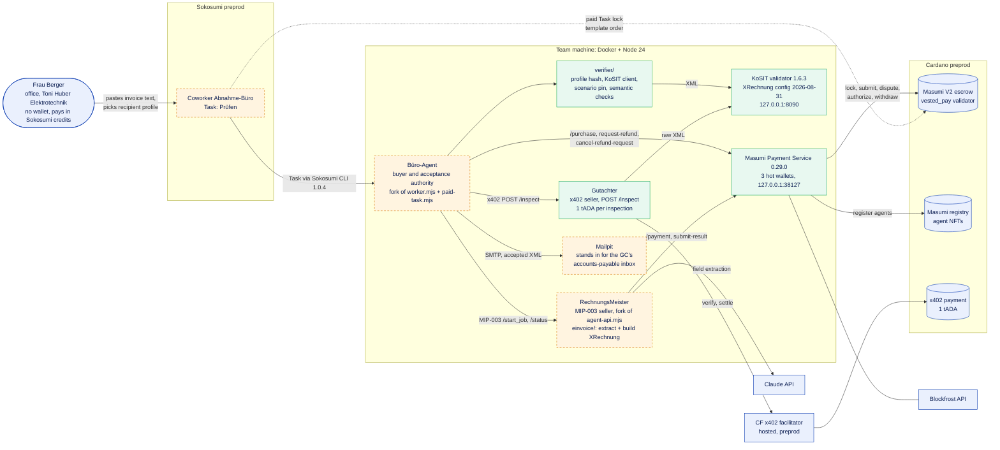
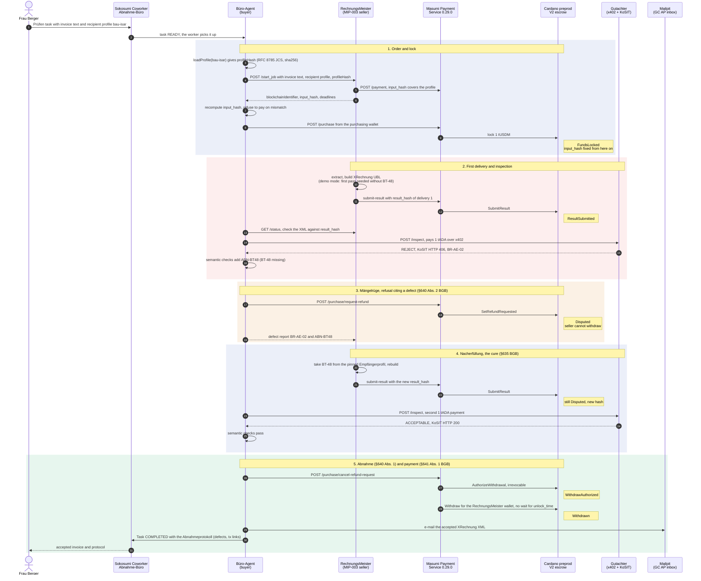
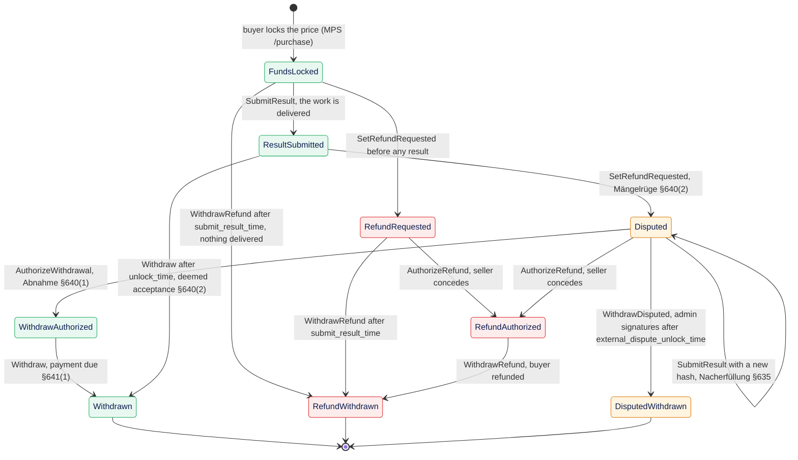
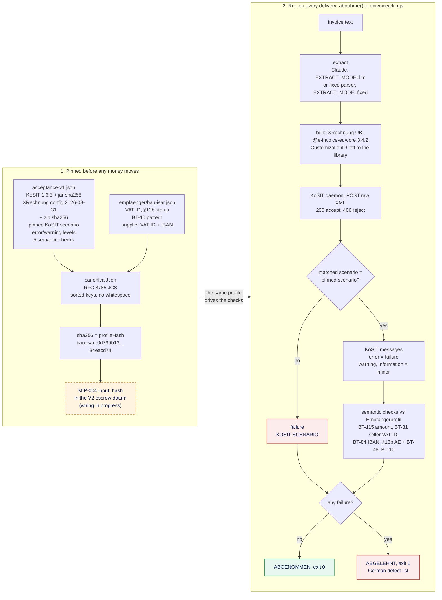
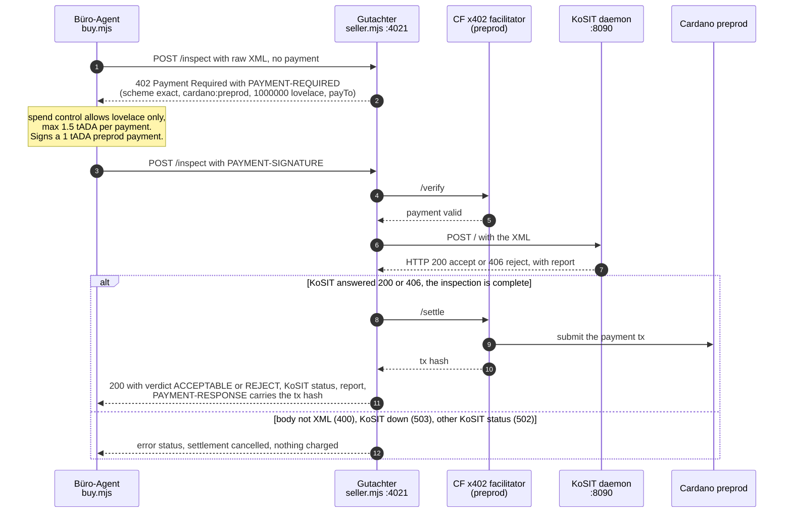

<div align="center">


### Ohne Abnahme kein Geld. No acceptance, no payment.

Abnahme is a **buyer-run acceptance test for German e-invoices, enforced by a Masumi escrow on Cardano**.
An agent that converts invoices into XRechnung gets paid only after the buyer's agent has run the KoSIT validator and the client's own acceptance profile on the result.
A defect freezes the converter's money on chain until the converter fixes it.

[](https://preprod.cardanoscan.io)
[](https://github.com/masumi-network/masumi-payment-service)
[](https://preprod.sokosumi.com)
[](https://developers.cardano.org/templates/x402-express/)
[](https://github.com/itplr-kosit/validator-configuration-xrechnung)
[](https://github.com/itplr-kosit/validator)
[](https://nodejs.org)
[](https://www.masumi.network/tum-hackathon)

</div>

---

> [!IMPORTANT]
> **Build status, Fri 30 Oct 2026 (hackathon day 1).** The acceptance test is built and tested: extraction, XRechnung build, KoSIT validation with a pinned scenario, semantic checks and the profile hash (22 tests pass against a live KoSIT 1.6.3). The x402 Gutachter is built and unit-tested, and our Masumi Payment Service runs locally.
> **Still in progress:** the RechnungsMeister MIP-003 agent, the Büro-Agent escrow loop (dispute, cure, accept), the Sokosumi Coworker, e-mail delivery, wallet funding, agent registration and every on-chain transaction. The diagrams below show the target flow. Each part that is not built yet is marked **in progress**. All tx hashes are **TBD**. The [Status](#status) section keeps the list.

## Contents

- [The customer](#the-customer)
- [The problem](#the-problem)
- [The idea: Abnahme, as German law already defines it](#the-idea-abnahme-as-german-law-already-defines-it)
- [What we don't build](#what-we-dont-build)
- [Architecture](#architecture)
- [One job, end to end](#one-job-end-to-end)
- [The escrow as a contract-law state machine](#the-escrow-as-a-contract-law-state-machine)
- [The acceptance test](#the-acceptance-test)
- [Four invoices, four verdicts](#four-invoices-four-verdicts)
- [The Gutachter: inspection paid per call over x402](#the-gutachter-inspection-paid-per-call-over-x402)
- [Why Cardano, why Masumi](#why-cardano-why-masumi)
- [What this proves, and what it doesn't](#what-this-proves-and-what-it-doesnt)
- [Reality check](#reality-check)
- [Run it yourself](#run-it-yourself)
- [Repo map](#repo-map)
- [Tech stack](#tech-stack)
- [On-chain evidence](#on-chain-evidence)
- [Status](#status)
- [Credits](#credits)

---

## The customer

**Toni Huber Elektrotechnik GmbH** is an electrical contractor in Munich. Toni is a **composite persona**: he stands for a Munich finishing-trade subcontractor that sends monthly progress invoices (*Abschlagsrechnungen*) to general contractors. The working assumption is 8 people and about EUR 1.1M turnover. These numbers are not from a real firm's books.

**Frau Berger** runs Toni's office part-time. She writes the invoices in a word processor, has no crypto wallet, and should never need one. She is the person who uses Abnahme.

Two recipients, both fictional, appear in the fixtures and recipient profiles:

| Recipient | Profile | What its accounts payable expects |
|---|---|---|
| **Bau Isar Generalunternehmer GmbH**, a general contractor | [`bau-isar.json`](verifier/profiles/empfaenger/bau-isar.json) | §13b reverse charge (VAT category AE, its own VAT ID `DE287654321` in BT-48), a project number like `BV-2026-014` in BT-10, Toni's VAT ID and IBAN from its supplier master data |
| **Hausverwaltung Giesing GmbH**, a property manager | [`hv-giesing.json`](verifier/profiles/empfaenger/hv-giesing.json) | Standard 19 % VAT, no category AE, a property number like `OBJ-GIE-0417` in BT-10, Toni's VAT ID and IBAN |

Why now:

- **The e-invoice deadline.** For domestic B2B supplies from **1 January 2027**, a German business whose turnover in the previous year was above **EUR 800,000** can no longer send paper or PDF invoices. From 1 January 2028 the transition ends for everyone ([§27 Abs. 38 UStG](https://www.gesetze-im-internet.de/ustg_1980/__27.html)). With the assumed turnover, Toni is above the threshold.
- **§13b reverse charge.** When a subcontractor supplies construction work to a contractor that itself supplies construction work, the recipient owes the VAT ([§13b Abs. 2 Nr. 4, Abs. 5 UStG](https://www.gesetze-im-internet.de/ustg_1980/__13b.html)). The invoice shows no VAT. In EN 16931 it carries VAT category `AE`, and rule **BR-AE-02** requires the buyer's VAT ID (BT-48). Leaving it out is the most expensive common mistake on a progress invoice, so it is our demo defect.
- **VOB/B 21 days.** Under VOB/B, "Ansprüche auf Abschlagszahlungen werden binnen 21 Tagen nach Zugang der Aufstellung fällig" ([§16 Abs. 1 Nr. 3 VOB/B](https://dejure.org/gesetze/VOB-B/16.html)): a progress payment is due 21 days after the statement arrives. An invoice the contractor's accounts payable cannot book has, in practice, not arrived. On our [18,400 EUR fixture](fixtures/b-abschlag-13b-bau-isar.txt), a bounce means three more weeks without the money. (Our reading, not legal advice.)

## The problem

1. **The deadline is close.** Small trades have to send structured e-invoices (XRechnung or another EN 16931 format) to their business clients, and most have never produced one.
2. **The receiver's rules decide.** A general contractor's accounts payable system rejects what it cannot validate or book. "Valid XRechnung" is necessary but not enough: the contractor also wants its own project number in BT-10, its own VAT ID in BT-48, and the IBAN from its supplier master data.
3. **Converters grade themselves.** Converters exist, and some promise "no charge if invalid". In that promise the converter grades its own work. Nothing stops it from deciding that its output was fine.
4. **Agent buyers have the same trust gap.** An agent that hires an unknown converter agent from an open registry has no reason to trust its output, and paying up front leaves the buyer without leverage.

## The idea: Abnahme, as German law already defines it

German contract-for-work law (*Werkvertrag*, §§631 ff. BGB) already has a protocol for "you get paid when I accept the work": the **Abnahme**. Every German tradesperson knows it. Masumi's V2 escrow on Cardano happens to have the same states. Abnahme maps the law onto the escrow, one transition at a time:

| Masumi V2 transition | Who signs | Contract law | Source |
|---|---|---|---|
| `SubmitResult` → `ResultSubmitted` | seller | Completion: the work is delivered | |
| `SetRefundRequested` → `Disputed` | buyer | **Refusal of acceptance citing a defect** (*Mängelrüge*) | [§640 Abs. 2 BGB](https://www.gesetze-im-internet.de/bgb/__640.html): deemed acceptance applies only if the buyer did not refuse "unter Angabe mindestens eines Mangels" |
| `SubmitResult` while `Disputed` (new result hash) | seller | **Right to cure** (*Nacherfüllung*) | [§635 Abs. 1 BGB](https://www.gesetze-im-internet.de/bgb/__635.html): the contractor may remove the defect or make a new work |
| `AuthorizeWithdrawal` → `WithdrawAuthorized` | buyer | **Acceptance** (*Abnahme*) | [§640 Abs. 1 BGB](https://www.gesetze-im-internet.de/bgb/__640.html) |
| `Withdraw` → `Withdrawn` | seller | **Payment falls due on acceptance** | [§641 Abs. 1 BGB](https://www.gesetze-im-internet.de/bgb/__641.html): "Die Vergütung ist bei der Abnahme des Werkes zu entrichten." |
| `Withdraw` from `ResultSubmitted` after `unlock_time` | seller | **Deemed acceptance**: the buyer stayed silent | §640 Abs. 2 BGB |
| KoSIT `warning` / `information` are "minor" in [`acceptance-v1.json`](verifier/profiles/acceptance-v1.json) | | **Minor defects cannot justify refusal** | §640 Abs. 1 S. 2 BGB: "Wegen unwesentlicher Mängel kann die Abnahme nicht verweigert werden." |
| `WithdrawDisputed` after `external_dispute_unlock_time` | Masumi admins | Arbitration when the parties cannot agree | |

There are three agents. One produces the invoice, one checks it, and the buyer holds the veto:

- **RechnungsMeister** (seller, *in progress*): a Masumi MIP-003 agent that turns pasted invoice text into XRechnung UBL. Its conversion core is built in [`einvoice/`](einvoice).
- **Büro-Agent** (buyer, *in progress*): Frau Berger's agent and a Sokosumi Coworker called *Abnahme-Büro*. It hires RechnungsMeister through the Masumi escrow, runs the acceptance test, and either refuses or accepts.
- **Gutachter** (inspector, built): an x402 seller that runs the KoSIT validator for 1 tADA per inspection. The code is in [`gutachter/`](gutachter).

---

## What we don't build

Abnahme writes as little as possible itself. Rule checking, XML rendering, escrow, registry and payments all come from existing pieces:

| Concern | What we use | What we write |
|---|---|---|
| EN 16931 + XRechnung business rules (BR-*, BR-DE-*) | [KoSIT validator](https://github.com/itplr-kosit/validator) 1.6.3 with the official [XRechnung configuration](https://github.com/itplr-kosit/validator-configuration-xrechnung) 2026-08-31, published by KoSIT (Koordinierungsstelle für IT-Standards), the body behind the XRechnung standard | none. We pin both by sha256 and pin the matched scenario |
| UBL serialization | [`@e-invoice-eu/core`](https://github.com/gflohr/e-invoice-eu) 3.4.2, format `XRECHNUNG-UBL` | the mapping from about 30 flat fields to UBL ([`einvoice/build.mjs`](einvoice/build.mjs)) |
| Escrow | Masumi V2 `vested_pay` validator (Aiken, Plutus V3), driven by the [Masumi Payment Service](https://github.com/masumi-network/masumi-payment-service) 0.29.0 | none. We deploy no smart contract |
| Agent identity and job API | Masumi registry (agent NFT) and MIP-003 (`/start_job`, `/status`, `/availability`, `/input_schema`) from the template's `agent-api.mjs` | the RechnungsMeister fork (*in progress*) |
| Human front door and billing | [Sokosumi](https://preprod.sokosumi.com) Coworker and credits, through the template's `worker.mjs` and `paid-task.mjs` | the Büro-Agent fork (*in progress*) |
| Pay per inspection | x402 with the Cardano Foundation [x402-express template](https://developers.cardano.org/templates/x402-express/) and its hosted preprod facilitator | the `/inspect` handler and its verdict mapping ([`gutachter/inspect.mjs`](gutachter/inspect.mjs)) |
| Field extraction from free text | Claude through [`@anthropic-ai/sdk`](https://github.com/anthropics/anthropic-sdk-typescript) structured outputs | the prompt and JSON schema ([`einvoice/extract.mjs`](einvoice/extract.mjs)) |

**What we write ourselves** is the part none of these pieces provide: an acceptance profile that is hashed and pinned before money moves, the semantic checks against the recipient's own master data, the German defect texts, and the buyer loop that turns a verdict into an on-chain refusal or acceptance.

**Cut on purpose** (from [`plan/BUILD_PLAN.md`](plan/BUILD_PLAN.md)): a web dashboard (this README and explorer links replace it), a custom Aiken validator, a second payment service with our own arbitrators, ZUGFeRD/Factur-X hybrid PDFs, and a live VIES VAT-ID check.

---

## Architecture



<sub>Green: code exists and runs locally. Orange, dashed: **in progress**. Blue: people and external services.</sub>

There are two payment rails, and the hiring agent decides on acceptance in both:

1. **Büro-Agent hires RechnungsMeister on Masumi.** This is a registry lookup, then a MIP-003 `/start_job`, then MPS `POST /purchase` from the Büro-Agent's purchasing wallet into the V2 escrow. Buyer and seller are separate registrations with separate wallets on one payment service (see [Reality check](#reality-check)).
2. **Büro-Agent hires the Gutachter over x402.** Each inspection is one HTTP request and one 1 tADA payment. There is no account and no subscription.

Frau Berger's own payment to the Büro-Agent goes through the template's paid Sokosumi Task: Sokosumi charges her credits and locks 1 tUSDM for the *Abnahme-Büro* selling wallet. This part is *in progress*.

---

## One job, end to end

This is the demo run: a §13b progress invoice to Bau Isar whose first delivery is missing the buyer's VAT ID. **Every on-chain step here is in progress.** The pure acceptance-test steps (extract, build, KoSIT, semantic checks) are built.



Three properties carry the design:

- **The test is fixed before money moves.** The profile hash goes into the MIP-004 `input_hash` that sits in the escrow datum. Every state-continuing redeemer of `vested_pay` requires `new_datum.input_hash == input_hash`, so the seller cannot swap the acceptance test after the lock. (Checked in `smart-contracts/payment-v2/validators/vested_pay.ak` of MPS 0.29.0. Wiring the profile hash into `input_hash` in the RechnungsMeister fork is *in progress*.)
- **A refusal has teeth.** From `Disputed` the seller cannot `Withdraw`. That redeemer accepts only `ResultSubmitted` after `unlock_time`, or `WithdrawAuthorized`.
- **Acceptance is explicit and final.** On V2, MPS's `cancel-refund-request` asks for `AuthorizeWithdrawal`, and only from `Disputed` (checked in MPS 0.29.0 `src/routes/api/purchases/cancel-refund-request`). The V2 README calls that transition "intentionally irrevocable".

---

## The escrow as a contract-law state machine

These are the Masumi V2 states we use, with the German law each transition stands for. State and action names come from MPS 0.29.0 (`OnChainState` enum, `payment-v2/README.md`). `Withdrawn`, `RefundWithdrawn` and `DisputedWithdrawn` are MPS states for an escrow UTxO that has been spent.



Abnahme's demo path is **FundsLocked → ResultSubmitted → Disputed → Disputed (cure) → WithdrawAuthorized → Withdrawn**. The refund branch covers the cases where the defect cannot be cured, for example when neither the source text nor the recipient profile has the missing BT-10. Then the seller concedes with `AuthorizeRefund` and the buyer withdraws the refund. Contract facts from the V2 README:

- `SetRefundRequested` must happen **before `unlock_time`**. It goes to `RefundRequested` when no result exists and to `Disputed` when one does.
- `SubmitResult` is allowed before `submit_result_time`, or **before `external_dispute_unlock_time` when a result already exists**. That second window is what makes the cure possible.
- `AuthorizeWithdrawal` needs `Disputed` and a non-empty result hash. After it, the seller can `Withdraw` without waiting for `unlock_time`.
- `WithdrawDisputed` needs weighted admin signatures and starts no earlier than `external_dispute_unlock_time`. Masumi's admins, not we, arbitrate a buyer who refuses in bad faith.

### The escrow clock

These are the deadlines the template's `agent-api.mjs` quotes for a MIP-003 job, in minutes after the quote. RechnungsMeister forks this file, so its values may still change.

```mermaid
gantt
    title Escrow windows for one job (template agent-api.mjs, time after the quote)
    dateFormat HH:mm
    axisFormat %H:%M
    section Buyer
    Lock funds before pay_by_time            :b1, 00:00, 00:10
    Refuse before unlock_time                :b2, 00:00, 00:36
    Accept while Disputed, AuthorizeWithdrawal, no deadline :b3, 00:20, 01:05
    section Seller
    First result before submit_result_time   :s1, 00:00, 00:20
    Cure while Disputed, until external_dispute_unlock_time :s2, 00:20, 00:52
    Withdraw if undisputed, after unlock_time :s3, 00:36, 01:05
    section Fallbacks
    Buyer refund if no result                :f1, 00:20, 01:05
    Admin arbitration, WithdrawDisputed      :f2, 00:52, 01:05
```



<sub>Template values: `payByTime` +10 min, `submitResultTime` +20, `unlockTime` +36, `externalDisputeUnlockTime` +52. The template's paid Sokosumi Task (`paid-task.mjs`) uses +5 for `payByTime`. The cure and accept bars start at +20 for readability; both are possible as soon as a result exists and the escrow is `Disputed`. Bars that reach the right edge have no upper time bound.</sub>

---

## The acceptance test

The acceptance test is two JSON files and a pipeline. The files are hashed into one `profileHash` before the job starts. The pipeline runs on every delivery.



What each piece does, and where it lives:

| Step | File | Detail |
|---|---|---|
| Profile hash | [`verifier/profile.mjs`](verifier/profile.mjs) | `profileHash = sha256(canonicalJson({acceptance, recipient}))`. JCS sorts keys by UTF-16 code units, so key order cannot change the hash. A test pins both hashes, so any change to a profile file is deliberate. |
| Extraction | [`einvoice/extract.mjs`](einvoice/extract.mjs) | Claude with a strict JSON schema of flat fields (`invoiceNumber`, `buyerVatId`, `buyerReference`, `lines`, `reverseCharge`, ...). The prompt says to copy values as printed and return `null` for missing ones. `EXTRACT_MODE=fixed` uses a deterministic parser for our own fixed-layout format instead ([`parse-fixed.mjs`](einvoice/parse-fixed.mjs)). |
| Build | [`einvoice/build.mjs`](einvoice/build.mjs) | Computes line, tax and total amounts in cents. Sets VAT category `AE` with exemption code `VATEX-EU-AE` for §13b. Leaves `cbc:CustomizationID` out so the library writes the XRechnung 3.0 ID. A plain EN 16931 ID would skip every BR-DE rule. |
| KoSIT client | [`verifier/kosit.mjs`](verifier/kosit.mjs) | `accepted` needs **all three**: HTTP 200, a KoSIT `accept` assessment, **and** the matched scenario `EN16931 XRechnung (UBL Invoice)`. |
| Semantic checks | [`verifier/checks.mjs`](verifier/checks.mjs) | Five checks, named in the acceptance profile and run against the recipient profile. An unknown check id in a profile throws an error. |
| German texts | [`verifier/messages-de.mjs`](verifier/messages-de.mjs) | KoSIT reports BR-DE-* in German but EN 16931 rules (BR-AE-02 and others) in English. A lookup table gives Frau Berger a German defect list. |

Codes the semantic checks emit: `ABN-BETRAG` (payable amount), `ABN-USTID` (seller VAT ID not in master data), `ABN-IBAN` (IBAN differs from master data), `ABN-13B` (wrong VAT category for the recipient), `ABN-BT48` (buyer VAT ID missing or wrong under §13b), `ABN-BT10` (buyer reference missing or wrong pattern).

---

## Four invoices, four verdicts

The [`fixtures/`](fixtures) folder has four invoices from Toni. Each comes as free text (`*.txt`, what Frau Berger would paste) and in our fixed layout (`*.fixed.txt`, the deterministic demo fallback). These results come from `EXTRACT_MODE=fixed node einvoice/cli.mjs` against KoSIT 1.6.3 on 127.0.0.1:8090. The round-trip tests in [`einvoice/roundtrip.test.mjs`](einvoice/roundtrip.test.mjs) assert the same results.

| Fixture | Recipient profile | Invoice | KoSIT | Defects | Verdict |
|---|---|---|---|---|---|
| [`a-reparatur-hv-giesing`](fixtures/a-reparatur-hv-giesing.txt) | `hv-giesing` | repair, 19 % VAT, 527,17 € | HTTP 200 | none | **ABGENOMMEN** |
| [`b-abschlag-13b-bau-isar`](fixtures/b-abschlag-13b-bau-isar.txt) | `bau-isar` | §13b progress invoice (type 875), 18.400,00 € | HTTP 200 | none | **ABGENOMMEN** |
| [`c-abschlag-13b-ohne-ustid`](fixtures/c-abschlag-13b-ohne-ustid.txt) | `bau-isar` | same §13b invoice, buyer VAT ID missing | HTTP 406 | `BR-AE-02`, `ABN-BT48` | **ABGELEHNT** |
| [`d-reparatur-ohne-bt10`](fixtures/d-reparatur-ohne-bt10.txt) | `hv-giesing` | same repair invoice, no buyer reference | HTTP 406 | `BR-DE-15`, `ABN-BT10` | **ABGELEHNT** |

In all four runs KoSIT matched the pinned scenario `EN16931 XRechnung (UBL Invoice)`. Fixture **c** is the demo's first delivery. This is the CLI output, as Frau Berger would read it:

```text
Abnahme: ABGELEHNT
Rechnung AR-2026-0087 vom 2026-10-28 – Toni Huber Elektrotechnik GmbH an Bau Isar Generalunternehmer GmbH
Zahlbetrag laut XRechnung: 18.400,00 € (erwartet: 18.400,00 €)
KoSIT 1.6.3 / Konfiguration 2026-08-31: HTTP 406, Szenario „EN16931 XRechnung (UBL Invoice)“
Prüfprofil: abnahme-xrechnung-v1 + bau-isar, Hash 0d799b1362b6e476f1d1f1b52dacc7458abdca0f4e8b99bf91d0a11034eacd74
Mängel:
 - [BR-AE-02] Bei Steuerschuldnerschaft des Leistungsempfängers (§ 13b UStG, Kategorie „AE“) müssen die USt-IdNr. des Verkäufers (BT-31) und die USt-IdNr. des Käufers (BT-48) bzw. dessen Registernummer (BT-47) angegeben sein.
 - [ABN-BT48] Die USt-IdNr. des Käufers (BT-48) fehlt; bei § 13b muss DE287654321 angegeben sein.
```

Exit codes: `0` = abgenommen, `1` = abgelehnt, `2` = error. The cure for **c** is fixture **b**: the same invoice with `DE287654321` in BT-48. That value is in the pinned recipient profile, so the converter can cure without inventing anything.

---

## The Gutachter: inspection paid per call over x402

The Gutachter (German for an appointed expert inspector) sells one thing: a KoSIT inspection of raw XRechnung XML for **1 tADA** (`{amount: '1000000', asset: 'lovelace'}`) on `cardano:preprod`. It is built from the Cardano Foundation x402-express template and settles through the CF hosted preprod facilitator.



| Gutachter answer | Meaning | Charged? |
|---|---|---|
| 200 `{verdict: 'ACCEPTABLE', httpStatus: 200, report}` | KoSIT accepted | yes |
| 200 `{verdict: 'REJECT', httpStatus: 406, report}` | KoSIT rejected. The inspection is complete. | yes |
| 400 | body is not XML | no |
| 503 | KoSIT unreachable | no |
| 502 | KoSIT answered something other than 200 or 406 | no |

A REJECT is a finished, paid inspection, so it comes back as HTTP 200. `@x402/express` runs the handler after `/verify` and before `/settle`, buffers the response, and cancels settlement when the handler answers 400 or higher (from [`gutachter/README.md`](gutachter/README.md)). A KoSIT outage therefore costs the buyer nothing. Every response carries `Cache-Control: no-store`. The verdict mapping is unit-tested in [`gutachter/inspect.test.mjs`](gutachter/inspect.test.mjs) without chain or KoSIT.

Two limits, from the Gutachter README:

- If the facilitator stops waiting before the block lands (`settlement_pending`), the buyer gets a 402 even though the tx may be on chain. The buyer has to check the payer address on the explorer before retrying, or it pays twice.
- The Gutachter's verdict is KoSIT's HTTP status alone. The scenario pin and the semantic checks run on the buyer's side, in `verifier/`. Wiring them to the Gutachter's report is part of the Büro-Agent, which is *in progress*.

---

## Why Cardano, why Masumi

- **The acceptance test can be pinned in the escrow.** The V2 datum carries `input_hash` and `result_hash`, and the validator keeps `input_hash` fixed through every state change. A commitment to "this is the test you will be graded by" becomes part of the payment itself, not a promise in a terms page.
- **The escrow already has an Abnahme lifecycle.** Refuse (`SetRefundRequested` → `Disputed`), cure (`SubmitResult` while `Disputed`), accept (`AuthorizeWithdrawal`), deemed acceptance (`Withdraw` after `unlock_time`), arbitration (`WithdrawDisputed`). We only had to map it to German law. We wrote no validator.
- **The buyer, not the seller, releases the money early.** After a refusal the seller cannot withdraw. Only the buyer's `AuthorizeWithdrawal` can pay the seller before the dispute window ends. A converter that grades its own work cannot do that here.
- **Agents need an identity and a job API.** The Masumi registry gives each agent an on-chain NFT and MIP-003 gives a standard job API, so any buyer agent can hire RechnungsMeister, and any converter could sell into the same acceptance test.
- **Inspection should cost per call, not per contract.** x402 on Cardano lets the Gutachter charge 1 tADA per inspection to anyone who sends a request. There are no accounts, and a failed inspection is not settled.
- **The human needs no wallet.** Sokosumi lets Frau Berger hire the *Abnahme-Büro* Coworker with credits. Everything on chain happens between agents.

---

## What this proves, and what it doesn't

| Leg | Status |
|---|---|
| XRechnung build, KoSIT verdict and semantic checks for the four fixtures | **real**, reproducible locally against KoSIT 1.6.3 (`node --test einvoice/*.test.mjs verifier/*.test.mjs`) |
| Scenario pin blocks the CustomizationID downgrade | **real**, tested against the live validator ([`verifier/kosit.test.mjs`](verifier/kosit.test.mjs)) |
| Profile hash is canonical, order-independent and stable | **real**, tested ([`verifier/profile.test.mjs`](verifier/profile.test.mjs)) |
| Claude extraction from free text | **built**. One opt-in test compares it with the fixed-layout parse (`RUN_LLM_TESTS=1`). It is skipped by default and was not run for this README. |
| x402 inspection, 1 tADA | **works on preprod**. First paid inspection: [`5820e591b57f…`](https://preprod.cardanoscan.io/transaction/5820e591b57f7baac9ea31818499dc37615a9697032919da83d183a0039ac4a9) (verdict ACCEPTABLE). |
| Masumi V2 refuse → cure → accept on preprod | **in progress**. It has not been run end to end. MPS's own CI does not cover V2 `cancel-refund-request` (see [Reality check](#reality-check)). |
| Profile hash inside the escrow `input_hash` | **in progress**: needs the RechnungsMeister `/start_job` fork |
| Sokosumi Coworker *Abnahme-Büro*, paid Task | **in progress** |
| E-mail to the GC's accounts payable | **in progress**. Mailpit stands in for the inbox. |

What the demo does not prove, stated plainly:

- **KoSIT checks format and rules, not truth.** A well-formed invoice for work that was never done passes KoSIT. Our semantic checks catch only what the recipient profile pins: payable amount, seller VAT ID, IBAN, §13b category and BT-48, and the BT-10 pattern. A pass does not prove that the GC's ERP will book the invoice, that the measured work is reviewable, or that the GC received the e-mail.
- **Sokosumi credits are not on-chain refunds.** When an escrow refunds on chain, Sokosumi does not give the credits back. "Pay only after acceptance" is enforced on the **agent-to-agent** hop (Büro-Agent → RechnungsMeister), not on Frau Berger's credits.
- **All agents are run by the team in the demo.** Büro-Agent, RechnungsMeister and Gutachter run on our machine, and one Masumi Payment Service both buys and sells. The structure does not require trusting the converter: the test is pinned before the lock, the result hash is public, and only the buyer can release early. But no paid hop in the demo crosses an ownership boundary.
- **The first-pass defect is seeded.** In demo mode, RechnungsMeister's first delivery drops BT-48 on purpose, so the refuse-and-cure path runs every time. We disclose this. A clean invoice passes on the first try (fixtures **a** and **b**).
- **Mailpit stands in for the accounts-payable inbox.** No real general contractor receives anything.
- **People and firms are fictional.** Toni Huber and Frau Berger are composite personas. Bau Isar and Hausverwaltung Giesing are invented. All e-mail domains in the fixtures end in `.example`.
- **Testnet only.** tUSDM and tADA on Cardano preprod. No real money moves.
- **An LLM can be wrong.** The pinned checks catch errors only in the fields they cover. The fixed-layout parser is the deterministic fallback for the demo.

---

## Reality check

These findings come from building it, from the validator itself, and from reading the MPS 0.29.0 source in the running container. Each row says which.

| Finding | How we know |
|---|---|
| An invoice with the plain EN 16931 `CustomizationID` makes KoSIT match the scenario `EN16931 (UBL Invoice)` and answer **HTTP 200**, even though it skips every German BR-DE rule. Checking "200 = valid" is not enough. | Run against KoSIT 1.6.3 in [`verifier/kosit.test.mjs`](verifier/kosit.test.mjs). This is why `acceptance-v1.json` pins the scenario. |
| KoSIT reports BR-DE-* in German but EN 16931 rules such as BR-AE-02 in English. A German small business needs a lookup table. | Raw validator output: fixture **c** gives `[BR-AE-02]-An Invoice that contains an Invoice line (BG-25) where …`, fixture **d** gives `[BR-DE-15] Das Element "Buyer reference" (BT-10) muss übermittelt werden.` |
| On V2, MPS `cancel-refund-request` asks for `AuthorizeWithdrawal` and returns 400 unless the purchase is `Disputed`. | MPS 0.29.0 `src/routes/api/purchases/cancel-refund-request/index.ts` |
| `AuthorizeWithdrawal` cannot be undone. The V2 README says integrators "MUST surface this irrevocability in the buyer-facing UI". | MPS 0.29.0 `smart-contracts/payment-v2/README.md` |
| The seller can rotate `result_hash` while `Disputed` until `external_dispute_unlock_time`. That is the cure window. | Same README, `SubmitResult` |
| MPS's V2 CI job does not run the `cancel-refund-request` flow, so the refuse → cure → accept loop on V2 has no upstream test. | [`plan/MPS.md`](plan/MPS.md) |
| One payment service can buy from its own registered agent. The MPS V2 e2e suite does exactly that. | [`plan/MPS.md`](plan/MPS.md) |
| Every full evidence cycle takes about an hour: auto-refund at about quote + 30 min, seller auto-withdraw at about quote + 46-60 min. | [`plan/BUILD_PLAN.md`](plan/BUILD_PLAN.md) (feasibility notes) |
| Preprod has two tUSDM tokens: `16a55b2a…` (Masumi dispenser, used by the template) and `e675b46e…` (x402 SDK default). The Gutachter prices in lovelace to avoid the mix-up. | [`plan/BUILD_PLAN.md`](plan/BUILD_PLAN.md), [`gutachter/seller.mjs`](gutachter/seller.mjs) |
| The MPS 0.29.0 image cannot seed its own database. A one-shot setup container builds the same release from source to do it. | [`mps/docker-compose.yml`](mps/docker-compose.yml) |

---

## Run it yourself

Requires Node.js 24 or newer and Docker. On the build machine the default `node` is 18, so put Node 24 first on `PATH`:

```sh
export PATH="/opt/homebrew/opt/node@24/bin:$PATH"
git clone https://github.com/omurbc/abnahme.git
cd abnahme
npm ci
```

### 1. The acceptance test (works today)

```sh
kosit/start.sh
# downloads validator 1.6.3 and the XRechnung configuration 2026-08-31, checks both sha256 values,
# starts eclipse-temurin:21-jre as container "abnahme-kosit" on 127.0.0.1:8090 (override with KOSIT_PORT)

node --test einvoice/*.test.mjs verifier/*.test.mjs
# 22 pass, 1 skipped (the live Claude test). Without KoSIT the round-trip and live-validator tests are skipped.

EXTRACT_MODE=fixed node einvoice/cli.mjs fixtures/c-abschlag-13b-ohne-ustid.fixed.txt bau-isar   # ABGELEHNT, exit 1
EXTRACT_MODE=fixed node einvoice/cli.mjs fixtures/b-abschlag-13b-bau-isar.fixed.txt bau-isar     # ABGENOMMEN, exit 0
```

With Claude extraction from the free-text invoice (needs `ANTHROPIC_API_KEY` in `.env`):

```sh
node --env-file-if-exists=.env einvoice/cli.mjs fixtures/b-abschlag-13b-bau-isar.txt bau-isar
RUN_LLM_TESTS=1 node --env-file-if-exists=.env --test einvoice/extract.test.mjs
```

`npm test` runs the Masumi template's own tests (`*.test.mjs` in the repo root, 29 pass). It does not include the Abnahme tests above.

### 2. The Gutachter (x402)

```sh
cd gutachter
npm ci
npm test                                        # 5 pass, no chain, no KoSIT
npm run wallet                                  # once: appends GUTACHTER_* wallets to ../.env, prints addresses only
npm run balance                                 # buyer balance via Blockfrost (needs BLOCKFROST_API_KEY_PREPROD)
npm run seller                                  # terminal 1: Gutachter on :4021
npm run buy -- fixtures/xrechnung-ok.xml        # terminal 2: pays 1 tADA, prints ACCEPTABLE and the tx hash
npm run buy -- fixtures/xrechnung-no-bt10.xml   # pays 1 tADA, prints REJECT (BR-DE-15)
```

Without KoSIT, `GUTACHTER_STUB=1 npm run seller` answers every paid inspection with a fixed ACCEPTABLE. The two XML fixtures come from the official [itplr-kosit/xrechnung-testsuite](https://github.com/itplr-kosit/xrechnung-testsuite). Details are in [`gutachter/README.md`](gutachter/README.md).

### 3. Masumi Payment Service (runs; registration in progress)

```sh
mps/mps.sh up -d                                  # MPS 0.29.0 + Postgres; first start builds the setup image
mps/mps.sh ps -a                                  # abnahme-mps-setup "Exited (0)", service "healthy"
curl -s http://127.0.0.1:38127/api/v1/health
node --env-file=.env --env-file=.local/mps.env mps/wallets.mjs   # roles, addresses, preprod balances
```

The compose file needs private files that are not in the repo: `.local/mps.env` (`ADMIN_KEY`) and `.local/mps-secrets.env` (`ENCRYPTION_KEY` and wallet mnemonics), plus `BLOCKFROST_API_KEY_PREPROD` in `.env`. Never run `mps/mps.sh down -v`, because it deletes the encrypted wallets. Wallet funding is described in [`plan/FUNDING.md`](plan/FUNDING.md), the setup in [`plan/MPS.md`](plan/MPS.md).

Registering both agents is **in progress**. It waits for funded selling wallets and `AGENT_AUTHOR` in `.env`:

```sh
node --env-file=.env --env-file=.local/mps.env mps/rechnungsmeister-registration.mjs register
node --env-file=.env --env-file=.local/mps.env payment-registration.mjs register      # Abnahme-Büro
```

### 4. Agents, Coworker and e-mail (in progress)

The RechnungsMeister MIP-003 fork, the Büro-Agent escrow loop, the Sokosumi Coworker and Mailpit delivery are not in the repo yet. Their run commands will go here when the code lands. Until then, `npm start`, `npm run worker` and `npm run api` run the **unmodified template agent** (a team-name suggester). See [`docs/masumi-quickstart.md`](docs/masumi-quickstart.md) for how the template's Coworker, worker and paid tasks are set up.

---

## Repo map

| Path | What it is | Status |
|---|---|---|
| [`einvoice/`](einvoice) | `extract.mjs` (Claude structured output), `parse-fixed.mjs` (deterministic fallback), `build.mjs` (XRechnung UBL), `cli.mjs` (`abnahme()` and the German summary) | built, tested |
| [`verifier/`](verifier) | `kosit.mjs` (daemon client, scenario pin), `checks.mjs` (semantic checks), `messages-de.mjs` (German rule texts), `profile.mjs` (JCS + profile hash) | built, tested |
| [`verifier/profiles/`](verifier/profiles) | `acceptance-v1.json` and the recipient profiles `empfaenger/bau-isar.json` and `empfaenger/hv-giesing.json` | built, hashes pinned in tests |
| [`kosit/start.sh`](kosit/start.sh) | Downloads, sha256-checks and starts the KoSIT daemon in Docker | built |
| [`fixtures/`](fixtures) | Four invoices from Toni, each as free text and in fixed layout | built |
| [`gutachter/`](gutachter) | x402 seller (`seller.mjs`), buyer (`buy.mjs`), verdict mapping (`inspect.mjs`), wallet and balance helpers | built, unit-tested, paid on preprod |
| [`mps/`](mps) | Docker Compose for MPS 0.29.0, `mps.sh` wrapper, wallet listing, RechnungsMeister registration, buyer runtime key | running locally; registration in progress |
| [`plan/`](plan) | `BUILD_PLAN.md` (scope, gates), `MPS.md` (payment service notes), `FUNDING.md` (wallets), `ideation-result.json` (full design spec) | |
| Root `*.mjs`, [`agent/`](agent) | Masumi TUM quickstart template: `worker.mjs`, `paid-task.mjs`, `agent-api.mjs`, `settlement.mjs`, `payment-registration.mjs` (its name and tags already say *Abnahme-Büro*), Eve agent | template. The Büro-Agent and RechnungsMeister forks are in progress. |
| [`docs/masumi-quickstart.md`](docs/masumi-quickstart.md) | The template's original README | |
| [`assets/hero.svg`](assets/hero.svg) | The banner above | |

---

## Tech stack

| Layer | Choice (exact versions from `package.json`, `package-lock.json` and the scripts) |
|---|---|
| Runtime | Node.js `>=24` (tested on v24.22.2), ES modules, `node:test` |
| E-invoice | `@e-invoice-eu/core` 3.4.2, format `XRECHNUNG-UBL` (XRechnung 3.0) |
| Validation | KoSIT validator 1.6.3 standalone jar, `validator-configuration-xrechnung` 2026-08-31 (XRechnung 3.0.2), in `eclipse-temurin:21-jre` |
| Extraction | `@anthropic-ai/sdk` 1.3.0, model `claude-opus-5-5`, JSON-schema structured output |
| Escrow and registry | Masumi Payment Service 0.29.0 (`ghcr.io/masumi-network/masumi-payment-service:0.29.0`), `postgres:15`, payment source `Web3CardanoV2` on Cardano preprod |
| Human front door | Sokosumi preprod, CLI `@masumi_network/sokosumi` 1.0.4 (template pin) |
| Template agent | `eve` 0.71.0, `ai` 7.0.127, `@ai-sdk/openai-compatible` 3.0.62, `zod` 4.6.5 |
| x402 | `@x402/core`, `@x402/express`, `@x402/fetch`, `@x402/cardano` 2.26.0; `@evolution-sdk/evolution` 0.5.14; `express` ^4.21.0; CF hosted preprod facilitator |
| Chain data | Blockfrost preprod API |
| Hashing | RFC 8785 JCS + SHA-256 for the profile hash. MIP-004-style `sha256(nonce;payload)` for input and result hashes (template `standard-hash.mjs`) |

---

## On-chain evidence

Hashes are filled in from preprod as each run lands; rows still marked TBD have no transaction yet. None is invented, and the table stays TBD until a real transaction exists.

| # | Transaction | Rail | What it shows | Tx hash |
|---|---|---|---|---|
| 1 | x402 inspection payment, 1 tADA | x402 | Gutachter paid per call (track requirement) | [`5820e591b57f…`](https://preprod.cardanoscan.io/transaction/5820e591b57f7baac9ea31818499dc37615a9697032919da83d183a0039ac4a9) |
| 2 | RechnungsMeister registration (agent NFT mint) | Masumi registry | Seller agent on the registry | [`8548d4f7a4a8…`](https://preprod.cardanoscan.io/transaction/8548d4f7a4a8667a91ccbd068d41ad6070062bc5794d1e6fe72159b625836333) |
| 3 | Abnahme-Büro registration (agent NFT mint) | Masumi registry | Buyer / Coworker agent on the registry | [`f63a51dc5728…`](https://preprod.cardanoscan.io/transaction/f63a51dc57282b2a680ce12ef25f4d80d74f65ed12a19330af1986d00bc0fc22) |
| 4 | `FundsLocked` | Masumi V2 escrow | Büro-Agent buys from RechnungsMeister, `input_hash` pins the profile | TBD |
| 5 | `ResultSubmitted`, first delivery | Masumi V2 escrow | Delivery with BT-48 missing | TBD |
| 6 | x402 inspection → REJECT `BR-AE-02` | x402 | The paid inspection that found the defect | TBD |
| 7 | `SetRefundRequested` → `Disputed` | Masumi V2 escrow | Mängelrüge, §640(2) BGB | TBD |
| 8 | `SubmitResult` while `Disputed` | Masumi V2 escrow | Nacherfüllung, §635 BGB | TBD |
| 9 | x402 re-inspection → ACCEPTABLE | x402 | The cure passes | TBD |
| 10 | `AuthorizeWithdrawal` → `WithdrawAuthorized` | Masumi V2 escrow | Abnahme, §640(1) BGB | TBD |
| 11 | `Withdraw` → `Withdrawn` | Masumi V2 escrow | Payment on acceptance, §641(1) BGB | TBD |
| 12 | Sokosumi paid Task `FundsLocked` | Masumi V2 escrow (Sokosumi) | Frau Berger's Task paid in credits (SENDEN AR-2026-0087, 1 tUSDM) | [`d9c69f508f1f…`](https://preprod.cardanoscan.io/transaction/d9c69f508f1f15299cdd3cc056ff4444b9ba0fcadf00e197cd14f7286c952859) |
| 13 | Sokosumi paid Task `Withdrawn` + seller receipt check | Masumi V2 escrow (Sokosumi) | Abnahme-Büro paid, checked by `settlement.mjs` | TBD |

Addresses to watch on [preprod.cardanoscan.io](https://preprod.cardanoscan.io) (from [`plan/MPS.md`](plan/MPS.md) and [`plan/FUNDING.md`](plan/FUNDING.md)):

| Role | Address |
|---|---|
| Masumi V2 escrow contract (our payment source) | [`addr_test1wzs4e6wc95hkwezlccjw9mdvq0r0rsgx6zk34avptga3ftgn37w4g`](https://preprod.cardanoscan.io/address/addr_test1wzs4e6wc95hkwezlccjw9mdvq0r0rsgx6zk34avptga3ftgn37w4g) |
| RechnungsMeister selling wallet | [`addr_test1qpdym62f…dssc92yck`](https://preprod.cardanoscan.io/address/addr_test1qpdym62fzyfmn35yrgr89qsr6nm50uxzpnndgewua7wx5qelmupkas792z774gh5ruwkd553dcf8ada86jjyf8hmvdssc92yck) |
| Büro-Agent purchasing wallet | [`addr_test1qpk4e2h3…psjclqusukag`](https://preprod.cardanoscan.io/address/addr_test1qpk4e2h3q36hz6tu3l9ycahvtl4q9nrufdmuu739gqetnl9zx6fhrmwf6zu84nh2rcmg8etm0yz8tk8yujdwh0psjclqusukag) |
| Abnahme-Büro selling wallet (Sokosumi Coworker) | [`addr_test1qzgq06w4…uw03qc`](https://preprod.cardanoscan.io/address/addr_test1qzgq06w4v4c0r63pft0wskzz58333w572qvul8cn2xwteg0mszt6smvwxweg9c38sydjwfuhvdt6v3zs8xew5szv8nusuw03qc) |
| Gutachter x402 buyer (payer) | [`addr_test1qpx5k8hy…aesk6xqy9r5xp`](https://preprod.cardanoscan.io/address/addr_test1qpx5k8hyheckf8z6c9c0mmhneaypgzpuh5xyh9ds535nqe3u6zxsgctw2ew65jmvam34trmc8s7zd7dnvwrqhaesk6xqy9r5xp) |
| Gutachter x402 seller (payTo) | [`addr_test1qzmzrgq7…cuex4qg6x5ce`](https://preprod.cardanoscan.io/address/addr_test1qzmzrgq7ux2zmn2gn8g7ddwnewu2cuwpluxf9aatn6yjeyfv68x94frsck5pt7hgq5pjk7edjxshy5ep46aw09cuex4qg6x5ce) |

---

## Status

Hackathon build, Cardano preprod only. Build window Fri 30 Oct 09:00 → Sat 31 Oct 15:00 (Munich time).

**Not done yet** (as of Fri 30 Oct 2026, morning):

- [ ] Fund the three MPS wallets and the Gutachter buyer wallet (all at 0 tADA when this was written)
- [ ] First x402 inspection payment on preprod (gate G1)
- [ ] Register RechnungsMeister and Abnahme-Büro on Masumi (blocked on funding and `AGENT_AUTHOR`)
- [ ] RechnungsMeister: MIP-003 fork of `agent-api.mjs` with the profile hash inside `input_hash`, and the seeded first-pass defect in demo mode
- [ ] Büro-Agent escrow loop: purchase → inspect → request-refund → re-inspect → cancel-refund-request, with a crash-safe journal
- [ ] GO/NO-GO for the V2 refuse → cure → accept loop on preprod (gate G3). The fallback in the plan is dispute → seller `AuthorizeRefund` → `RefundWithdrawn`, plus a separate clean deemed-acceptance run.
- [ ] Sokosumi Coworker *Abnahme-Büro* and the paid Task
- [ ] E-mail of the accepted XML to Mailpit
- [ ] On-chain evidence table filled with real hashes

**Done:**

- [x] E-invoice core: Claude extraction, fixed-layout parser, XRechnung UBL build
- [x] Verifier: KoSIT client with scenario pin, five semantic checks, German defect texts, JCS profile hash
- [x] KoSIT 1.6.3 daemon script with sha256-pinned downloads
- [x] Four fixtures with asserted verdicts (22 tests pass, 1 opt-in LLM test skipped)
- [x] Gutachter x402 seller and buyer (5 unit tests pass)
- [x] Masumi Payment Service 0.29.0 running locally with three hot wallets and wallet-scoped runtime keys

## Credits

Abnahme starts from the official **Masumi TUM hackathon quickstart** ([masumi-network/tum-hackathon-quickstart](https://github.com/masumi-network/tum-hackathon-quickstart) at commit d93783b). Its worker, paid-task, registration and settlement code is the base for the Büro-Agent and RechnungsMeister. The template's original README is kept at [`docs/masumi-quickstart.md`](docs/masumi-quickstart.md).

The Gutachter is based on the Cardano Foundation [x402-express template](https://developers.cardano.org/templates/x402-express/). Validation uses the [KoSIT validator](https://github.com/itplr-kosit/validator) and its [XRechnung configuration](https://github.com/itplr-kosit/validator-configuration-xrechnung). UBL rendering uses [`@e-invoice-eu/core`](https://github.com/gflohr/e-invoice-eu).

Built for the TUM Blockchain & AI Hackathon 2026, Cardano track.
