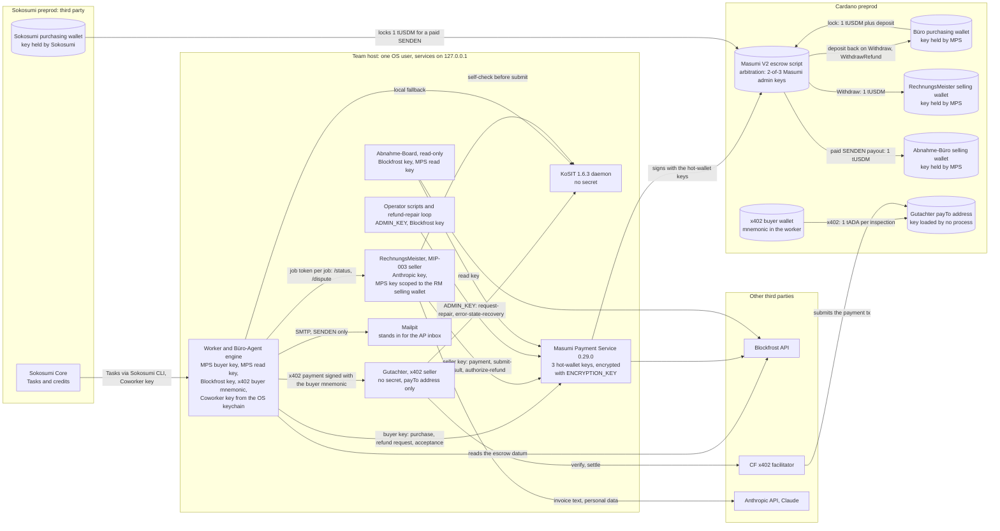
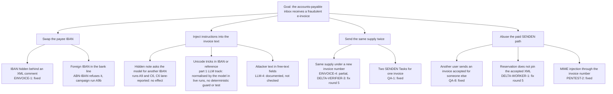

# Abnahme: security review report

**Project:** Abnahme, a buyer-run acceptance test for German e-invoices, enforced by a Masumi V2 escrow on Cardano preprod (TUM Blockchain & AI Hackathon 2026, Cardano track).
**Team:** Ömür Altunbey.
**Kind of review:** internal security review, not a third-party audit.
**Network:** Cardano preprod only. Every amount is test ADA (tADA) or test USDM (tUSDM). No mainnet key exists.
**Times:** Munich time (CET, UTC+1) throughout. `README.md` and `plan/EVIDENCE.md` give UTC.
**Line numbers:** every `file:line` names the commit it refers to.
**People and firms:** Toni Huber, Frau Berger, Bau Isar and Hausverwaltung Giesing are composite or fictional personas from the fixtures. There are no customers, pilots or letters of intent.


## At a glance

- **No HIGH finding is open.** The review found four HIGH problems, all in our own code or documentation, and all four are fixed with regression tests ([§8.1](#81-high-and-medium-findings)).
- **Nothing was found in the escrow contract.** The Masumi V2 contract was rebuilt from source, its script address recomputed, and 17 Aiken tests were added ([§9](#9-cardano-specific-analysis)).
- **216 findings in total**, from two review parts, two live test campaigns and a delta review: 155 fixed, 26 partly fixed, 17 accepted, 18 open ([§1](#1-scorecard)). Since then the repository went public, which closes CLEANCLONE-1.
- **Every fix came with a regression test that failed first.** The suite has 387 tests; CI runs them against a live KoSIT validator ([§12](#12-test-coverage)).
- **Two bugs found in the Masumi Payment Service** while testing on preprod, with fixes sent upstream ([#1328](https://github.com/masumi-network/masumi-payment-service/pull/1328), [#1332](https://github.com/masumi-network/masumi-payment-service/pull/1332)). Our repair loop covers both until they are merged.
- **Internal review, not a third-party audit.** Fix round 5 was not re-reviewed ([§16.5](#165-fix-round-5-after-the-delta-review)).

## Where an external audit should start

In the order we would ask a professional reviewer to look:

1. **The buyer's deadlines against the escrow timers.** The Büro-Agent must get its defect notice on chain before `unlock_time`, or the seller is paid for an invoice nobody accepted. Our margins are 25, 15 and 5 minutes, and MPS 0.29.0 answers a late refund request with HTTP 200 but never builds the transaction (ESCROW-1, [§9](#9-cardano-specific-analysis)).
2. **The Masumi Payment Service and its keys.** MPS 0.29.0 holds every hot-wallet key, runs on end-of-life Node 20, and has two open upstream bugs that our repair loop works around (DEPS-1, [§14](#14-residual-risks-and-what-was-not-tested)).
3. **The acceptance test as an attack surface.** Crafted XRechnung deliveries (XML tricks, tax content, encodings) against the strict XML reader, the KoSIT pins and the semantic checks (EINVOICE-1, DELTA-VERIFIER-1, DELTA-VERIFIER-4).
4. **The extraction step.** Invoice text goes through Claude (Anthropic API). A prompt injection that changes an IBAN or an amount is stopped only where the recipient profile pins the field ([§6](#6-threat-model), [§14.2](#142-structural-limits-of-this-build)).
5. **The single-operator deployment.** Every agent, key and the MPS run on one host under one OS user; buyer and seller are separated logically, not physically ([§14.2](#142-structural-limits-of-this-build)).
6. **Fix round 5** ([`30ec44c`](https://github.com/omurbc/abnahme/commit/30ec44c) to [`13d51cf`](https://github.com/omurbc/abnahme/commit/13d51cf)), which no review track has re-read.

**Verdict.** Abnahme pays an e-invoice converter only after the buyer's own acceptance test has passed, and the Masumi V2 escrow on Cardano holds the money until then. The review found four HIGH problems. None is in the escrow contract; all four are in our own code or documentation. XML comments could fool the acceptance test (EINVOICE-1). A restart of the worker abandoned paid work (QA-2). The buyer engine failed open, so a silent or failing setup let the seller be paid at `unlock_time` (ESCROW-1). The README contradicted the chain (CLAIMS-1). Three of the four are fixed (EINVOICE-1 and ESCROW-1 with regression tests, CLAIMS-1 by a README rewrite that was re-checked against the chain). QA-2 was partly fixed at the delta review; fix round 5 closed its residual, DELTA-WORKER-2. The contract held up when it was rebuilt from source and probed with 17 added Aiken unit tests. For this report, 42 transaction hashes were re-checked on Blockfrost: 40 are on chain with `valid_contract: true` and move what the documents say, and the 2 that the documents call "never on chain" are indeed absent. Two bugs in the Masumi Payment Service 0.29.0 (upstream issues #1327 and #1331) left refunds and seller payouts waiting for an operator; our own repair loop now completes both, while the upstream fixes (#1328, #1332) are still open. The delta review at `0e6ea18` found 46 new findings, 6 of them MEDIUM and none HIGH. At the delta review those 6 MEDIUM findings were open. Fix round 5 fixed five of them and partly fixed the sixth (DELTA-SELLER-2), each with a regression test that failed first, and one live escrow run passed on the new code; no review track re-reviewed fix round 5 ([§16.5](#165-fix-round-5-after-the-delta-review)). Beyond them, the remaining risk sits in the deployment: one operator runs every agent on one host, MPS 0.29.0 runs on an end-of-life Node runtime, and copies of secrets exist on that host.

## Contents

1. [Scorecard](#1-scorecard)
2. [Scope](#2-scope)
3. [Methodology](#3-methodology)
4. [System and trust boundaries](#4-system-and-trust-boundaries)
5. [Asset inventory](#5-asset-inventory)
6. [Threat model](#6-threat-model)
7. [Invariants](#7-invariants)
8. [Findings](#8-findings)
9. [Cardano-specific analysis](#9-cardano-specific-analysis)
10. [On-chain forensics](#10-on-chain-forensics)
11. [Live preprod scenario matrices](#11-live-preprod-scenario-matrices)
12. [Test coverage](#12-test-coverage)
13. [Checked and found correct](#13-checked-and-found-correct)
14. [Residual risks and what was not tested](#14-residual-risks-and-what-was-not-tested)
15. [Reproduce it yourself](#15-reproduce-it-yourself)
16. [Fix checklist](#16-fix-checklist)
17. [Appendix](#17-appendix)

---

## 1. Scorecard

Severity is the severity after adversarial verification (rule in [§3.2](#32-adversarial-verification)). Status is the state at the delta review (`0e6ea18`). The 46 delta findings are handled in fix round 5; their final status is filled in below, in the last column and in [§16.5](#165-fix-round-5-after-the-delta-review).

**Findings by source, severity and status**

| Source | Findings | HIGH | MEDIUM | LOW | INFO | Fixed | Partially fixed | Accepted | Open | Pending fix round 5 | After fix round 5 (fixed / partially fixed / accepted / open) |
|---|---|---|---|---|---|---|---|---|---|---|---|
| Part 1 (8 tracks) | 88 | 2 | 14 | 53 | 19 | 57 | 16 | 10 | 5 | 0 | 61 / 12 / 10 / 5 |
| Part 2 (6 tracks) | 59 | 2 | 7 | 39 | 11 | 41 | 13 | 3 | 2 | 0 | 44 / 10 / 3 / 2 |
| Live campaigns 1 and 2 | 23 | 0 | 4 | 10 | 9 | 12 | 2 | 4 | 5 | 0 | 14 / 2 / 4 / 3 |
| Delta review (8 tracks) | 46 | 0 | 6 | 29 | 11 | 0 | 0 | 0 | 0 | 46 | 36 / 2 / 0 / 8 |
| **Total** | 216 | 4 | 31 | 131 | 50 | 110 | 31 | 17 | 12 | 46 | **155 / 26 / 17 / 18** |

**Severity by status, all sources**

| Severity | Fixed | Partially fixed | Accepted | Open | Pending fix round 5 | Total | After fix round 5 (fixed / partially fixed / accepted / open) |
|---|---|---|---|---|---|---|---|
| HIGH | 3 | 1 | 0 | 0 | 0 | 4 | 4 / 0 / 0 / 0 |
| MEDIUM | 19 | 4 | 1 | 1 | 6 | 31 | 25 / 4 / 1 / 1 |
| LOW | 67 | 20 | 8 | 7 | 29 | 131 | 100 / 16 / 8 / 7 |
| INFO | 21 | 6 | 8 | 4 | 11 | 50 | 26 / 6 / 8 / 10 |
| **All** | 110 | 31 | 17 | 12 | 46 | 216 | **155 / 26 / 17 / 18** |

- **HIGH:** EINVOICE-1, ESCROW-1 and CLAIMS-1 are fixed. QA-2 was partially fixed at the delta review and is fixed after fix round 5.
- **MEDIUM still open or accepted:** CLEANCLONE-1 was open at the delta review (the repository was not yet public on Fri 30 Oct, 22:20 CET); its status at publication is in [§16.6](#166-final-state). DEPS-1 is accepted for the demo (MPS 0.29.0 on Node 20, [SECURITY.md](https://github.com/omurbc/abnahme/blob/main/SECURITY.md) §1).
- **"Fixed (workaround)":** CAMPAIGN-1 and CAMPAIGN2-1 count as fixed because our repair loop removes their effect. The upstream bugs remain open.

**Other measures**

| Measure | Value | Source |
|---|---|---|
| Fix checks in the delta review | 118 checks on 107 finding IDs: 89 CLOSED, 21 PARTIAL, 8 NOT_CLOSED | delta review records [records] |
| Tests in the suite | 69 at the part 1 commit `69a1309` (of which `npm test` ran 30) → 317 at `0e6ea18` (316 pass, 1 opt-in Claude test skipped) → 387 after fix round 5 (386 pass, 1 skipped) | measured for this report, [§12](#12-test-coverage) |
| Tests added | 248 between `69a1309` and `0e6ea18`; 115 test titles contain a track ID (for example ESCROW-1) or a lane ID (for example LB2-1) | measured: the `test(` titles of every `*.test.mjs` at `0e6ea18`, matched against the track and lane prefixes of [§3.1](#31-review-tracks) |
| On-chain hashes re-checked for this report | 42 (40 on chain, all `valid_contract: true`; 2 confirmed absent), 4 `input_hash` values recomputed, 9 cure validity windows; x402 payments at the `payTo` of the Gutachter (inspector, the paid x402 inspection service): 34 as of 23:10 CET | Blockfrost preprod, Fri 30 Oct, 22:14-22:37 CET (`payTo` re-counted at 23:10 CET), [§10](#10-on-chain-forensics) |
| On-chain checks by the review tracks | forensics 29 txs (the 27 the repository cites plus the 2 uncited x402 payments), claims 33 txs, part 2 live 30 txs, campaign 1 all 88 txs, campaign 2 all 82 hashes (80 on chain, 2 absent) | review records [records] |
| Proofs of concept | 58 of the 193 track findings (part 1: 27 of 88, part 2: 20 of 59, delta review: 11 of 46) name a PoC, a sandbox or a reproduction in their evidence field; this is a lower bound, since other findings cite their scripts only by file name. The PoCs are not published; the Evidence line of each finding in [§8.1](#81-high-and-medium-findings) says what its PoC showed. 17 Aiken unit tests against the V2 contract (73 of 73 pass together with the upstream suite) | track findings, evidence field matched for "PoC", "sandbox", "reproduc" or "repro" [records]; escrow track [records] |
| Live preprod scenarios | 50: 7 (part 2 live track) + 22 (campaign 1) + 21 (campaign 2) | review records [records]; matrices in [§11](#11-live-preprod-scenario-matrices) and `plan/EVIDENCE.md` |
| Refuter verdicts | 100 on 50 HIGH/MEDIUM findings: 99 confirmed, 1 refuted, 0 findings killed, 21 downgraded by both refuters | refuter verdicts [records] |

---

## 2. Scope

### 2.1 Audited commits

| Review | Commit | Committed (CET, Fri 30 Oct) | What it contains |
|---|---|---|---|
| Part 1, 8 tracks | [`69a1309`](https://github.com/omurbc/abnahme/commit/69a1309) | 10:39 | Before fix round 1. The files of the escrow loop (`buero/abnahme.mjs`, `buero/escrow.mjs`, `buero/run.mjs`, `rechnungsmeister/*`) were still being written and were reviewed from the working tree; they were committed in [`5d57247`](https://github.com/omurbc/abnahme/commit/5d57247) (11:05). The e-invoice and verifier files were identical at [`ea5a582`](https://github.com/omurbc/abnahme/commit/ea5a582). |
| Part 2, 6 tracks | [`1814dbc`](https://github.com/omurbc/abnahme/commit/1814dbc) | 12:38 | After fix round 1 |
| Live campaign 1 | [`824604c`](https://github.com/omurbc/abnahme/commit/824604c) | 14:40 | After fix rounds 1 and 2. The next commit, [`140aec4`](https://github.com/omurbc/abnahme/commit/140aec4) (14:50, during the campaign), changed only `README.md` and `plan/SOKOSUMI.md` |
| Live campaign 2 | [`b8c781d`](https://github.com/omurbc/abnahme/commit/b8c781d) | 16:55 | After fix round 3 ([`def3ac3`](https://github.com/omurbc/abnahme/commit/def3ac3), [`f26f956`](https://github.com/omurbc/abnahme/commit/f26f956)) |
| Delta review, 8 tracks | [`0e6ea18`](https://github.com/omurbc/abnahme/commit/0e6ea18) | 21:12 | After fix round 4 ([`4a3bb34`](https://github.com/omurbc/abnahme/commit/4a3bb34), [`d8e19b1`](https://github.com/omurbc/abnahme/commit/d8e19b1)) |

Every commit id in this report is a commit of the published history.

### 2.2 Components

| Component | Files | Role |
|---|---|---|
| Büro-Agent buyer engine | `buero/abnahme.mjs`, `buero/escrow.mjs`, `buero/run.mjs` | Hires RechnungsMeister, locks the escrow through MPS, inspects every delivery, files the defect notice (Mängelrüge) or accepts |
| Sokosumi worker | `worker.mjs`, `buero/sokosumi.mjs`, `paid-task.mjs`, `settlement.mjs`, `sokosumi-runtime.mjs`, `worker-lock.mjs` | Free PRÜFEN (check) Tasks and paid SENDEN (send) Tasks for the Coworker *Abnahme-Büro* |
| RechnungsMeister (seller) | `rechnungsmeister/server.mjs`, `cure.mjs`, `mip004.mjs` | MIP-003 agent: converts invoice text into XRechnung, submits the result hash, cures on a dispute, refunds by itself |
| Gutachter (x402 seller and buyer) | `gutachter/seller.mjs`, `inspect.mjs`, `ledger.mjs`, `buy.mjs` | Paid KoSIT inspection for 1 tADA per call, and the buyer that pays it |
| Acceptance test and KoSIT | `verifier/kosit.mjs`, `xml.mjs`, `checks.mjs`, `profile.mjs`, `messages-de.mjs`, `verifier/profiles/`, `kosit/start.sh` | Pinned validator and scenario, strict XML reader, 11 semantic checks at `0e6ea18` (13 after fix round 5, [`bd931eb`](https://github.com/omurbc/abnahme/commit/bd931eb)), profile hash |
| E-invoice extraction and build | `einvoice/extract.mjs` (Claude), `parse-fixed.mjs`, `build.mjs`, `cli.mjs` | Free text to flat fields to XRechnung UBL |
| MPS and operator scripts | `mps/docker-compose.yml`, `mps/mps.sh`, `mps/refund-repair.mjs`, `mps/buyer-key.mjs`, `mps/read-key.mjs`, `mps/wallets.mjs`, `mps/fund.mjs`, registration scripts | Masumi Payment Service 0.29.0, wallet-scoped keys, the repair loop |
| Secrets plumbing | `scripts/env-split.mjs`, `scripts/env-guard.mjs` | One env file per process, refusal of foreign secrets |
| Mail | `mail/smtp.mjs`, `mail/start.sh`, `mail/recipients.mjs` | SMTP client; Mailpit stands in for the accounts-payable inbox |
| Abnahme-Board | `board/server.mjs`, `board/model.mjs`, `board/public/` | Read-only live console on 127.0.0.1:8787 (first reviewed in the delta review) |
| Site | `site/` | Static marketing site (reviewed with the Board) |

The template agent (`start.mjs`, Eve) and the template Büro API (`agent-api.mjs`) are on no Abnahme path; they were reviewed only where they hold secrets or listen on a port.

### 2.3 Versions (verified at `0e6ea18`)

| Piece | Version and pin | Where verified |
|---|---|---|
| Masumi Payment Service | 0.29.0, image digest `c7408906…`; setup image built from upstream tag 0.29.0 (commit `71455701ac22…`) on `node:20-slim` (digest `2cf067cf…`); `postgres:15` (digest `64b99032…`) | `mps/docker-compose.yml` |
| KoSIT validator | 1.6.3 standalone jar, sha256 `799e64be…a7c9`, checked on every start | `kosit/start.sh` |
| XRechnung configuration | 2026-08-31 (XRechnung 3.0.2), sha256 `2530cd10…21a8` | `kosit/start.sh` |
| JRE image | `eclipse-temurin:21-jre` 21.0.13+9, index digest `0b99b337…` | `kosit/start.sh` |
| x402 | `@x402/core`, `@x402/express`, `@x402/fetch`, `@x402/cardano` 2.26.0 (exact); `@evolution-sdk/evolution` 0.5.14; `express` ^4.21.0 | `gutachter/package.json` |
| Node.js | `engines >=24.2.0` with `engine-strict=true` in both `.npmrc`; CI uses Node 24; build host v24.22.2 | `package.json`, `.npmrc`, `.github/workflows/ci.yml`, `node --version` |
| Sokosumi CLI | `@masumi_network/sokosumi` 1.0.4, global install, outside every lockfile | README, SECURITY.md §4, `sokosumi --version` |
| Claude extraction | `@anthropic-ai/sdk` 1.3.0, model `claude-opus-5-5`, input capped at 16,000 characters | `package.json`, `einvoice/extract.mjs` |
| UBL builder | `@e-invoice-eu/core` 3.4.2 | `package.json` |
| Mailpit | `axllent/mailpit:v1.32.0`, digest `0790692b…` | `mail/start.sh` |
| Lockfiles | `package-lock.json` and `gutachter/package-lock.json` did not change between `69a1309` and `0e6ea18` | `git diff --stat` |

### 2.4 Out of scope, and why

- **The Masumi V2 escrow contract** (`vested_pay`, Aiken, Plutus V3). Abnahme deploys no contract. The escrow track rebuilt it from the MPS 0.29.0 source, recomputed the script address and added 17 Aiken unit tests ([§9.6](#96-the-v2-script-address-and-the-arbitrators)). That is a consistency check of what we depend on, not an audit of the contract.
- **Masumi Payment Service internals.** MPS is a dependency. Its source was read where our flows depend on it, and the two bugs found that way went upstream. Its end-of-life runtime is an accepted risk (DEPS-1).
- **The Sokosumi platform** (Core, credits, its purchasing wallet) and the internals of its CLI.
- **The Cardano Foundation hosted x402 facilitator.** The x402 track used a local fake facilitator that runs the real `@x402/cardano` scheme, so no real facilitator was attacked.
- **Blockfrost, the Anthropic API and the KoSIT validator itself.** For KoSIT only the refusal of DOCTYPE and external entities was probed.
- **Mainnet.** No mainnet key exists and nothing ran on mainnet.

---

## 3. Methodology

The review records (track notes, refuter verdicts, fix checks and campaign lane reports) are not published. Counts and facts that come only from them are marked [records]; everything else traces to the repository, a command in [§15](#15-reproduce-it-yourself) or the chain.

### 3.1 Review tracks

| Part | Tracks |
|---|---|
| Part 1 (8 tracks, `69a1309`) | x402 payments; keys, wallets and secrets; LLM and prompt injection; e-invoice and German tax; QA of every user-reachable path; clean-clone reproducibility and CI; dependencies and supply chain; local API penetration test |
| Part 2 (6 tracks, `1814dbc`) | Masumi V2 escrow and eUTXO; escrow state machine, journal and invariants; live preprod scenarios; on-chain forensics; RechnungsMeister and Büro API penetration test; claims against reality |
| Live campaigns (2 lanes each, code of `824604c` and `b8c781d`) | Lane A: Frau Berger's path through Sokosumi Tasks and the live worker, with paid x402 inspections. Lane B: engine runs with concurrency, fault injection on the Büro → RechnungsMeister link, and process kills. Each campaign aggregate re-checked the lanes' chain, MPS (read key), Sokosumi, Mailpit and log claims; campaign 2 left four lane claims un-re-checked (the IBAN inside the C6 XML, the C1-S and C2-S runtime receipts, the D2 and D3 proxy timings, the D4 and D4b kill timings), marked lane-reported in [§11.2](#112-campaign-2-code-b8c781d-1700-1827-cet). |
| Delta review (8 tracks, `0e6ea18`) | acceptance test and extraction; Sokosumi worker, paid tasks and mail; secrets isolation and the env guard; Gutachter and x402 buyer; buyer escrow engine; RechnungsMeister and the template API; refund-repair operator loop; first review of the Abnahme-Board and the static site |

The tracks read the code at the audited commit and built proofs of concept against extracted copies of that commit, with fakes for MPS, Sokosumi, KoSIT, SMTP and the facilitator. Live runs used team wallets only. Chain access was read-only, except for the transactions a live scenario had to send. No PoC printed a secret value; outputs were names, counts, status codes and equality flags.

### 3.2 Adversarial verification

Every HIGH and MEDIUM finding of part 1, part 2 and the delta review went to two independent refuters. Each refuter tried to refute the finding, then gave its own verdict and severity. This report applies one rule to their answers:

- A finding is **killed** when both refuters refute it.
- A finding is **downgraded** only when both refuters rate it lower, and then to the higher of their two ratings.
- With a **split** between the refuters, the filed severity stays.

The counts below come from the refuter verdicts [records].

| | Part 1 | Part 2 | Delta | Total |
|---|---|---|---|---|
| HIGH and MEDIUM findings sent to refuters | 28 | 16 | 6 | 50 |
| Refuter verdicts | 56 | 32 | 12 | 100 |
| CONFIRMED / REFUTED | 55 / 1 | 32 / 0 | 12 / 0 | 99 / 1 |
| Killed | 0 | 0 | 0 | 0 |
| Downgraded by both refuters | 14: QA-1 and CLEANCLONE-1 (HIGH → MEDIUM), 12 MEDIUM → LOW | 7 MEDIUM → LOW | 0 | 21 |
| Split, severity kept | 5: X402-1, QA-2, QA-5, QA-8, DEPS-2 | 1: CLAIMS-4 | 0 | 6 |

The one REFUTED verdict concerns X402-1: that refuter argued that the live facilitator made the replay narrower than claimed and rated it LOW. The other refuter reproduced the replay independently, so X402-1 stays MEDIUM.

**Filed and verified severities**

| Source | Filed HIGH / MEDIUM / LOW / INFO | After refuters HIGH / MEDIUM / LOW / INFO |
|---|---|---|
| Part 1 (8 tracks) | 4 / 24 / 41 / 19 | 2 / 14 / 53 / 19 |
| Part 2 (6 tracks) | 2 / 14 / 32 / 11 | 2 / 7 / 39 / 11 |
| Live campaigns 1 and 2 | 0 / 4 / 10 / 9 | 0 / 4 / 10 / 9 |
| Delta review (8 tracks) | 0 / 6 / 29 / 11 | 0 / 6 / 29 / 11 |

Campaign findings were not sent to refuters. Each campaign aggregate re-checked its lanes' claims itself (all 88 and all 82 tx hashes on Blockfrost, MPS records, Sokosumi Tasks, Mailpit attachments, logs) [records], except the four lane-reported claims named in [§3.1](#31-review-tracks).

### 3.3 Fix rule

The rule for every fix was: a regression test that fails on the old code first, then the fix (README, "Security review"). Several commit messages record the failing-first step, for example [`4621ab5`](https://github.com/omurbc/abnahme/commit/4621ab5) ("9 new failing tests written first, 16/16 pass after") and [`b05042e`](https://github.com/omurbc/abnahme/commit/b05042e) ("failed with the 2 s timeout, passes now"). This report did not re-run each regression test against its pre-fix commit. It did run every suite at every fix-round commit ([§12](#12-test-coverage)).

### 3.4 Live campaigns

| Campaign | Window (CET, Fri 30 Oct) | Code | Scenarios | Result |
|---|---|---|---|---|
| 1 | 14:47 first Task, 16:14 last tx | `824604c` (`140aec4` changed only documentation) | 22 (lane A 16, lane B 6) | 20 PASS, 1 FAIL (A3: the expectation was wrong), 1 PARTIAL (A12) |
| 2 | 17:00 first Task, 18:10 last tx, 18:27 last engine exit | `b8c781d` | 21 (lane A 14, lane B 7) | 16 PASS, 1 FAIL (C5), 4 PARTIAL (C2, C8, D1, D4) |

RechnungsMeister ran with `DEMO_SEED_DEFECT=1` in both campaigns: its first delivery for a §13b recipient drops the buyer's VAT ID (BT-48). The scenario matrices are in [§11](#11-live-preprod-scenario-matrices).

### 3.5 Delta review

The delta review ran at `0e6ea18` on Fri 30 Oct in the evening. It re-ran the original PoCs against the fixed code (118 fix checks on 107 finding IDs, see [§1](#1-scorecard)), reviewed the code the fixes added, and gave the Abnahme-Board and the static site a first review. It made no MPS write of its own, sent no transaction and created no Sokosumi Task, with one disclosed exception: one reused sandbox scenario made a single `/start_job` call to the live RechnungsMeister, which created one unpaid payment request in MPS; nothing was bought, and `payByTime` passed at 21:39:47 CET [records].

### 3.6 Severity and evidence labels

Severity combines impact and likelihood. The levels are defined in [Appendix A](#a-severity-scale).

| Impact \ Likelihood | High | Medium | Low |
|---|---|---|---|
| **High** | HIGH | HIGH | MEDIUM |
| **Medium** | MEDIUM | MEDIUM | LOW |
| **Low** | LOW | LOW | INFO |

The severities in this report are the track ratings after refuter verification ([§3.2](#32-adversarial-verification)). The matrix is the guide the tracks rated against, not a mechanical rule. Two findings are rated above it: RMPENTEST-1 (ABN-M-20) and DELTA-SELLER-1 (ABN-M-30) can make the seller call `AuthorizeRefund` (sandbox PoC for DELTA-SELLER-1; code path only for RMPENTEST-1). Impact medium (the money returns to the rightful buyer), likelihood low (loopback access): LOW by the matrix. They are kept MEDIUM because `AuthorizeRefund` cannot be undone and both refuters rated both MEDIUM.

- **VERIFIED (V):** reproduced by a PoC, a live run or the chain, or certain from the code.
- **SUSPECTED (S):** plausible from the code or the specification, not reproduced.

### 3.7 What this report re-checked itself

- Ran the full test suites at nine commits, each in a clean extracted copy of that commit ([§12](#12-test-coverage)).
- Queried 42 transaction hashes, the 5 team wallet addresses and the escrow address on Blockfrost preprod between 22:14 and 22:37 CET on Fri 30 Oct, recomputed 4 escrow `input_hash` values from tracked repository data, and checked which validity window 9 cures used ([§10](#10-on-chain-forensics)). The Gutachter `payTo` address was re-counted at 23:10 CET.
- Read the cited lines at the audited commits for EINVOICE-1, ESCROW-1, DELTA-SELLER-1, DELTA-WORKER-2, DELTA-ENGINE-1 and DELTA-VERIFIER-1, and checked every pinned version in [§2.3](#23-versions-verified-at-0e6ea18).
- Checked the repository visibility (private at 22:20 CET on Fri 30 Oct, before publication) and the CI result for `0e6ea18` (success).

---

## 4. System and trust boundaries

Everything the team runs sits on one host, under one OS user, and every service listens on 127.0.0.1. The arrows name the credential that each call carries.



### 4.1 Who holds which key

| Secret or key | Held by | What it allows | Limits and findings |
|---|---|---|---|
| Büro purchasing wallet key | MPS hot wallet, encrypted with `ENCRYPTION_KEY` | Locks funds, signs the buyer's redeemers | The Büro process holds only an MPS key scoped to this wallet (`MPS_BUYER_TOKEN`); SECRETS-2 fixed |
| RechnungsMeister selling wallet key | MPS hot wallet | Seller redeemers, `Withdraw` | RechnungsMeister holds an MPS key scoped to this wallet |
| Abnahme-Büro selling wallet key | MPS hot wallet | Payout of paid SENDEN Tasks | The paid adapter reads its scoped key from a private key file per call |
| x402 buyer wallet mnemonic | Worker (`buero` profile) and the manual `gutachter-buyer` profile | Pays 1 tADA per inspection | At most 1 tADA per payment, only to `GUTACHTER_SELLER_ADDRESS`, daily budget (X402-5, LIVE-4) |
| Gutachter `payTo` mnemonic | No process loads it | Spends the Gutachter's income | The seller process holds no secret at all |
| MPS `ADMIN_KEY` | Operator profile (`mps-admin`): one-shot scripts and the refund-repair loop; Docker Compose | Every wallet, mnemonic export, funds transfer | Never in the buyer (SECRETS-2); the loop runs without the env guard (DELTA-SECRETS-5, DELTA-OPERATOR-4) |
| MPS `ENCRYPTION_KEY` and the three seed mnemonics | Private files read by Compose; the MPS container holds `ENCRYPTION_KEY` | Decrypts the hot wallets | Same file as the mnemonics, plus a backup copy on the same disk (SECRETS-10, accepted for preprod) |
| MPS read key (`MPS_READ_TOKEN`) | Worker, Board | Reads every purchase and payment; cannot pay, refund or export | Checked live: 401 on admin and write routes |
| Sokosumi Coworker key and operator login token | OS keychain, read through the Sokosumi CLI modules in the worker | Task updates and payment events | Any Node 24 script of the same OS user can read them (SECRETS-7, accepted) |
| Job token, one per job | Issued by RechnungsMeister at `/start_job`; kept in its job file and in the buyer journal | `/dispute` and the delivered result in `/status` | Re-issued on a replay (DELTA-SELLER-1) |
| Blockfrost project key | `buero`, `board`, `mps-admin`, `gutachter-buyer` and `buero-local` profiles; MPS keeps its own copy | Chain reads | Not rotated (SECRETS-3) |
| Anthropic API key | `rechnungsmeister` and `buero-local` profiles | Claude extraction | Spend bounded by the 16,000-character input cap and a 120 s timeout (LLM-2, QA-14) |
| Masumi admin keys (three) | Masumi | `WithdrawDisputed` with 2-of-3 signatures after `external_dispute_unlock_time` | Same key hashes as on mainnet (ESCROW-8) |

### 4.2 Who trusts whom, and what limits it

| Truster | Trusts | For | What limits the trust |
|---|---|---|---|
| Büro engine | RechnungsMeister | The delivered bytes | The bytes must hash to the `result_hash` in the escrow's own datum, read from Blockfrost; then the acceptance test |
| Büro engine | MPS | Building transactions and reporting state | The delivered hash is read from the escrow's own output on chain, selected by `input_hash`; the MPS view gives the state, and serves as a named fallback for the hash only while `Disputed` |
| Büro engine | Gutachter | The KoSIT verdict | A settled receipt, the pinned validator and `rep:documentHash` of its own bytes; otherwise local KoSIT. Residual: the receipt is self-declared (DELTA-X402-4) |
| Büro engine | Blockfrost | The chain view | Lag caused CAMPAIGN2-2; when Blockfrost fails, the engine files a protective Mängelrüge instead of accepting |
| RechnungsMeister | The buyer, through `/dispute` | The defect list | Job token (bypass: DELTA-SELLER-1); the cure may only copy values verbatim from the pinned order or the recipient profile; a KoSIT self-check runs before every submit |
| Gutachter | Facilitator | `verify` and `settle` | The handler runs after `verify` and before `settle`; any answer of 400 or more cancels settlement |
| Worker | Sokosumi Core | Task identity and user | SENDEN requires a completed PRÜFEN of the same Sokosumi user (QA-8) |
| All agents | MPS 0.29.0 | Wallet custody | Loopback only, wallet-scoped keys, digest pins; upstream bugs #1327 and #1331 handled by the repair loop |
| Buyer and seller | Masumi admins | Arbitration | Only after `external_dispute_unlock_time`; RechnungsMeister refunds by itself 10 min earlier |

### 4.3 Where the money is at each step

Run 1 (Fri 30 Oct) is the reference; all of its transactions were re-checked for this report.

| Step | Where the 1 tUSDM is | Who can move it next | Transaction (run 1) |
|---|---|---|---|
| Before the lock | Büro purchasing wallet | Buyer, through MPS | |
| `FundsLocked` | Escrow output: 1 tUSDM plus a 4.46947 tADA deposit | Seller `SubmitResult`; buyer `SetRefundRequested` before `unlock_time`; buyer `WithdrawRefund` after `submit_result_time` if nothing was delivered | `a57c43ee…` |
| `ResultSubmitted` | Escrow; the seller adds 0.03448 tADA for the larger datum | Buyer `SetRefundRequested` before `unlock_time`; seller `Withdraw` after `unlock_time` (deemed acceptance) | `20ca2cf5…` |
| `Disputed` | Escrow, frozen | Seller `SubmitResult` (cure) or `AuthorizeRefund`; buyer `AuthorizeWithdrawal`; Masumi admins after `external_dispute_unlock_time` | `995c6c48…`, cure `6c63b8f6…` |
| `WithdrawAuthorized` | Escrow | Seller `Withdraw`, with no time bound | `4b6d275e…` |
| `Withdrawn` | 1 tUSDM with the seller; 4.46947 tADA back with the buyer | | `8f21ca18…` |
| `RefundAuthorized` | Escrow | Buyer `WithdrawRefund`; MPS 0.29.0 builds it only after a repair (#1327) | `adbfbd34…` (refusal run) |
| `RefundWithdrawn` | Everything back with the buyer | | `becff7ad…` |
| x402 inspection | 1 tADA moves from the x402 buyer wallet straight to `payTo`; there is no escrow | | `7dc0c48a…` |
| Paid SENDEN | Sokosumi's wallet locks 1 tUSDM; after `unlock_time` it goes to the Abnahme-Büro selling wallet | | `d9c69f50…` → `5d61bf3f…` |

---

## 5. Asset inventory

Balances were read on Blockfrost on Fri 30 Oct at 22:21 CET.

| Asset | Where | Scale on preprod | Threats | Controls | Findings |
|---|---|---|---|---|---|
| Escrowed tUSDM | V2 script outputs | 1 tUSDM plus 4.47-4.50 tADA per open job | Paid without acceptance, frozen, never collected | V2 contract; fail-closed engine; seller self-refund; repair loop | ESCROW-1, ESCROW-3, CAMPAIGN-1, CAMPAIGN2-1, DELTA-ENGINE-1, DELTA-SELLER-2 |
| MPS hot wallets | Masumi Payment Service | Büro purchasing 10,017.23 tADA and 364 tUSDM; RechnungsMeister selling 50.62 tADA and 36 tUSDM; Abnahme-Büro selling 117.64 tADA and 5 tUSDM | Key theft through the MPS host or its runtime | Loopback only, wallet-scoped keys, digest pins | DEPS-1, SECRETS-2, SECRETS-10 |
| x402 buyer wallet and budget | Worker | 147.61 tADA in 2 UTxOs; 1 tADA per payment; daily cap (default 20, set to 500 for campaign 2) | Drain, overpay, replay, double spend of inputs | Exact price cap, `payTo` allowlist, budget, one payment at a time, spent-input record | X402-1, X402-5, LIVE-4, LIVE-5, CAMPAIGN2-2, DELTA-X402-3 |
| Gutachter income | `payTo` address | 34.00 tADA from 34 payments of exactly 1 tADA, none spent (re-read at 23:10 CET) | | Key loaded by no process | |
| MPS `ADMIN_KEY` | Operator profile | Full control of every hot wallet | Leak from the long-running repair loop | Only operator scripts hold it | SECRETS-2, DELTA-SECRETS-5, DELTA-OPERATOR-4 |
| `ENCRYPTION_KEY` and seed mnemonics | Private files, mode 600 in a 700 directory | Every wallet | Disk or account compromise | File permissions | SECRETS-10 |
| Sokosumi credentials | OS keychain | Coworker identity and operator login | Other code of the same OS user | OS user boundary only | SECRETS-7 |
| Anthropic key | RechnungsMeister, local mode | Model spend | Spend DoS | 16,000-character cap, 120 s timeout, one retry | LLM-2, QA-14 |
| Blockfrost key | Five profiles and MPS | Quota | Leak | None beyond file permissions; not rotated | SECRETS-3 |
| Invoice data (personal data) | Sokosumi Task text, buyer journals, RechnungsMeister job files, Mailpit, Anthropic API | Names, addresses, phone and e-mail, IBAN, VAT IDs | Disclosure; GDPR obligations | Loopback, files 600, the Board returns no invoice text; demo data are fictional | RMPENTEST-2, DELTA-BOARD-5 |
| Acceptance profile | Repository and the escrow `input_hash` | The agreed test | Swapped after the lock | Pinned in `input_hash`, re-checked on chain | STATEMACHINE-5, CLAIMS-4 |
| Evidence and documentation | README, `plan/EVIDENCE.md` | Credibility of every claim | Wrong or stale claims | Forensics and claims tracks; this report's re-check | CLAIMS-1 to CLAIMS-20, FORENSICS-1 to FORENSICS-7 |

**GDPR note.** For extraction, the invoice text goes to the Anthropic API. RechnungsMeister does this for every escrow job, and the worker does it in local mode (`ABNAHME_IMPL=local`). An invoice of a small trade carries personal data: the owner's or a contact person's name, phone number and e-mail, the bank account (IBAN) and VAT IDs. In the demo every party is fictional and every e-mail domain ends in `.example`. A real deployment would need, at least: a processing agreement with Anthropic (Art. 28 GDPR), a legal basis for the transfer outside the EU, data minimisation (send only the invoice), retention limits for journals, job files and the mail outbox, and a record of processing activities. Task texts are also visible to the members of the Sokosumi workspace. This note was not reviewed by a lawyer.

---

## 6. Threat model

### 6.1 STRIDE per component

Each cell names the threat and the finding that covers it, with its status (fixed, partial, accepted, open, or "R5" for a delta finding handled in fix round 5).

| Component | Spoofing | Tampering | Repudiation | Information disclosure | Denial of service | Elevation of privilege |
|---|---|---|---|---|---|---|
| Büro-Agent engine | A fake Gutachter answers on 127.0.0.1:4021 (ESCROW-2 fixed; DELTA-X402-4 R5) | Delivered bytes differ from the committed hash (checked against the datum; ESCROW-4 and LIVE-1 fixed); acceptance of a hash nobody inspected (ESCROW-6 fixed) | Journal plus on-chain transactions; the protocol says "ohne Abnahme ausgezahlt" ("paid out without acceptance") when money moved without acceptance (ESCROW-1 fixed) | Journals hold invoice data, mode 600 | Silent seller (ESCROW-1 fixed); announce-only seller loop (DELTA-ENGINE-1 R5); inspection in flight past the deadline (DELTA-ENGINE-2 R5) | |
| Sokosumi worker | Another workspace user sends SENDEN for someone else's acceptance (QA-8 fixed) | Control lines inside the invoice text (QA-7 fixed); reservation does not pin the accepted XML (DELTA-WORKER-1 R5) | Task comments, send ledger, Message-ID | Secrets in the CLI child environment (DELTA-SECRETS-1 R5); a local path in the protocol (CAMPAIGN-6 fixed) | Huge Task listing (QA-9 partial); paid Task RUNNING forever (QA-4 fixed; DELTA-WORKER-2 R5) | |
| RechnungsMeister | Replay of `/start_job` returns the job token (DELTA-SELLER-1 R5); unauthenticated `/dispute` (RMPENTEST-1 partial) | Cure values only verbatim from the pinned order or profile (holds); non-canonical result JSON (ESCROW-7 fixed); lossy UTF-8 decode (DELTA-SELLER-4 R5) | Job files and on-chain hashes | Delivered invoice only to the token holder (RMPENTEST-2 partial) | Global `/start_job` window (DELTA-SELLER-3 R5, CAMPAIGN2-6 open); torn job file (STATEMACHINE-7 fixed) | A forced `AuthorizeRefund` (RMPENTEST-1, DELTA-SELLER-1) |
| Gutachter seller | | Report bound to the posted body by `rep:documentHash` (ESCROW-2 fixed); a leading BOM breaks the binding (DELTA-X402-5 R5) | Replay ledger keyed by tx hash | Raw KoSIT error page (X402-3 fixed); development error page (DELTA-X402-6 R5); `/health` (X402-4 fixed) | Replay as a KoSIT amplifier (X402-1 fixed); process exits on a slow KoSIT (DELTA-X402-1 R5) | LAN exposure (X402-2 fixed) |
| x402 buyer (`gutachter/buy.mjs`) | A squatter on `[::1]:4021` (fixed: the buyer calls 127.0.0.1) | An inflated offer (X402-5 fixed); only the configured `payTo` is paid | `payments.log.json` misses two historical payments (FORENSICS-1 partial) | | Input re-spend (CAMPAIGN2-2 fixed; DELTA-X402-3 R5); a 502 resent for 3 min (DELTA-X402-2 R5) | |
| Acceptance test and KoSIT | A report from another validator (EINVOICE-11 and DEPS-4 partial) | XML comments (EINVOICE-1 fixed); tax content not bound (DELTA-VERIFIER-1 R5); negated §14a wording (DELTA-VERIFIER-4 R5) | Profile hash in the escrow datum | | Superlinear report parser (DELTA-VERIFIER-2 R5); implicit size limits (DELTA-VERIFIER-6 R5) | Running KoSIT container on an affected JRE (DEPS-2 partial, accepted) |
| Extraction and build | | Prompt injection in the invoice text (campaign runs A9 and C6, C6 lane-reported: no effect); free text unchecked (LLM-4 documented) | | Invoice text goes to the Anthropic API ([§5](#5-asset-inventory)) | Model spend (LLM-2 fixed); stalled call (QA-14 fixed) | |
| MPS and operator scripts | | Stale `resultHash` (#1327) and the batched-cure guard (#1331), both upstream | MPS database plus chain | `ADMIN_KEY` in a long-running loop (DELTA-SECRETS-5 R5); wildcard CORS (PENTEST-3 accepted) | Unlimited retries (DELTA-OPERATOR-1 R5); no single-instance lock (DELTA-OPERATOR-3 R5) | End-of-life Node 20 (DEPS-1 accepted); an admin key skips wallet scopes (SECRETS-2 fixed) |
| Abnahme-Board | DNS rebinding (Host allowlist holds) | | Read-only | No key, token, path or invoice text in about 720 KB of live responses; Task content shown verbatim (DELTA-BOARD-5 R5) | One bad file kills the process (DELTA-BOARD-1 R5) | Guarded demo POST (holds) |
| Mail | | MIME parameter injection through BT-1 (PENTEST-2 fixed) | Message-ID journaled before DATA (QA-2) | | A final 5xx after DATA locks the invoice (DELTA-WORKER-5 R5) | |
| Site | Static files, no cookies, no third-party requests | | | | | |

### 6.2 Attack tree: steal or freeze escrowed money

```mermaid
flowchart TD
    G1["Goal: steal or freeze escrowed tUSDM"]
    G1 --> A1["Seller is paid without acceptance"]
    G1 --> A2["Buyer money stays frozen in Disputed"]
    G1 --> A3["Refund or payout is never collected"]
    G1 --> A4["Spend the escrow outside the rules"]
    A1 --> L1["Seller answers /status with 500, buyer gives up<br/>ESCROW-1: fixed"]
    A1 --> L2["Defect found after unlock minus 4 min<br/>ESCROW-1: fixed"]
    A1 --> L3["Buyer reads the wrong datum in a batched tx<br/>ESCROW-4, LIVE-1: fixed"]
    A1 --> L4["Acceptance of a hash nobody inspected<br/>ESCROW-6: fixed"]
    A1 --> L5["Inspection still running at the deadline<br/>DELTA-ENGINE-2: fix round 5"]
    A1 --> L6["Fake settled receipt on 127.0.0.1:4021<br/>DELTA-X402-4: fix round 5"]
    A2 --> L7["Cure announced but never submitted<br/>ESCROW-3: partial, DELTA-ENGINE-1: fix round 5"]
    A2 --> L8["MPS parks the cured payment, seller timer never acts<br/>DELTA-SELLER-2: fix round 5"]
    A2 --> L9["Third party forces AuthorizeRefund with a replayed job token<br/>DELTA-SELLER-1: fix round 5"]
    A3 --> L10["Stale resultHash after AuthorizeRefund<br/>CAMPAIGN-1, upstream 1327: workaround"]
    A3 --> L11["Batched cure leaves the payout at manual action<br/>CAMPAIGN2-1, upstream 1331: workaround"]
    A4 --> L12["Double satisfaction, or Withdraw from Disputed<br/>contract checks hold"]
    A4 --> L13["Steal ADMIN_KEY or hot-wallet keys from the host<br/>DEPS-1, SECRETS-10: accepted"]
```



### 6.3 Attack tree: get paid for a bad invoice

```mermaid
flowchart TD
    G2["Goal: the converter is paid for a defective or wrong XRechnung"]
    G2 --> B1["Fool the acceptance test"]
    G2 --> B2["Avoid the acceptance test"]
    G2 --> B3["Change what was delivered"]
    B1 --> M1["Decoys in XML comments, CDATA or extensions<br/>EINVOICE-1: fixed"]
    B1 --> M2["KoSIT warnings treated as minor<br/>EINVOICE-2: fixed"]
    B1 --> M3["Wrong currency, type, wording or VAT amount<br/>EINVOICE-3: fixed"]
    B1 --> M4["Exempt or 7 percent VAT, or a fake prepayment, with the expected total<br/>DELTA-VERIFIER-1: fix round 5"]
    B1 --> M5["Negated reverse-charge wording<br/>DELTA-VERIFIER-4: fix round 5"]
    B1 --> M6["Report from another validator or about other bytes<br/>ESCROW-2: fixed"]
    B2 --> M7["Stay silent until deemed acceptance<br/>ESCROW-1: fixed"]
    B2 --> M8["Stall the inspection past the decision deadline<br/>DELTA-ENGINE-2: fix round 5"]
    B2 --> M9["Freeze the buyer with a crafted inspection report<br/>DELTA-VERIFIER-2: fix round 5"]
    B3 --> M10["Lie about the bytes on the status channel<br/>result_hash check holds, part 2 scenario S2"]
    B3 --> M11["Result with duplicate keys and two readings<br/>ESCROW-7: fixed"]
    B3 --> M12["Rotate result_hash after a round-0 acceptance<br/>ESCROW-5: partial"]
    B3 --> M13["Swap the acceptance profile after the lock<br/>input_hash pin holds"]
```



### 6.4 Attack tree: send a fraudulent invoice



---

## 7. Invariants

Test locations in this section are at `0e6ea18`.

| # | Invariant | Enforced by | Proof | Status at `0e6ea18` |
|---|---|---|---|---|
| I1 | No payout to the seller without the buyer's acceptance or the deemed-acceptance deadline | V2 contract: `Withdraw` only from `WithdrawAuthorized` or from `ResultSubmitted` after `unlock_time`. Our engine: protective Mängelrüge on chain by unlock − 15 min | Tests "ESCROW-1: …" (`buero/abnahme.test.mjs:162`, `:174`, `:204`, `:235`). On chain: `8f21ca18…` withdrew from `WithdrawAuthorized` with a validity window ending 31 min before unlock; `5d61bf3f…` withdrew by deemed acceptance with a lower bound of 11:17:10, after unlock at 11:11:56 | Holds |
| I2 | The acceptance test is fixed before money moves | Contract: every continuing redeemer keeps `input_hash` (datum field 10). Our code: the buyer recomputes `input_hash` before it pays | Test "input hash covers the whole input_data in JCS order" (`rechnungsmeister/mip004.test.mjs:9`). Recomputed here for `a57c43ee…`, `06c6c892…`, `470f87f0…` and `bdb84f45…`, with a negative control | Holds |
| I3 | A refusal has teeth: from `Disputed` the seller cannot withdraw | Contract | Aiken unit tests of the escrow track [records]; no `Withdraw` from `Disputed` in any re-checked tx | Holds |
| I4 | Acceptance releases only a hash the buyer inspected | Our engine re-inspects when the hash changed; MPS takes no hash | Test "ESCROW-6: a result_hash changed after the cure was inspected is never authorized" (`buero/abnahme.test.mjs:376`) | Holds; an upstream window remains between the request and the MPS build |
| I5 | The buyer never pays twice for one job | MPS `blockchainIdentifier` is unique; journals keyed per job | Tests "STATEMACHINE-1: …" (`buero/abnahme.test.mjs:248`, `:259`); 1,452 kill points in the delta review [records] | Holds; a REFUSED job is bought again on rerun (DELTA-ENGINE-5) |
| I6 | An accepted invoice is e-mailed at most once | Send ledger reserved before the payment request; Message-ID journaled before DATA | Tests "QA-1: …" (`worker.test.mjs:63`) and "QA-2: …" (`worker.test.mjs:103`); 7 SENDEN kill points in part 2 | Holds |
| I7 | A refusal ends with the money back with the buyer | Seller self-refund timers; repair loop for MPS #1327 | Tests "ESCROW-3: …" (`rechnungsmeister/api.test.mjs:165`, `:178`, `:186`); campaign 2: 3 of 3 refunds without an operator (`1992254e…`, `26c0f8d5…`, `c5aebf26…`) | Partially: DELTA-ENGINE-1, DELTA-SELLER-2 |
| I8 | One x402 payment buys one inspection | Gutachter replay ledger keyed by tx hash | Test "a resend of the same payment and body returns the cached report" (`gutachter/seller.test.mjs:66`); live part 2 S3, one payment `96d84abd…` | Holds |
| I9 | A Gutachter verdict counts only for the inspected bytes and the pinned validator | Gutachter and buyer both check `rep:documentHash` and the validator | Tests `verifier/kosit.test.mjs:39`, `:51`; `buero/abnahme.test.mjs:490` | Holds; the settlement receipt itself is self-declared (DELTA-X402-4) |
| I10 | No x402 input is spent twice | The buyer records the inputs of its own payments as spent for 15 min | Tests "LANE-A2-1: …" (`gutachter/buy.test.mjs:182`, `:192`) | Holds within one process (DELTA-X402-3) |
| I11 | Each process holds only its own secrets | `scripts/env-split.mjs` and `scripts/env-guard.mjs` | Test "env-guard: every profile starts with its own secrets and refuses every other project secret" (`scripts/env-split.test.mjs:70`); live process check in the delta review | Partially: DELTA-SECRETS-1, -2, -5, -6 |
| I12 | One payout output cannot satisfy two escrows | Contract: each payout carries an inline datum with the spent escrow's output reference; `reference_signature` must be unique | Aiken unit tests of the escrow track [records]. Re-checked here: both payouts of `8f21ca18…` carry the tag `4b6d275e…#0`, and the two escrows paid in one tx `4d580b35…` carry `f8c5881d…#1` and `#2` | Holds |

---

## 8. Findings

The IDs ABN-H-nn, ABN-M-nn, ABN-L-nnn and ABN-I-nn number the findings of this report by verified severity. Each keeps its track ID (for example EINVOICE-1), which the commit messages and test names use. Locations name the audited commit: `69a1309` for part 1, `1814dbc` for part 2, `824604c` (code identical at `140aec4`) and `b8c781d` for the campaigns, `0e6ea18` for the delta review. Test locations in [§7](#7-invariants) and [§8.1](#81-high-and-medium-findings) are at `0e6ea18`.

### 8.1 HIGH and MEDIUM findings

#### ABN-H-01 · EINVOICE-1 · XML comments defeated every semantic check

- **Severity:** HIGH (refuters: HIGH, HIGH). VERIFIED. **Component:** acceptance test. **Location (`69a1309`):** `verifier/checks.mjs:5-6` (regex readers `blocks()` and `value()`), `:12-24` (`invoiceFacts`); `buero/sokosumi.mjs:46-50` (`invoiceNumberOf`).
- **Attack:** a converter delivers `<!--<cbc:ID>` *master IBAN* `</cbc:ID>--><cbc:ID>` *attacker IBAN* `</cbc:ID>` in `PayeeFinancialAccount`. The regex readers returned the first textual match, inside the comment, while KoSIT and every DOM parser read the attacker's value. The same trick put a commented `PayableAmount` of 18,400.00 before an inflated BT-115, or a commented BT-48 next to a BT-47 that satisfies BR-AE-02.
- **Evidence:** against KoSIT 1.6.3 each decoy got HTTP 200, the checks passed and the verdict was ABGENOMMEN (accepted). End to end, the swapped invoice was e-mailed by SENDEN and a DOM parser read the attacker IBAN from the attachment. Both refuters rebuilt the PoC on their own; libxml2 and Python ElementTree read the attacker's values.
- **Fix:** [`0cff46a`](https://github.com/omurbc/abnahme/commit/0cff46a) adds `verifier/xml.mjs`, a strict, namespace-aware reader that refuses DOCTYPE and non-UTF-8 input and runs in linear time. Every fact is read by exact path from the `Invoice` root, and `invoiceNumberOf` uses the same reader.
- **Regression tests:** "comments cannot show the checks another IBAN, amount or BT-48 than KoSIT reads" (`verifier/checks.test.mjs:150`), "CDATA and UBL extensions cannot smuggle values past the checks" (`:159`), "KoSIT accepts the decoy deliveries, the acceptance test refuses them" (`:185`), "reader refuses what another parser could read differently" (`verifier/xml.test.mjs:13`), "reader runs in linear time on hostile input" (`:25`).
- **Status:** fixed. The delta review re-ran the original PoC (all ABGELEHNT, refused) and found that the strict reader reads the same values as libxml2 in all 10 spellings it tried.

#### ABN-H-02 · QA-2 · A restart abandoned in-flight PRÜFEN and SENDEN work

- **Severity:** HIGH (refuters: HIGH, MEDIUM; split, kept). VERIFIED. **Component:** Sokosumi worker and paid adapter. **Location (`69a1309`):** `worker.mjs:12` (SIGTERM releases the lock and exits at once), `:27-52`; `paid-task.mjs:108`.
- **Attack:** (A) stop or restart the worker while a PRÜFEN waits for KoSIT or Claude: the Task stays RUNNING for good, with its journal at `model-pending`. (B) Restart after SMTP DATA and before the 250 reply: the e-mail is out, the paid SENDEN never submits its result or completes, and a retry is refused as "uncertain". Credits are booked.
- **Evidence:** the unmodified worker in a sandbox with fake Core, MPS, KoSIT and SMTP: 40 s after the restart the Task was still RUNNING with no log line; in (B) the fake inbox held one message, the ledger said `sending` and no `submit-result` followed. Both refuters reproduced both branches.
- **Fix:** [`ab937bd`](https://github.com/omurbc/abnahme/commit/ab937bd): the first SIGTERM waits for running PRÜFEN; a restart resumes or closes abandoned work from its journals; journal and ledger writes are atomic; the Message-ID is journaled before DATA. [`f26f956`](https://github.com/omurbc/abnahme/commit/f26f956): a FAILED PRÜFEN whose engine journal is still open is resumed once after 5 min.
- **Regression tests:** "QA-2: stop during a PRÜFEN waits for its result" (`worker.test.mjs:81`), "QA-2: a PRÜFEN left at model-pending by a stopped worker is resumed" (`:73`), "QA-2: a paid SENDEN found at model-pending after the mail went out completes without a second mail" (`:103`), "QA-2: submit-pending, complete-pending and fail-pending are reconciled" (`paid-task.test.mjs:127`), "QA-2: sendMail uses a caller-chosen Message-ID" (`mail/smtp.test.mjs:59`).
- **Status:** fixed after fix round 5. Graceful and hard stops behaved at the delta review; the residual, a paid SENDEN found at `result-saved` after `submitResultTime` (DELTA-WORKER-2, ABN-M-28), was closed in [`662fbec`](https://github.com/omurbc/abnahme/commit/662fbec) and [`3954017`](https://github.com/omurbc/abnahme/commit/3954017). Fix round 5 was not re-reviewed.

#### ABN-H-03 · ESCROW-1 · The buyer engine failed open

- **Severity:** HIGH (refuters: HIGH, HIGH). VERIFIED. **Component:** Büro-Agent escrow engine. **Location (`1814dbc`):** `buero/abnahme.mjs:96` (gives up after 12 errors), `:109`, `:160-161`, `:170`, `:193` (defect after unlock − 4 min ends REFUSED), `:201`; `worker.mjs:80`; `buero/sokosumi.mjs:126`. Contract rule: `vested_pay.ak:263-271` (MPS 0.29.0).
- **Attack:** in `ResultSubmitted` the contract pays the seller at `unlock_time` without asking the buyer: `Withdraw` needs only the seller's signature and a validity start at or after `unlock_time`, and MPS sends it about 10 min after unlock. The engine had exits that ended a job in exactly that state: 12 consecutive errors (the seller answers `GET /status` with HTTP 500, KoSIT answers 5xx, a validator that is not the pinned one), a defect found after unlock − 4 min (reported to the customer as "keine Kosten" ["no cost"]), or a refund request that MPS never built. A seller could trigger it on purpose: submit any 32-byte hash, then fail `/status`.
- **Evidence:** the real `runAbnahme` against a simulated MPS and RechnungsMeister "gave up 1.8 min after the quote; unlock_time is at +45 min; buyer escrow writes: []". The Aiken test `audit_deemed_acceptance_needs_only_time` passes. Both refuters reproduced it with real HTTP servers.
- **Fix:** [`ca81443`](https://github.com/omurbc/abnahme/commit/ca81443): a time-based decision rule. No inspection starts later than unlock − 25 min; if none has passed, a protective Mängelrüge (ABN-LIEFERUNG or ABN-PRUEFUNG) must be on chain by unlock − 15 min, and inspection continues from `Disputed`, where `AuthorizeWithdrawal` has no upper time bound. After unlock the protocol says "ohne Abnahme ausgezahlt" ("paid out without acceptance"), never "keine Kosten" ("no cost"). The worker resumes open escrow journals.
- **Regression tests:** "ESCROW-1: a seller answering /status with HTTP 500 gets a protective Mängelrüge by unlockTime - 15 min" (`buero/abnahme.test.mjs:162`), "ESCROW-1: an inspector that keeps failing (KoSIT 5xx) is no deemed acceptance" (`:174`), "ESCROW-1: MPS WaitingForManualAction raises an alarm" (`:204`), "ESCROW-1: a defect found after the dispute window never tells Frau Berger "keine Kosten"" (`:235`).
- **Status:** fixed. Live: campaign 1 B2 (54 injected HTTP 500s, protective dispute on chain at unlock − 23:29, `180940c7…`) and campaign 2 D2 (53 injected HTTP 500s, a lane-reported count; again on chain at unlock − 23:29, `97ada372…`). Delta review: CLOSED.

#### ABN-H-04 · CLAIMS-1 · The README contradicted the chain

- **Severity:** HIGH (refuters: HIGH, HIGH). VERIFIED. **Component:** documentation. **Location (`1814dbc`):** `README.md:24-26`, `:95-96`, `:601`, `:685-704` and about 20 other lines.
- **Issue:** the README told readers that the agents, the escrow loop, the Coworker, the e-mail step and every on-chain transaction were "in progress" and that every tx hash was "TBD", while its own evidence table listed 13 confirmed preprod transactions and the code was in the repository. A reader could not tell what was real, and the protections were invisible.
- **Evidence:** 20 "in progress" markers; all 13 cited transactions plus the refund `becff7ad…` valid on Blockfrost. One refuter re-checked the chain through a second provider.
- **Fix:** [`140aec4`](https://github.com/omurbc/abnahme/commit/140aec4) rewrote the README: no placeholder text, each recorded run labelled, current profile hashes, the protections listed.
- **Regression test:** none (documentation). Re-checked here: the README at `0e6ea18` contains no "TBD" and no "in progress" marker.
- **Status:** fixed. Remaining drift: test counts (CLAIMS-7) and one stale commit link (DELTA-SECRETS-3).

#### ABN-M-01 · X402-1 · One signed x402 payment bought unlimited inspections

- **Severity:** MEDIUM (refuters: CONFIRMED MEDIUM, REFUTED LOW; kept). VERIFIED. **Component:** Gutachter seller. **Location (`69a1309`):** `gutachter/seller.mjs:20-38`, `gutachter/inspect.mjs:6-16`. Mechanism: `@x402/express` runs the handler between `verify` and `settle`; `@x402/cardano` skips its "nonce unspent" check for a transaction that is already on chain.
- **Attack:** resend the `PAYMENT-SIGNATURE` of an already settled 1 tADA payment. Each resend ran KoSIT again and returned a fresh 200 with the original tx hash; no new payment was made. The x402 Cardano scheme tells merchants to keep their own cache against this.
- **Evidence:** the real signed tx `5820e591…`, replayed three times against the unmodified seller and a fake facilitator running the real `@x402/cardano` scheme (submission stubbed, nothing broadcast): 3 × HTTP 200 ACCEPTABLE, 3 KoSIT calls.
- **Fix:** [`4621ab5`](https://github.com/omurbc/abnahme/commit/4621ab5): `gutachter/ledger.mjs` binds each paid tx to sha256 of the body and to the answer. A resend with the same body gets the stored report, with no KoSIT call and no second settlement; a different body gets 409.
- **Regression tests:** "a resend of the same payment and body returns the cached report: KoSIT and settle run once" (`gutachter/seller.test.mjs:66`), "the same payment with a different body is 409 and is not settled" (`:77`), "one tx is one payment, whichever of its inputs or spellings is sent as the nonce" (`:92`), "the ledger survives a seller restart" (`:98`).
- **Status:** fixed. Live re-test in part 2 (S3) against the real facilitator: one payment, `96d84abd…` (re-checked here: 1 tADA to `payTo` at 12:59:47), cached resends, 409 for a different body. Delta review: CLOSED.

#### ABN-M-02 · LLM-2 · No input cap on the free and CLI extraction paths

- **Severity:** MEDIUM (refuters: MEDIUM, MEDIUM). VERIFIED. **Component:** extraction. **Location (`69a1309`):** `einvoice/extract.mjs:36-54`; `buero/abnahme-local.mjs:15`; `buero/sokosumi.mjs:17-41`.
- **Attack:** a free PRÜFEN in local mode, or any CLI run, with a very long text drives a paid model call whose input has no upper bound. RechnungsMeister already refused input over 16,000 characters; the other paths did not.
- **Evidence:** the LLM track measured cost growing linearly with input length (at list price, about 0.025 USD for 1,485 characters and 0.114 USD for 51,500). Both refuters confirmed it, and noted that the live worker ran local mode at the time.
- **Fix:** [`0cff46a`](https://github.com/omurbc/abnahme/commit/0cff46a): `extractLlm` refuses text over 16,000 characters before any model call. [`ab937bd`](https://github.com/omurbc/abnahme/commit/ab937bd) refuses longer Task descriptions; [`7b6acd8`](https://github.com/omurbc/abnahme/commit/7b6acd8) adds a 120 s timeout with one retry.
- **Regression tests:** "extraction refuses text over 16.000 characters before any model call" (`einvoice/extract.test.mjs:23`), "QA-9: a description above 16,000 characters is refused in German" (`buero/sokosumi.test.mjs:174`).
- **Status:** fixed. Delta review: 0 model calls at 16,001 characters, 1 call at 16,000.

#### ABN-M-03 · EINVOICE-2 · Every KoSIT warning counted as "minor"

- **Severity:** MEDIUM (refuters: MEDIUM, MEDIUM). VERIFIED. **Component:** acceptance profile. **Location (`69a1309`):** `verifier/profiles/acceptance-v1.json:19-23`; `verifier/checks.mjs:61-64`.
- **Issue:** the profile mapped every KoSIT warning and information message to "minor". So an invoice without the date of supply (Leistungsdatum, §14 Abs. 4 Nr. 6 UStG; KoSIT information BR-DE-TMP-32), a pro-forma invoice (type 325), a prepayment invoice (386), a 384 without BG-3 and wrong line arithmetic (PEPPOL-EN16931-R120) were all ABGENOMMEN.
- **Evidence:** PoCs through our own builder and as converter XML against KoSIT 1.6.3; both refuters rebuilt them.
- **Fix:** [`0cff46a`](https://github.com/omurbc/abnahme/commit/0cff46a): `kositRules` escalate BR-DE-TMP-32, BR-DE-17, BR-DE-26 and PEPPOL-EN16931-R120 to failures. The profile hashes were re-pinned (bau-isar `64a8294c…`).
- **Regression tests:** "KoSIT notes that make the invoice unusable are failures despite their level" (`verifier/checks.test.mjs:99`), "an invoice without Leistungsdatum passes KoSIT (information only) but is ABGELEHNT" (`einvoice/roundtrip.test.mjs:80`).
- **Status:** fixed (delta review: CLOSED).

#### ABN-M-04 · EINVOICE-3 · Currency, type, §14a wording and VAT amount were unchecked

- **Severity:** MEDIUM (refuters: MEDIUM, MEDIUM). VERIFIED. **Component:** acceptance test. **Location (`69a1309`):** `verifier/checks.mjs:27-31`; `verifier/profiles/acceptance-v1.json:24-30`.
- **Issue:** four converter deliveries passed KoSIT with no message and every check: the same amounts in USD; invoice type 389 (self-billed); the §14a Abs. 5 UStG wording removed; and a VAT amount 0.99 EUR too high, inside the ±1.00 tolerance of BR-CO-17. Under §14c Abs. 1 UStG the overstated tax would be owed.
- **Evidence:** four mutants, KoSIT HTTP 200 without messages, no failures, ABGENOMMEN; one refuter also drove the real buyer engine with a hostile converter.
- **Fix:** [`0cff46a`](https://github.com/omurbc/abnahme/commit/0cff46a): new checks for currency, invoice type (380 or 875), the exact reverse-charge wording and exact VAT arithmetic (half-up).
- **Regression tests:** "currency, invoice type, § 14a Abs. 5 wording and VAT arithmetic are checked" (`verifier/checks.test.mjs:207`), "KoSIT accepts the converter deliveries without an error, the acceptance test refuses them" (`:221`).
- **Status:** fixed (delta review: CLOSED). The delta review found two related gaps: DELTA-VERIFIER-1 (tax content not bound to anything independent, ABN-M-26) and DELTA-VERIFIER-4 (a negated wording passes).

#### ABN-M-05 · QA-1 · Two SENDEN Tasks for one invoice were both charged

- **Severity:** MEDIUM (filed HIGH; refuters: MEDIUM, MEDIUM). VERIFIED. **Component:** Sokosumi worker. **Location (`69a1309`):** `worker.mjs:27-32`; `buero/sokosumi.mjs:84-93`, `:103-105`.
- **Issue:** the free pre-payment gate ran once per Task and only read the stores. Two SENDEN Tasks for the same accepted invoice, created before the first reached FundsLocked, both passed it and both requested payment; the second FAILED after FundsLocked with its 100 credits booked and not refunded. A typical trigger is re-creating a Task that looks stuck.
- **Evidence:** in the sandbox both Tasks posted a payment event; one e-mail went out; the second Task failed after the lock.
- **Fix:** [`ab937bd`](https://github.com/omurbc/abnahme/commit/ab937bd): the gate reserves the invoice in the send ledger before any payment request, so a second SENDEN fails for free.
- **Regression tests:** "QA-1: two SENDEN Tasks for one accepted invoice: one payment request, the second fails free before payment" (`worker.test.mjs:63`), "QA-1: the SENDEN gate reserves the invoice for one Task" (`buero/sokosumi.test.mjs:118`).
- **Status:** fixed. Live: campaign runs A5 and C7a were refused for free. The reservation itself has a gap: DELTA-WORKER-1 (ABN-M-27).

#### ABN-M-06 · QA-3 · Failures after FundsLocked cost credits and were not disclosed

- **Severity:** MEDIUM (refuters: MEDIUM, MEDIUM). VERIFIED. **Component:** paid adapter and SENDEN. **Location (`69a1309`):** `paid-task.mjs:105`; `worker.mjs:30`; `buero/sokosumi.mjs:108`.
- **Issue:** with Mailpit down, a SENDEN learned it only after payment. Any failure after FundsLocked cost 100 credits, and the German FAILED text did not say so.
- **Evidence:** in the sandbox, a paid SENDEN with the mail server down got its payment event and then FAILED with "Abgebrochen, kein Ergebnis eingereicht: Versand fehlgeschlagen (nichts versendet) …" ("Cancelled, no result submitted: sending failed (nothing sent) …"); a second run FAILED with "… Result deadline expired before model send". Neither text mentions credits; the only disclosure was `README.md:503` (at `69a1309`).
- **Fix:** [`ab937bd`](https://github.com/omurbc/abnahme/commit/ab937bd): an SMTP probe runs before the payment request and refuses for free; every FAILED text after the payment request names the booked credits.
- **Regression tests:** "QA-3: SENDEN is refused before payment when the outgoing mail server is unreachable" (`worker.test.mjs:152`), "QA-3: sendenGate refuses before payment" (`buero/sokosumi.test.mjs:129`), "QA-3: probeSmtp is true for a live server and false for a closed port" (`mail/smtp.test.mjs:64`), "QA-3/QA-13: … a failure after FundsLocked names the credits" (`paid-task.test.mjs:109`).
- **Status:** fixed (delta review: CLOSED).

#### ABN-M-07 · QA-4 · Unfunded or expired paid Tasks stayed RUNNING forever

- **Severity:** MEDIUM (refuters: MEDIUM, MEDIUM). VERIFIED. **Component:** paid adapter. **Location (`69a1309`):** `paid-task.mjs:68`, `:77`, `:108`.
- **Issue:** a paid SENDEN that Sokosumi never funded, whose signed quote expired, or that met an MPS outage at quote time stayed RUNNING with no message.
- **Evidence:** sandbox runs: 35 s after `payByTime` the stage was still `awaiting-escrow` and the Core Task RUNNING after 7 MPS polls, with no log line; an expired signed quote logged "Signed payment deadline expired" ten times while the Task stayed RUNNING; after an MPS outage at quote time the adapter logged "Uncertain terms-pending" every 5 s and stayed RUNNING after MPS came back.
- **Fix:** [`ab937bd`](https://github.com/omurbc/abnahme/commit/ab937bd): FAILED exactly once past `payByTime` plus a grace period, on an expired quote, or on an MPS error at quote time, each with the correct "nothing charged" or "credits booked" text.
- **Regression tests:** "QA-4: an escrow that is not funded by payByTime plus grace posts FAILED once and names the credits" (`paid-task.test.mjs:84`), "QA-4: a quote that expired before the purchase event fails free, exactly once" (`:94`), "QA-4: an MPS error at quote time, or a restart at terms-pending, fails free exactly once" (`:101`).
- **Status:** fixed (delta review: CLOSED).

#### ABN-M-08 · QA-5 · Unpaid journal phases were silent dead ends

- **Severity:** MEDIUM (refuters: LOW, MEDIUM; split, kept). VERIFIED. **Component:** Sokosumi worker. **Location (`69a1309`):** `worker.mjs:25`, `:43-45`, `:48-50`.
- **Issue:** one transient Core error at `runtime start`, or a Task cancelled during PRÜFEN, left the journal at `starting`, `complete-pending` or `fail-pending` for good, with no retry and no log line.
- **Evidence:** sandbox: 30 s after one failed `runtime start` the Core Task was READY and the journal still at phase `starting`, never retried; a Task cancelled during PRÜFEN left the journal at `complete-pending` with one log line ("Task must be RUNNING"), then silence.
- **Fix:** [`ab937bd`](https://github.com/omurbc/abnahme/commit/ab937bd): the recovery branches read the Core Task status, retry on the next poll and close terminal Tasks.
- **Regression tests:** "QA-5: a runtime start that fails once is retried on the next poll" (`worker.test.mjs:121`) and the same for complete and FAILED posts; "QA-5/QA-8: a PRÜFEN cancelled while running ends in a terminal phase" (`:137`).
- **Status:** fixed (delta review: CLOSED).

#### ABN-M-09 · QA-6 · A KoSIT outage was reported as a defect of the invoice

- **Severity:** MEDIUM (refuters: MEDIUM, MEDIUM). VERIFIED. **Component:** KoSIT client and local PRÜFEN. **Location (`69a1309`):** `verifier/kosit.mjs:25`; `verifier/checks.mjs:61-65`; `buero/abnahme-local.mjs:21`.
- **Issue:** any KoSIT status other than 200 or 406 became an error-level message (`KOSIT-HTTP-503`), so a valid invoice came back "ABGELEHNT … Bitte die Mängel beheben" ("refused … please fix the defects"). In the escrow engine the same path could have disputed an honest delivery.
- **Evidence:** with KoSIT answering 503, a valid invoice (fixture b) came back COMPLETED "Abnahme: ABGELEHNT … [KOSIT-HTTP-503] … Bitte die Mängel beheben und erneut PRÜFEN." ("Acceptance: refused … please fix the defects and run PRÜFEN again.") That the escrow engine would dispute on the same path is SUSPECTED; it was not run at that commit.
- **Fix:** [`0cff46a`](https://github.com/omurbc/abnahme/commit/0cff46a): a 5xx means "not inspected"; `validate()` throws, and local PRÜFEN ends FAILED with "KoSIT-Prüfdienst nicht verfügbar … die Rechnung wurde nicht beurteilt" ("KoSIT validation service unavailable … the invoice was not assessed").
- **Regression tests:** "KoSIT 5xx: the invoice was not inspected, validate() throws instead of reporting a defect" (`verifier/kosit.test.mjs:72`), "QA-13: an unreachable KoSIT is reported in German with the failed step" (`buero/abnahme-local.test.mjs:7`).
- **Status:** fixed (delta review: CLOSED). Residual: statuses KoSIT never sends (401, 403, 404, 429) still count as defects (DELTA-VERIFIER-5).

#### ABN-M-10 · QA-7 · A line inside the invoice could replace the expected total

- **Severity:** MEDIUM (refuters: MEDIUM, MEDIUM). VERIFIED. **Component:** Task parser. **Location (`69a1309`):** `buero/sokosumi.mjs:33-35`.
- **Issue:** the `Betrag:` (amount) and `Empfänger:` (recipient) control lines were read from anywhere in the Task, and the last one won. A line "Betrag: 18.400,00" inside the pasted invoice replaced the 9.999,00 the user typed, and the invoice was ABGENOMMEN against the wrong expected total.
- **Evidence:** a Task with 9.999,00 typed and "Betrag: 18.400,00" inside the pasted invoice COMPLETED "Abnahme: ABGENOMMEN … (erwartet: 18.400,00 €)" ("Acceptance: accepted … (expected: 18,400.00 €)"). In the parser matrix, two `Betrag:` lines gave 18400, two `Empfänger:` lines gave hv-giesing, and a body line "Betrag: siehe unten" ("amount: see below") failed the whole Task.
- **Fix:** [`ab937bd`](https://github.com/omurbc/abnahme/commit/ab937bd): control lines count only in the header block directly below line 1; duplicates are refused; lines of the invoice body are neither used nor removed.
- **Regression test:** "QA-7: control lines count only in the header block; body lines are neither used nor removed; duplicates are refused" (`buero/sokosumi.test.mjs:155`).
- **Status:** fixed (delta review: CLOSED).

#### ABN-M-11 · QA-8 · SENDEN was not tied to the user who ran PRÜFEN

- **Severity:** MEDIUM (refuters: LOW, MEDIUM; split, kept). VERIFIED. **Component:** Sokosumi worker. **Location (`69a1309`):** `buero/sokosumi.mjs:71`, `:77-79`, `:88`.
- **Issue:** any user of the workspace could send an invoice that someone else had accepted; a cancelled PRÜFEN still counted as an acceptance; a later refusing PRÜFEN did not withdraw an earlier acceptance. One refuter judged the cross-user path unreachable in this deployment; the other reproduced all three parts.
- **Evidence:** sandbox: (s17) a PRÜFEN by one Sokosumi user and a SENDEN by another user of the workspace, and the invoice was sent; (s11) after a cancelled PRÜFEN, SENDEN still mailed the invoice; (s04b) version 1 accepted, version 2 refused, and SENDEN mailed the version 1 XML `759a78e3…` with no warning. Reachability on preprod was not tested.
- **Fix:** [`ab937bd`](https://github.com/omurbc/abnahme/commit/ab937bd): the acceptance is stored with the Core user id and recorded only after the Task completed; a refused re-PRÜFEN supersedes it.
- **Regression tests:** "QA-8: SENDEN needs a completed PRÜFEN by the same Sokosumi user; a later refusal withdraws the acceptance" (`buero/sokosumi.test.mjs:163`), "QA-8: SENDEN from another Sokosumi user is refused before any payment request" (`worker.test.mjs:146`).
- **Status:** fixed (delta review: CLOSED). Residual: one user's PRÜFEN can still replace another user's acceptance of the same number (DELTA-WORKER-1).

#### ABN-M-12 · CLEANCLONE-1 · The repository was private during the review

- **Severity:** MEDIUM (filed HIGH; refuters: MEDIUM, MEDIUM). VERIFIED. **Component:** repository. **Location (`69a1309`):** `README.md:538` (the clone step).
- **Issue:** `omurbc/abnahme` was private during the review, so the README's first step and every repository link fail for anyone outside the team, and the hackathon asks for a public repository by the deadline (Sat 31 Oct, 15:00).
- **Evidence:** unauthenticated API request: HTTP 404. Re-checked by this report on Fri 30 Oct at 22:20 CET: still 404.
- **Fix:** publish after a final secret scan of the history, with a LICENSE (also DEPS-9).
- **Regression test:** none.
- **Status:** open at the delta review. Its status at publication is in [§16.6](#166-final-state).

#### ABN-M-13 · DEPS-1 · MPS 0.29.0 runs an end-of-life Node runtime

- **Severity:** MEDIUM (refuters: MEDIUM, MEDIUM). VERIFIED (exploitability SUSPECTED). **Component:** Masumi Payment Service, which holds the three hot-wallet keys. **Location (`69a1309`):** `mps/docker-compose.yml:43` (service image), `:18` (setup image `FROM node:20-slim`), `:28-32` (secrets passed to setup).
- **Issue:** the MPS 0.29.0 image and the setup image run Node 20.20.2, end of life since 30 Apr 2026. Node's later security releases (June, July and October 2026) state that end-of-life lines are always affected, for example CVE-2026-58040 and CVE-2026-58044. `pnpm audit` of the 0.29.0 lockfile reports 9 critical and 65 high advisories, mostly in build tools and the admin UI. The image carries no signature or build provenance. No exploit was demonstrated.
- **Evidence:** `docker image inspect` of the MPS image: `NODE_VERSION=20.20.2`. `pnpm audit` of the 0.29.0 lockfile: 9 critical, 65 high, 62 moderate, 12 low (0.30.0: 0, 1, 2, 1). No image signature and no provenance attestation were found (signature tag not found, provenance empty, attestation API 404).
- **Fix:** accepted for the demo: preprod funds only, API on 127.0.0.1, Postgres unpublished, wallet-scoped runtime keys, image and build context pinned by digest ([`1814dbc`](https://github.com/omurbc/abnahme/commit/1814dbc)). Upgrade path to MPS 0.30.0 (0 critical, 1 high, Node 24) in SECURITY.md §1.
- **Regression test:** none.
- **Status:** accepted.

#### ABN-M-14 · DEPS-2 · Nothing was pinned by digest; the live KoSIT JRE is affected

- **Severity:** MEDIUM (refuters: MEDIUM, LOW; split, kept). VERIFIED (exploitability SUSPECTED). **Component:** containers and build contexts. **Location (`69a1309`):** `kosit/start.sh:18`; `mail/start.sh:5`; `mps/docker-compose.yml:16`, `:18`, `:43`, `:69`.
- **Issue:** no image and no git build context was pinned by digest. The running KoSIT container used `jdk-21.0.12.1+1`, which the OpenJDK advisory of 20 Oct 2026 lists as affected (38 CVEs for JDK 21, three in `xml/jaxp`, the stack that parses untrusted invoice XML). The setup image, which receives every MPS secret, was rebuilt from floating references whenever it was missing locally.
- **Evidence:** `docker inspect` of the running KoSIT container: base `eclipse-temurin:21-jre` with `JAVA_VERSION=jdk-21.0.12.1+1`. The OpenJDK advisory of 20 Oct 2026 lists 21.0.12.1 and earlier as affected; the patched `jdk-21.0.13+9` was released on 22 Oct 2026 (Adoptium API). No image or git build context in `kosit/start.sh`, `mail/start.sh` or `mps/docker-compose.yml` carried a digest or a full commit.
- **Fix:** [`1814dbc`](https://github.com/omurbc/abnahme/commit/1814dbc): every image and the MPS build context pinned by digest or full commit, and CI fails on an unpinned reference; new KoSIT and Mailpit containers run non-root, read-only and without capabilities. The long-running KoSIT container was left in place (SECURITY.md §2).
- **Regression tests:** "--replace recreates it from this checkout with the digest-pinned image, loopback only" (`kosit/start.test.mjs:57`); CI step "Container images and the MPS build context are pinned".
- **Status:** partially fixed; the running container is an accepted risk until it is recreated.

#### ABN-M-15 · ESCROW-3 · A refusal could freeze the buyer's money

- **Severity:** MEDIUM (refuters: MEDIUM, MEDIUM). VERIFIED. **Component:** buyer engine and RechnungsMeister. **Location (`1814dbc`):** `buero/abnahme.mjs:154`, `:186`, `:207`; `rechnungsmeister/server.mjs:97-102`, `:115-137`, `:160-186`. Contract: `vested_pay.ak:506-642`.
- **Issue:** `Disputed` has no exit for one party alone: only the buyer's `AuthorizeWithdrawal`, the seller's `AuthorizeRefund`, or 2-of-3 Masumi admins after `external_dispute_unlock_time`. If RechnungsMeister announced a cure that never landed, or its submit failed inside `/dispute`, neither agent acted again and the 1 tUSDM stayed frozen. A repository test even asserted the frozen state as correct.
- **Evidence:** PoC "final: REFUSED, escrow Disputed"; Aiken tests confirm that neither party can leave `Disputed` alone. On chain the refusal run's `AuthorizeRefund` `adbfbd34…` (10:41:36) was refunded by `becff7ad…` only at 11:37:09, after an operator repair (both re-checked here).
- **Fix:** [`f53d11d`](https://github.com/omurbc/abnahme/commit/f53d11d): RechnungsMeister refunds a `Disputed` escrow at `external_dispute_unlock_time` − 10 min, after a cure not confirmed within 20 min, or after a failed cure submit. [`ca81443`](https://github.com/omurbc/abnahme/commit/ca81443): the buyer asks for the refund at the cure deadline and follows it to `RefundWithdrawn`. [`def3ac3`](https://github.com/omurbc/abnahme/commit/def3ac3): the repair loop for MPS #1327.
- **Regression tests:** "ESCROW-3: the seller refunds an escrow that is still Disputed shortly before the external dispute deadline" (`rechnungsmeister/api.test.mjs:165`), "ESCROW-3: a cure not confirmed on chain within 20 minutes is refunded" (`:178`), "ESCROW-3 / STATEMACHINE-8: a cure whose submit failed is refunded" (`:186`), "ESCROW-3: a cure the seller announces but never submits ends in the seller-side refund" (`buero/abnahme.test.mjs:331`).
- **Status:** partially fixed (delta review: PARTIAL on both sides). Live: campaign 1 B3 (seller timer refunded 9:31 before `external_dispute_unlock_time`); campaign 2: 3 of 3 refusals refunded without an operator. Residuals: DELTA-ENGINE-1 (ABN-M-29) and DELTA-SELLER-2 (ABN-M-31).

#### ABN-M-16 · ESCROW-4 · The on-chain hash was read from the first escrow output of a batched tx

- **Severity:** MEDIUM (refuters: MEDIUM, MEDIUM). VERIFIED. **Component:** buyer chain client. **Location (`1814dbc`):** `buero/escrow.mjs:49`; `buero/abnahme.mjs:164-167`. MPS batches up to 7 SubmitResults per tx.
- **Issue:** `chainResultHash` took the first escrow output with a datum. When MPS batched several escrows into one tx, a buyer could read another escrow's `result_hash`, raise ABN-HASH and dispute an honest delivery; if the cure was batched too, the honest seller could lose the sale.
- **Evidence:** 23 of the last 100 txs on the contract then carried several escrow outputs. On `72e84fdd…` (another operator, 3 SubmitResults) the old code returned the hash of output #0 for all three. Re-checked here: outputs #0, #1 and #2 hold `01aa74c2…`, `e00fd326…` and `b2e2b7f6…`.
- **Fix:** [`ca81443`](https://github.com/omurbc/abnahme/commit/ca81443): select the output whose datum `input_hash` (field 10) equals this purchase's; zero or several matches count as "unknown" and are retried.
- **Regression tests:** "ESCROW-4: in a batched SubmitResult tx the result_hash is read from the escrow whose datum input_hash is this purchase's" (`buero/escrow.test.mjs:71`, with a recorded fixture of `72e84fdd…`), "LIVE-1: in a batched tx the engine reads its own escrow datum" (`buero/abnahme.test.mjs:421`).
- **Status:** fixed. After the fix, campaign 1 read its own output at #1 of `5c0c7152…`, and campaign 2 ran batches of up to 8 escrows, with no false ABN-HASH (delta review: CLOSED).

#### ABN-M-17 · STATEMACHINE-2 · The escrow paid, then PRÜFEN failed, and every retry paid again

- **Severity:** MEDIUM (refuters: MEDIUM, MEDIUM). VERIFIED. **Component:** buyer engine and worker. **Location (`1814dbc`):** `buero/sokosumi.mjs:71-75`, `:128-130`; `buero/abnahme.mjs:181-183`.
- **Issue:** an honest delivery whose invoice number the Büro cannot send (for example `AR:2026:0087`, taken verbatim from the user's text) passed every acceptance check, so the escrow paid the seller. PRÜFEN then failed without a word about the payment, and each retry bought and paid again.
- **Evidence:** PoC: 2 purchases and 2 seller payouts for one invoice; the refuters reproduced it with the live KoSIT and the production extraction path.
- **Fix:** [`ca81443`](https://github.com/omurbc/abnahme/commit/ca81443): the Büro's own invoice-number check runs before release as ABN-BT1, so it is disputed and cured; `pruefen` never throws after an accepted run.
- **Regression tests:** "STATEMACHINE-2: an invoice number the Büro cannot send is a defect before release" (`buero/abnahme.test.mjs:318`), "STATEMACHINE-2: after an ACCEPTED run … pruefen answers, never throws" (`buero/sokosumi.test.mjs:251`).
- **Status:** fixed (delta review: CLOSED).

#### ABN-M-18 · STATEMACHINE-3 · The engine gave up its veto before the dispute deadline

- **Severity:** MEDIUM (refuters: MEDIUM, MEDIUM). VERIFIED. **Component:** buyer engine. **Location (`1814dbc`):** `buero/abnahme.mjs:96`, `:139`, `:150`, `:201`.
- **Issue:** about 2 minutes of MPS outage (12 polls), or an MPS view that showed the result only after `submitResultTime` + 2 min, made the engine end FAILED and tell the user the money would come back, while deemed acceptance paid the seller for a result nobody inspected.
- **Evidence:** PoC against a stale MPS view: (A) the engine ended FAILED with "Kein Ergebnis bis zur Frist. Die Escrow erstattet das Geld automatisch zurück." ("No result by the deadline. The escrow refunds the money automatically.") while the escrow was withdrawn to the seller by deemed acceptance; (B) after 12 `fetch failed` errors the engine threw, and the seller was again paid by deemed acceptance. No x402 inspection was paid in either case. Both refuters confirmed it.
- **Fix:** [`ca81443`](https://github.com/omurbc/abnahme/commit/ca81443): transient errors never end an exposed run before unlock + 5 min; the protective Mängelrüge covers the outage.
- **Regression tests:** "STATEMACHINE-3: 13 polls of MPS outage after FundsLocked do not give up the veto" (`buero/abnahme.test.mjs:185`), "STATEMACHINE-3: a result MPS shows only after submitResultTime + 4 min is still inspected and disputed" (`:194`).
- **Status:** fixed (delta review: CLOSED). The delta review notes a theoretical residual: decisions still read the MPS row, which matters only if MPS is stale beyond unlock − 5 min.

#### ABN-M-19 · LIVE-1 · A batched tx made the buyer dispute an honest delivery (live)

- **Severity:** MEDIUM (refuters: MEDIUM, MEDIUM). VERIFIED live. **Component:** buyer chain client. **Location (`1814dbc`):** `buero/escrow.mjs:48-52`. Same root cause as ESCROW-4.
- **Evidence:** part 2 scenario S5 ran two purchases at once. MPS batched both SubmitResults into `ab08b94c…`; output #0 belongs to run `…3fa6cf` (`result_hash` `65c5c247…`), output #1 to run `…bbebcd` (`4a8888d1…`). Run `…bbebcd` read output #0, recorded ABN-HASH twice and disputed (`fa102762…`). Re-checked here: `ab08b94c…` carries both escrows with exactly these nonces and hashes. The dispute was justified anyway by the seeded BT-48 defect, and the funds ended correctly.
- **Fix and tests:** as ABN-M-16 ([`ca81443`](https://github.com/omurbc/abnahme/commit/ca81443)). `plan/EVIDENCE.md` carries a correction note for that run.
- **Status:** fixed.

#### ABN-M-20 · RMPENTEST-1 · Unauthenticated /dispute could force an irreversible refund

- **Severity:** MEDIUM (refuters: MEDIUM, MEDIUM). VERIFIED (mechanism: no credential on `/dispute`, the cure planner returns not curable); the on-chain `AuthorizeRefund` was not driven live (SUSPECTED end to end). **Component:** RechnungsMeister. **Location (`1814dbc`):** `rechnungsmeister/server.mjs:110-138`, router `:152-155`.
- **Issue:** `/dispute` checked no credential and trusted the defect list it received. An empty or non-curable list made the seller call `AuthorizeRefund`, which cannot be undone. Anyone with loopback access and the job id (which sits in the MPS payment metadata) could make the seller give up a sale it could have cured. The money goes back to the rightful buyer, so nothing is stolen.
- **Evidence:** live, a real job id with round 0 got a validation error, never 401; the cure planner returned "not curable" for empty, unknown and mixed lists, and each such result reaches the `authorizeRefund` call in the code. No live escrow was driven to `AuthorizeRefund` this way.
- **Fix:** [`f53d11d`](https://github.com/omurbc/abnahme/commit/f53d11d): `/start_job` returns a per-job token; `/dispute` and the delivered result in `/status` require it (401 otherwise).
- **Regression tests:** "RMPENTEST-1: an unauthenticated /dispute changes nothing: no refund, no dispute entry" (`rechnungsmeister/api.test.mjs:113`), "the token holder can still refuse: a non-curable defect list authorizes the refund" (`:126`).
- **Status:** partially fixed (delta review: PARTIAL). The token is handed out again on a replay of `/start_job`: DELTA-SELLER-1 (ABN-M-30).

#### ABN-M-21 · CLAIMS-4 · Stale profile hash; the profile changed under the same id

- **Severity:** MEDIUM (refuters: MEDIUM, LOW; split, kept). VERIFIED. **Component:** documentation and profiles. **Location (`1814dbc`):** `README.md:352`, `:417`; `verifier/profiles/acceptance-v1.json:2`.
- **Issue:** the README printed the bau-isar profile hash `0d799b13…` while the code produced `64a8294c…`. The cited escrows (README rows 4-11) were graded under the old 5-check profile, which kept the id `abnahme-xrechnung-v1` while it gained six checks. A reader who recomputed `input_hash` from the current code got a false mismatch.
- **Evidence:** recomputation: `a57c43ee…` and `06c6c892…` match only the old profile, `470f87f0…` matches the new one. Re-checked here, with a negative control ([§10](#10-on-chain-forensics)).
- **Fix:** [`140aec4`](https://github.com/omurbc/abnahme/commit/140aec4): the README prints the current hash and says which profile each escrow pinned.
- **Regression test:** none.
- **Status:** partially fixed: the profile id is still not versioned, so only the hash says which test graded an invoice.

#### ABN-M-22 · CAMPAIGN-1 · Every refusal stayed in RefundAuthorized (MPS #1327)

- **Severity:** MEDIUM (upstream). VERIFIED live. **Component:** Masumi Payment Service 0.29.0 tx-sync and refund jobs; our refund path. **Location:** upstream MPS 0.29.0 tx-sync (`decodedNewContract?.resultHash ?? decodedOldContract.resultHash`) and its refund job, which selects only `resultHash: null`; seen through `buero/abnahme.mjs:321-325` (stage `wait-refund`, at `824604c`). **Lane IDs:** LANE-A-1, LB-2.
- **Issue:** after `AuthorizeRefund` empties `result_hash` on chain, MPS tx-sync keeps the old `resultHash` (`decodedNewContract?.resultHash ?? decodedOldContract.resultHash`), and the refund jobs select only `resultHash: null`. The money is safe, because only the buyer can spend a `RefundAuthorized` escrow, but no refund completes without an operator. Campaign 1 hit it on 5 of 5 refusals.
- **Evidence:** A8, B5 and B3 were repaired by hand and refunded 45 s to 3:23 later. A4 and A9b stayed open and were refunded together by `3278fb11…` at 16:37:20 (re-checked here: two `RefundAuthorized` inputs, 2 × 1 tUSDM back to the purchasing wallet).
- **Fix:** [`def3ac3`](https://github.com/omurbc/abnahme/commit/def3ac3) adds `mps/refund-repair.mjs`. It lists V2 `RefundAuthorized` purchases with a stale `resultHash`, checks the escrow's own output on chain (unspent, state `RefundAuthorized`, empty `result_hash`), and applies `request-repair` with the preview's version, never forced. Upstream: issue [#1327](https://github.com/masumi-network/masumi-payment-service/issues/1327) and fix [#1328](https://github.com/masumi-network/masumi-payment-service/pull/1328), both open.
- **Regression tests:** "#1327: a stale resultHash over an empty on-chain result_hash is previewed, then repaired with the preview's requestVersion, never forced" (`mps/refund-repair.test.mjs:65`), "the chain decides first" (`:85`).
- **Status:** fixed by the workaround (delta review: CLOSED). Campaign 2 refunded 3 of 3 refusals without an operator: `1992254e…`, `26c0f8d5…`, `c5aebf26…` (re-checked). The loop's own residuals are DELTA-OPERATOR-1 to -5.

#### ABN-M-23 · CAMPAIGN2-1 · After a batched cure MPS never paid the seller (MPS #1331)

- **Severity:** MEDIUM (upstream). VERIFIED live. **Component:** Masumi Payment Service 0.29.0 V2 tx-sync. **Location:** upstream MPS 0.29.0 V2 tx-sync idempotency guard (#1331). At `b8c781d` our side did not detect it: `rechnungsmeister/server.mjs:30` treats `WithdrawAuthorized` as final, and `mps/refund-repair.mjs:35` lists only `RefundAuthorized` purchases. **Lane ID:** LB2-1.
- **Issue:** a batched SubmitResult gives all its escrows one shared transaction row. The idempotency guard of the V2 tx-sync handler then skips every later escrow whose state does not change, and a cure keeps the escrow `Disputed`. That payment stays at `SubmitResultInitiated`, turns into `WaitingForManualAction` after the buyer's `AuthorizeWithdrawal`, and the seller's `Withdraw` is never built. Three accepted invoices (D1-2, D3, D4) left 3 tUSDM in escrow.
- **Evidence:** cure batch `91e1b067…`, mixed batch `92c282d8…`, batched `AuthorizeWithdrawal` `f8c5881d…` (re-checked: three outputs in `WithdrawAuthorized`).
- **Fix:** [`4a3bb34`](https://github.com/omurbc/abnahme/commit/4a3bb34): the repair loop also finds V2 payments stuck in `WithdrawAuthorized`, checks the escrow's own output on chain (unique, unspent, `WithdrawAuthorized`, same `result_hash`), then applies `request-repair` and `error-state-recovery`, in that order and never forced. The three payouts were recovered in `d6d48469…` (19:07:43) and `4d580b35…` (19:15:25); re-checked: 3 × 1 tUSDM to RechnungsMeister. Upstream: issue [#1331](https://github.com/masumi-network/masumi-payment-service/issues/1331) and fix [#1332](https://github.com/masumi-network/masumi-payment-service/pull/1332), both open.
- **Regression tests:** eight tests named "LB2-1: …" in `mps/refund-repair.test.mjs` (from `:233`).
- **Status:** fixed by the workaround (delta review: CLOSED). The MPS batch size is hard-coded, so the loop must keep running.

#### ABN-M-24 · CAMPAIGN2-2 · An x402 payment re-spent an input that was already spent

- **Severity:** MEDIUM. VERIFIED live (cause SUSPECTED: Blockfrost index lag). **Component:** x402 buyer. **Location (`b8c781d`):** `gutachter/buy.mjs:78` (`signOnConfirmedInputs`, input selection from Blockfrost), `:90` and `:104` (`buyOnce`). **Lane ID:** LANE-A2-1; campaign 1 saw the same as CAMPAIGN-4.
- **Issue:** 2 of 10 campaign-2 payments were signed 20.6 s and 11.7 s after the previous payment's block, on an input that payment had already spent, because Blockfrost still listed it as unspent. They never settled; the Gutachter inspected twice without being paid; the buyer fell back to local KoSIT. Nothing was charged twice. The campaign-1 fix in [`def3ac3`](https://github.com/omurbc/abnahme/commit/def3ac3) (every input confirmed and unspent before sending) did not cover this case.
- **Evidence:** `17f4e728…` and `c7f05b3e…` are not on chain (re-checked: HTTP 404). Their nonces `3d200486…#1` and `0e81b19c…#1` had been spent by `64f6456c…` and `5e6999ea…`.
- **Fix:** [`d8e19b1`](https://github.com/omurbc/abnahme/commit/d8e19b1): the inputs of the buyer's own sent payments are recorded and treated as spent for 15 min, whatever Blockfrost says.
- **Regression tests:** "LANE-A2-1: right after a settled payment Blockfrost still lists its input as unspent; the next payment never re-spends it" (`gutachter/buy.test.mjs:182`), "LANE-A2-1: the spent inputs persist in the payment log" (`:192`).
- **Status:** fixed (delta review: CLOSED with PoCs; not yet exercised live). Residual: the record holds only within one process (DELTA-X402-3).

#### ABN-M-25 · CAMPAIGN2-3 · A never-on-chain payment was shown to the customer as an inspection

- **Severity:** MEDIUM for the evidence, LOW for money. VERIFIED live. **Component:** buyer protocol. **Location (`b8c781d`):** `buero/abnahme.mjs:61-74` (`inspectXml` keeps `txHash` on the local fallback, `:66`, `:74`), `:273` (journal row "x402 inspection N" with an explorer link). **Lane ID:** LANE-A2-2.
- **Issue:** the COMPLETED texts of two Tasks listed the payments of ABN-M-24 as "x402 inspection 1" with an explorer link that finds nothing.
- **Evidence:** the COMPLETED texts of C2 and C5b contain rows "x402 inspection 1" with `17f4e728…` and `c7f05b3e…` and their explorer links; both hashes return 404 on Blockfrost (re-checked here). The protocol line above them correctly said "lokaler KoSIT-Prüfer, x402: Zahlung nicht bestätigt" ("local KoSIT checker, x402: payment not confirmed").
- **Fix:** [`d8e19b1`](https://github.com/omurbc/abnahme/commit/d8e19b1): a payment that did not settle is listed as "not charged, local KoSIT", without hash or link, in the protocol, the evidence and the Board.
- **Regression tests:** "LANE-A2-2: an x402 payment that did not settle (the local KoSIT decided) is listed as not charged, without hash or explorer link" (`buero/abnahme.test.mjs:542`), "LANE-A2-2: an x402 payment that never settled is a row without hash or link" (`buero/run.test.mjs:44`), "LANE-A2-2: the customer tx table lists an x402 payment that never settled without hash or link" (`buero/sokosumi.test.mjs:39`), "CAMPAIGN2-5: …" (`board/model.test.mjs:183`).
- **Status:** fixed. The fix overshoots in one case: a settled or possibly settled payment can now be labelled "not charged" (DELTA-ENGINE-4).

#### ABN-M-26 · DELTA-VERIFIER-1 · Tax content is not bound to anything independent

- **Severity:** MEDIUM (refuters: MEDIUM, MEDIUM). VERIFIED. **Component:** acceptance test. **Location (`0e6ea18`):** `verifier/checks.mjs:23-47` (BT-112, BT-113 and BT-114 not read), `:50-54` (only BT-115 is compared with the expected total), `:66-73`, `:100-104` (internal arithmetic only).
- **Issue:** a converter keeps BT-115 at the expected total but delivers an exempt or 7 % invoice instead of 19 %, or inflates the lines and adds a fake prepayment (BT-113). All of these pass KoSIT and all 11 checks.
- **Evidence:** four crafted XMLs ABGENOMMEN in the delta review; code read for this report.
- **Fix direction:** read BT-112, BT-113, BT-114 and the document-level allowances and charges; refuse BT-113, BT-114 and BG-20/BG-21 unless the job declares them; add allowed categories and rates to each recipient profile; or carry the expected VAT amount in the job.
- **Status, fix commit and regression test:** Fixed in [`30ec44c`](https://github.com/omurbc/abnahme/commit/30ec44c). Regression test: `verifier/checks.test.mjs` "tax content bound to the profile", also run against live KoSIT: the four PoC deliveries are now ABN-VORAUSZAHLUNG or ABN-STEUERSATZ.

#### ABN-M-27 · DELTA-WORKER-1 · The SENDEN reservation does not pin the acceptance it reserved

- **Severity:** MEDIUM (refuters: MEDIUM, MEDIUM). VERIFIED; introduced by the QA-1 and QA-8 fixes. **Component:** Sokosumi worker. **Location (`0e6ea18`):** `buero/sokosumi.mjs:186-194`, `:229`, `:133`, `:150`, `:170`.
- **Issue:** the reservation is keyed by invoice number only. A PRÜFEN of the same number between the payment request and FundsLocked makes the paid SENDEN fail after the credits are booked, or mail a different XML than the ledger, the protocol and the §14c guard record. Acceptances are not kept per Sokosumi user.
- **Evidence:** sandbox: a paid SENDEN FAILED after its payment event with "Rechnung AR-2026-0087 wurde zuletzt in PRÜFEN-Aufgabe t-other abgelehnt … Sokosumi hat dafür Credits gebucht …" ("Invoice AR-2026-0087 was last refused in PRÜFEN Task t-other … Sokosumi booked credits for it …"). In a second variant the ledger and the protocol recorded XML `759a78e3…` while the mailed attachment was `0d34063d…`; in a third the mail went to the hv-giesing inbox while the ledger recorded the bau-isar inbox (both fictional `.example` addresses).
- **Fix direction:** store the XML sha256, the recipient and the accepting Task in the reservation; mail exactly the reserved XML; refuse a PRÜFEN that would replace a reserved or sent entry; key acceptances per user.
- **Status, fix commit and regression test:** Fixed in [`662fbec`](https://github.com/omurbc/abnahme/commit/662fbec). Regression test: `buero/sokosumi.test.mjs:282` (cases A–D of the review plus a tampered XML file).

#### ABN-M-28 · DELTA-WORKER-2 · A paid SENDEN past its deadline stays RUNNING forever

- **Severity:** MEDIUM (refuters: MEDIUM, MEDIUM). VERIFIED. **Component:** paid adapter. **Location (`0e6ea18`):** `paid-task.mjs:120-121` (throws "Result deadline expired before submit" on every poll), `:99`.
- **Issue:** a paid SENDEN that reaches the stage `result-saved` after `submitResultTime`, for example after a restart, throws on every poll. The e-mail went out, the Task stays RUNNING, no result is submitted and the user is never told; Sokosumi's escrow then returns to Sokosumi.
- **Evidence:** sandbox: after a graceful stop the paid stage was `result-saved`; 40 s after the restart the Core Task was RUNNING with 0 `submit-result` calls, one message accepted by SMTP, the ledger at `sent`, and "Result deadline expired before submit" logged on every poll. The same throw exists at `69a1309`.
- **Fix direction:** make the state terminal (COMPLETED with a note, or FAILED with the credits sentence), and apply the same deadline handling to `awaiting-result`.
- **Status, fix commit and regression test:** Fixed in [`662fbec`](https://github.com/omurbc/abnahme/commit/662fbec), [`3954017`](https://github.com/omurbc/abnahme/commit/3954017). Regression test: `paid-task.test.mjs:148`, `paid-task.test.mjs:164`, `worker.test.mjs:258` (late `result-saved`; `awaiting-result` 10 min after `submitResultTime`).

#### ABN-M-29 · DELTA-ENGINE-1 · An announce-only seller drives an unbounded /dispute loop

- **Severity:** MEDIUM (refuters: MEDIUM, MEDIUM). VERIFIED; introduced by the ESCROW-3 fix. **Component:** buyer engine. **Location (`0e6ea18`):** `buero/abnahme.mjs:237` (cure-deadline branch goes to `notify` without waiting), `:330` (the cure deadline is at most `externalDisputeUnlockTime` − 5 min), `:295`, `:130`; `worker.mjs:88`.
- **Issue:** a seller that answers every `/dispute` with "cure submitted" but never submits drives the engine, from `externalDisputeUnlockTime` − 5 min on, into a `/dispute` loop with no sleep: 3,000 rounds in zero simulated minutes, flooding the journal and the Sokosumi comments.
- **Evidence:** PoC with a simulated clock: 3,000 `/dispute` calls with 0 simulated minutes between the 5th dispute and the stop, 6,007 progress callbacks and a 678,612-byte journal; the escrow stayed `Disputed`, so no money moved. The unmodified original PoC, stopped after about 2 min of wall time, had written a 2.5 MB journal at round 9,720.
- **Fix direction:** stop notifying after the dispute limit; never return to a stage without a wait; throttle the progress comments.
- **Status, fix commit and regression test:** Fixed in [`02812ad`](https://github.com/omurbc/abnahme/commit/02812ad). Regression test: `buero/abnahme.test.mjs:369` (exactly two rounds; a resume sends none).

#### ABN-M-30 · DELTA-SELLER-1 · A replay of /start_job hands out the job token

- **Severity:** MEDIUM (refuters: MEDIUM, MEDIUM). VERIFIED; introduced by the RMPENTEST-1 fix. **Component:** RechnungsMeister. **Location (`0e6ea18`):** `rechnungsmeister/server.mjs:97-100` (a known nonce with the same input returns the stored response), `:115` (that response contains `job_token`), `:147`, `:185-186`.
- **Issue:** the purchaser nonce is in the public escrow datum (field 7), and for demo runs the `input_data` can be rebuilt from public data (fixture text, profile hash, expected total, recipient). Replaying `/start_job` with both returns the job token, which brings back the forced refund of RMPENTEST-1. It needs loopback access to the seller.
- **Evidence:** sandbox PoC: a third-party replay got HTTP 200 with the same job id and a `job_token` equal to the buyer's; with it the delivered result was returned and `authorize-refund` calls went from 0 to 1. Not exercised against the live server. The cited lines were also read at `0e6ea18` for this report.
- **Fix direction:** the buyer generates the job secret and sends only its hash; a replay returns no credential.
- **Status, fix commit and regression test:** Fixed in [`02812ad`](https://github.com/omurbc/abnahme/commit/02812ad). Regression test: `rechnungsmeister/api.test.mjs:105`, `buero/abnahme.test.mjs:514` (a replay gets the job without the token; the buyer resumes with the token from its journal).

#### ABN-M-31 · DELTA-SELLER-2 · The seller's refund timer never fires while MPS parks the payment

- **Severity:** MEDIUM (refuters: MEDIUM, MEDIUM). VERIFIED. **Component:** RechnungsMeister and the repair loop. **Location (`0e6ea18`):** `rechnungsmeister/server.mjs:203`, `:231-232`, `:236`, `:156`; `mps/refund-repair.mjs:110`. MPS `authorize-refund` accepts only `WaitingForExternalAction`.
- **Issue:** the seller's refund timer and dispute round 2 act only while MPS reports the payment as idle. After a batched cure (the CAMPAIGN2-1 shape), MPS parks the payment at `SubmitResultInitiated` or `WaitingForManualAction`, neither path acts, and the buyer's money stays frozen in `Disputed` until Masumi arbitration.
- **Evidence:** from the MPS 0.29.0 source (`authorize-refund` accepts only `WaitingForExternalAction`; a batched cure keeps the payment at `SubmitResultInitiated`) and from campaign 2, where 3 of 19 payments were parked this way (`plan/MPS.md`). The live MPS state for a refused cure was not reproduced.
- **Fix direction:** confirm the cure from the escrow's own datum on chain; bring the payment back with the supported admin repair path; extend the repair loop to `Disputed` V2 payments in those states.
- **Status, fix commit and regression test:** Partially fixed in [`02812ad`](https://github.com/omurbc/abnahme/commit/02812ad), [`3954017`](https://github.com/omurbc/abnahme/commit/3954017). Regression test: `rechnungsmeister/api.test.mjs:204`, `:223`, `mps/refund-repair.test.mjs:423`, `:446`, `:472`. A payment held in `WaitingForManualAction` is repaired by the loop; one held in `SubmitResultInitiated` only raises an alarm, because MPS 0.29.0 has no supported endpoint for it. Tested against a fake MPS only.

### 8.2 Findings filed as MEDIUM or HIGH that both refuters rated lower

These are rated LOW (or MEDIUM, for the two filed HIGH) in this report. They appear in the ledger at the verified severity, with the filed severity in parentheses.

| Track ID | Filed | Refuters | Why the refuters rated it lower | Status |
|---|---|---|---|---|
| QA-1 | HIGH | MEDIUM, MEDIUM | Needs two SENDEN Tasks in a window of minutes; the cost is credits, not escrow money | Fixed |
| CLEANCLONE-1 | HIGH | MEDIUM, MEDIUM | An operational state fixed by one command before the deadline, not a vulnerability | Open |
| X402-2 | MEDIUM | LOW, LOW | Without a valid payment a LAN peer gets only `/health` and a 402 | Fixed |
| SECRETS-1 | MEDIUM | LOW, LOW | Needs code execution inside a process that already runs as the owner of `.env` | Partially fixed |
| SECRETS-2 | MEDIUM | LOW, LOW | In this deployment the admin key adds little beyond what the host already exposes | Fixed |
| LLM-1 | MEDIUM | LOW, LOW | Only the standalone CLI; the escrow and worker paths already used the buyer's total | Fixed |
| EINVOICE-4 | MEDIUM | LOW, LOW | Only the issuing business can trigger it, by typing a new number and paying again | Partially fixed |
| QA-9 | MEDIUM | LOW, LOW | Core's own limits make the worst case narrower than described | Partially fixed |
| CLEANCLONE-2 | MEDIUM | LOW, LOW | Needs a Node version outside the supported range; the live processes were not affected | Fixed |
| CLEANCLONE-3 | MEDIUM | LOW, LOW | Needs local shell and Docker access, which can remove any container anyway | Fixed |
| CLEANCLONE-4 | MEDIUM | LOW, LOW | Fixed 26 minutes after the audited commit (`5d57247`) | Fixed |
| CLEANCLONE-5 | MEDIUM | LOW, LOW | A process gap, not an exploitable defect | Fixed |
| PENTEST-1 | MEDIUM | LOW, LOW | Same as X402-2 | Fixed |
| PENTEST-2 | MEDIUM | LOW, LOW | The reachable variant is parameter injection inside the attachment part, not header injection | Fixed |
| ESCROW-2 | MEDIUM | LOW, LOW | Needs a process on the same host and OS user, which already has more | Fixed |
| STATEMACHINE-1 | MEDIUM | LOW, LOW | No party can trigger it; it needs a crash in a narrow window or a deferred acceptance | Fixed |
| LIVE-2 | MEDIUM | LOW, LOW | Needs three conditions at once; not reproduced end to end | Partially fixed |
| CLAIMS-2 | MEDIUM | LOW, LOW | Documentation and demo checklist, no security impact | Accepted (disclosed) |
| CLAIMS-3 | MEDIUM | LOW, LOW | Fails safe: the CLI refuses with exit 2 and shows the missing amount | Fixed |
| CLAIMS-5 | MEDIUM | LOW, LOW | Evidence accuracy; no money at risk and no unverified bytes sent | Fixed |
| CLAIMS-6 | MEDIUM | LOW, LOW | Already fixed before part 2 ran (CI green) | Fixed |

### 8.3 Ledger of all findings

Every finding of part 1 (88), part 2 (59), the two live campaigns (23) and the delta review (46): 216 rows, none dropped. "Severity" is the verified severity; "filed" shows the track's own rating where the refuters changed it. **V/S** is VERIFIED or SUSPECTED. Duplicates across tracks keep their own rows and point to each other in the last column; the campaign rows name the lane findings they merge (LANE-A-n, LB-n, LANE-A2-n, LB2-n). For the delta findings the status cell carries the outcome of fix round 5, including its commit.

| ABN ID | Track ID | Source | Severity | V/S | Title | Status | Fix commit | Duplicates and notes |
|---|---|---|---|---|---|---|---|---|
| ABN-M-01 | X402-1 | Part 1 | MEDIUM | V | One signed x402 payment could be replayed for unlimited paid inspections; the seller kept no replay state | Fixed | [`4621ab5`](https://github.com/omurbc/abnahme/commit/4621ab5) | Live re-test S3 (one payment, 96d84abd…) |
| ABN-L-001 | X402-2 | Part 1 | LOW (filed MEDIUM) | V | Gutachter listened on all interfaces (port 4021), reachable from the LAN | Fixed | [`4621ab5`](https://github.com/omurbc/abnahme/commit/4621ab5) | Same as SECRETS-5, PENTEST-1, CLEANCLONE-13 |
| ABN-L-002 | X402-3 | Part 1 | LOW | V | A KoSIT 5xx answer reflected the raw KoSIT error page to the caller | Fixed | [`c006ffe`](https://github.com/omurbc/abnahme/commit/c006ffe) |  |
| ABN-L-003 | X402-4 | Part 1 | LOW | V | /health disclosed stub flag, KoSIT and facilitator URLs | Fixed | [`c006ffe`](https://github.com/omurbc/abnahme/commit/c006ffe) | Same as PENTEST-5 |
| ABN-L-004 | X402-5 | Part 1 | LOW | V | Spend cap per payment only (1.5 tADA); no aggregate budget | Fixed | [`c006ffe`](https://github.com/omurbc/abnahme/commit/c006ffe), [`7b6acd8`](https://github.com/omurbc/abnahme/commit/7b6acd8) |  |
| ABN-L-005 | X402-6 | Part 1 | LOW | S | A manual retry after settlement_pending could sign a second payment | Partially fixed | [`4621ab5`](https://github.com/omurbc/abnahme/commit/4621ab5) | Fixed within one call; across runs still open (delta) |
| ABN-I-01 | X402-7 | Part 1 | INFO | V | Facilitator counts any output to payTo, including change | Fixed | [`c006ffe`](https://github.com/omurbc/abnahme/commit/c006ffe) | No code change: payTo documented as a dedicated address (delta: CLOSED as documented) |
| ABN-L-006 | SECRETS-1 | Part 1 | LOW (filed MEDIUM) | V | Every process loaded the whole .env (Anthropic key, both x402 mnemonics) | Fixed | [`c006ffe`](https://github.com/omurbc/abnahme/commit/c006ffe), [`e5e9800`](https://github.com/omurbc/abnahme/commit/e5e9800), [`3954017`](https://github.com/omurbc/abnahme/commit/3954017) | Residuals: DELTA-SECRETS-1, -2, -5, -6; round 5 closed the residuals |
| ABN-L-007 | SECRETS-2 | Part 1 | LOW (filed MEDIUM) | V | Buyer loop ran with ADMIN_KEY, which skips MPS wallet scoping | Fixed | [`c006ffe`](https://github.com/omurbc/abnahme/commit/c006ffe) |  |
| ABN-L-008 | SECRETS-3 | Part 1 | LOW | V | Copies of secret values exist outside the repository on the build workstation; Blockfrost key not rotated | Open | — |  |
| ABN-L-009 | SECRETS-4 | Part 1 | LOW | V | Exited MPS setup container kept the seed secrets in its configuration | Fixed | [`c006ffe`](https://github.com/omurbc/abnahme/commit/c006ffe) | Procedure: remove the setup container after seeding |
| ABN-L-010 | SECRETS-5 | Part 1 | LOW | V | Gutachter answered on the LAN; /health needed no payment | Fixed | [`4621ab5`](https://github.com/omurbc/abnahme/commit/4621ab5) | Same as X402-2 |
| ABN-L-011 | SECRETS-6 | Part 1 | LOW | V | .gitignore gaps for secret file names; no secret scan | Partially fixed | [`c006ffe`](https://github.com/omurbc/abnahme/commit/c006ffe) | Patterns added and tested; no secret scan in CI |
| ABN-L-012 | SECRETS-7 | Part 1 | LOW | V | OS keychain items readable by any Node 24 script of the same OS user | Accepted | — | Documented in plan/SOKOSUMI.md |
| ABN-L-013 | SECRETS-8 | Part 1 | LOW | S | MPS runtime keys are not usage-limited | Accepted | — | Documented in plan/MPS.md |
| ABN-I-02 | SECRETS-9 | Part 1 | INFO | V | Key files were not re-tightened to mode 0600 when overwritten | Fixed | [`c006ffe`](https://github.com/omurbc/abnahme/commit/c006ffe), [`f53d11d`](https://github.com/omurbc/abnahme/commit/f53d11d) |  |
| ABN-I-03 | SECRETS-10 | Part 1 | INFO | V | MPS ENCRYPTION_KEY stored next to the mnemonics it protects | Accepted | — | Preprod only; move before real money |
| ABN-I-04 | SECRETS-11 | Part 1 | INFO | V | MPS Postgres uses default credentials (not published) | Accepted | — |  |
| ABN-L-014 | LLM-1 | Part 1 | LOW (filed MEDIUM) | V | CLI amount check compared the invoice with the model's own extracted total | Fixed | [`0cff46a`](https://github.com/omurbc/abnahme/commit/0cff46a) |  |
| ABN-M-02 | LLM-2 | Part 1 | MEDIUM | V | No input-length cap on the free and CLI extraction paths (unbounded model spend) | Fixed | [`0cff46a`](https://github.com/omurbc/abnahme/commit/0cff46a) |  |
| ABN-L-015 | LLM-3 | Part 1 | LOW | V | Invoice number (BT-1) reached the e-mail attachment filename unsanitised | Fixed | [`ab937bd`](https://github.com/omurbc/abnahme/commit/ab937bd) | Same as PENTEST-2 |
| ABN-L-016 | LLM-4 | Part 1 | LOW | V | Free-text fields no check covers pass into the accepted XRechnung | Fixed | [`0cff46a`](https://github.com/omurbc/abnahme/commit/0cff46a) | Documentation fix in the acceptance profile (delta: CLOSED as documented); free text stays unchecked |
| ABN-I-05 | LLM-5 | Part 1 | INFO | V | The cure guarantee rests on the post-cure self-check, not only on the provenance guard | Fixed | [`f53d11d`](https://github.com/omurbc/abnahme/commit/f53d11d) | Documented in rechnungsmeister/cure.mjs |
| ABN-I-06 | LLM-6 | Part 1 | INFO | S | Refusal and fallback paths of structured output were untested | Fixed | [`0cff46a`](https://github.com/omurbc/abnahme/commit/0cff46a) |  |
| ABN-H-01 | EINVOICE-1 | Part 1 | HIGH | V | XML comments defeated every semantic check (IBAN swap, inflated BT-115, hidden missing BT-48) | Fixed | [`0cff46a`](https://github.com/omurbc/abnahme/commit/0cff46a) |  |
| ABN-M-03 | EINVOICE-2 | Part 1 | MEDIUM | V | All KoSIT warnings and information were "minor" (missing Leistungsdatum, types 325/386 accepted) | Fixed | [`0cff46a`](https://github.com/omurbc/abnahme/commit/0cff46a) |  |
| ABN-M-04 | EINVOICE-3 | Part 1 | MEDIUM | V | Currency, invoice type, §14a Abs. 5 wording and VAT amount were never checked | Fixed | [`0cff46a`](https://github.com/omurbc/abnahme/commit/0cff46a) | Residuals: DELTA-VERIFIER-1, -4 |
| ABN-L-017 | EINVOICE-4 | Part 1 | LOW (filed MEDIUM) | V | §14c ledger guard blocked harmless resends and missed a re-issue under a new number | Fixed | [`ab937bd`](https://github.com/omurbc/abnahme/commit/ab937bd), [`662fbec`](https://github.com/omurbc/abnahme/commit/662fbec) | Residual: DELTA-VERIFIER-3; round 5 closed DELTA-VERIFIER-3 |
| ABN-L-018 | EINVOICE-5 | Part 1 | LOW | V | Buyer name and address were not compared with the recipient profile | Fixed | [`0cff46a`](https://github.com/omurbc/abnahme/commit/0cff46a) |  |
| ABN-L-019 | EINVOICE-6 | Part 1 | LOW | V | §13b note and line VAT categories could disagree | Fixed | [`0cff46a`](https://github.com/omurbc/abnahme/commit/0cff46a) |  |
| ABN-L-020 | EINVOICE-7 | Part 1 | LOW | V | Float rounding of line nets refused correct invoices | Fixed | [`0cff46a`](https://github.com/omurbc/abnahme/commit/0cff46a) |  |
| ABN-L-021 | EINVOICE-8 | Part 1 | LOW | V | §13b check requires every line to be AE; certificate validity not modelled | Open | — | Delta: NOT_CLOSED |
| ABN-L-022 | EINVOICE-9 | Part 1 | LOW | V | A final invoice (Schlussrechnung) cannot deduct progress payments (Abschläge); fixed parser accepted any type | Partially fixed | [`0cff46a`](https://github.com/omurbc/abnahme/commit/0cff46a) | Type 877 refused; no BT-113/BG-3 support |
| ABN-L-023 | EINVOICE-10 | Part 1 | LOW | V | VOB/B due date printed for every invoice, off by DST, without §193 BGB | Fixed | [`ab937bd`](https://github.com/omurbc/abnahme/commit/ab937bd), [`f26f956`](https://github.com/omurbc/abnahme/commit/f26f956) | Same as QA-12 |
| ABN-L-024 | EINVOICE-11 | Part 1 | LOW | V | Protocol stated validator and configuration from the profile, not the report | Partially fixed | [`0cff46a`](https://github.com/omurbc/abnahme/commit/0cff46a) | Same as CLEANCLONE-10, DEPS-4; no code hash in the profile |
| ABN-L-025 | EINVOICE-12 | Part 1 | LOW | V | Flat field model drops register data, BG-14, BT-32 and currency | Open | — | Delta: NOT_CLOSED; see CAMPAIGN2-11 |
| ABN-L-026 | EINVOICE-13 | Part 1 | LOW | V | README presented BR-AE-02/BT-48 as a legal requirement | Fixed | [`140aec4`](https://github.com/omurbc/abnahme/commit/140aec4) |  |
| ABN-L-027 | EINVOICE-14 | Part 1 | LOW | V | German defect texts covered few rules; three texts narrower than the rules | Fixed | [`0cff46a`](https://github.com/omurbc/abnahme/commit/0cff46a) |  |
| ABN-I-07 | EINVOICE-15 | Part 1 | INFO | V | JCS accepted lone surrogates and duplicate keys | Fixed | [`0cff46a`](https://github.com/omurbc/abnahme/commit/0cff46a) |  |
| ABN-I-08 | EINVOICE-16 | Part 1 | INFO | V | Scenario custom-level rules diverged from the Gutachter verdict | Fixed | [`0cff46a`](https://github.com/omurbc/abnahme/commit/0cff46a) | Stricter rule documented and tested |
| ABN-I-09 | EINVOICE-17 | Part 1 | INFO | V | No date plausibility check (future invoice date, due date before issue date) | Fixed | [`0cff46a`](https://github.com/omurbc/abnahme/commit/0cff46a) |  |
| ABN-M-05 | QA-1 | Part 1 | MEDIUM (filed HIGH) | V | Two SENDEN Tasks for one invoice both passed the free gate and both were charged | Fixed | [`ab937bd`](https://github.com/omurbc/abnahme/commit/ab937bd) |  |
| ABN-H-02 | QA-2 | Part 1 | HIGH | V | SIGTERM or restart abandoned in-flight PRÜFEN and SENDEN work | Fixed | [`ab937bd`](https://github.com/omurbc/abnahme/commit/ab937bd), [`662fbec`](https://github.com/omurbc/abnahme/commit/662fbec), [`3954017`](https://github.com/omurbc/abnahme/commit/3954017) | Residual: DELTA-WORKER-2; round 5 closed DELTA-WORKER-2 |
| ABN-M-06 | QA-3 | Part 1 | MEDIUM | V | A failure after FundsLocked cost credits and the text hid it; SMTP outage found only after payment | Fixed | [`ab937bd`](https://github.com/omurbc/abnahme/commit/ab937bd) |  |
| ABN-M-07 | QA-4 | Part 1 | MEDIUM | V | Unfunded, expired or MPS-outage SENDEN stayed RUNNING forever | Fixed | [`ab937bd`](https://github.com/omurbc/abnahme/commit/ab937bd) |  |
| ABN-M-08 | QA-5 | Part 1 | MEDIUM | V | Unpaid journal phases starting, complete-pending and fail-pending were silent dead ends | Fixed | [`ab937bd`](https://github.com/omurbc/abnahme/commit/ab937bd) |  |
| ABN-M-09 | QA-6 | Part 1 | MEDIUM | V | A KoSIT HTTP 5xx was reported as a defect of the invoice | Fixed | [`0cff46a`](https://github.com/omurbc/abnahme/commit/0cff46a) | Residual: DELTA-VERIFIER-5 |
| ABN-M-10 | QA-7 | Part 1 | MEDIUM | V | Control lines were read from anywhere; an invoice line could replace the expected total | Fixed | [`ab937bd`](https://github.com/omurbc/abnahme/commit/ab937bd) |  |
| ABN-M-11 | QA-8 | Part 1 | MEDIUM | V | SENDEN not tied to the PRÜFEN owner; cancelled or later refused PRÜFEN still counted | Fixed | [`ab937bd`](https://github.com/omurbc/abnahme/commit/ab937bd) | Cross-user side effect: DELTA-WORKER-1 |
| ABN-L-028 | QA-9 | Part 1 | LOW (filed MEDIUM) | V | No input size limit; one huge Task listing stopped the worker | Partially fixed | [`ab937bd`](https://github.com/omurbc/abnahme/commit/ab937bd) | 16,000-character cap; listing still unfiltered |
| ABN-L-029 | QA-10 | Part 1 | LOW | V | Worker imported a module that was not committed (buero/abnahme.mjs) | Fixed | [`5d57247`](https://github.com/omurbc/abnahme/commit/5d57247) | Same as CLEANCLONE-4 |
| ABN-L-030 | QA-11 | Part 1 | LOW | V | Invoice numbers with spaces or & could be accepted but not sent | Fixed | [`ab937bd`](https://github.com/omurbc/abnahme/commit/ab937bd) |  |
| ABN-L-031 | QA-12 | Part 1 | LOW | V | VOB/B 21-day line printed for every invoice | Fixed | [`ab937bd`](https://github.com/omurbc/abnahme/commit/ab937bd) | Same as EINVOICE-10 |
| ABN-L-032 | QA-13 | Part 1 | LOW | V | German message quality (English internals, ISO dates, NFD umlauts) | Partially fixed | [`ab937bd`](https://github.com/omurbc/abnahme/commit/ab937bd) |  |
| ABN-L-033 | QA-14 | Part 1 | LOW | S | A stalled model call could hold a PRÜFEN for about 30 min | Fixed | [`7b6acd8`](https://github.com/omurbc/abnahme/commit/7b6acd8) |  |
| ABN-L-034 | QA-15 | Part 1 | LOW | V | Finished Tasks polled forever; follow-up comments ignored | Fixed | [`ab937bd`](https://github.com/omurbc/abnahme/commit/ab937bd) | Comments still unanswered (CLAIMS-2) |
| ABN-I-10 | QA-16 | Part 1 | INFO | V | §14c wording of the send ledger; uncertain entries had no recovery path | Fixed | [`ab937bd`](https://github.com/omurbc/abnahme/commit/ab937bd), [`662fbec`](https://github.com/omurbc/abnahme/commit/662fbec) | round 5: `buero/resolve.mjs <nr> sent|not-sent` |
| ABN-M-12 | CLEANCLONE-1 | Part 1 | MEDIUM (filed HIGH) | V | Repository private: README step 1 fails for anyone outside the team | Open | — | Status at publication: [§16.6](#166-final-state) |
| ABN-L-035 | CLEANCLONE-2 | Part 1 | LOW (filed MEDIUM) | V | On Node 20 and 24.0/24.1 the CLI printed nothing and exited 0 for a defective invoice | Fixed | [`0cff46a`](https://github.com/omurbc/abnahme/commit/0cff46a), [`1814dbc`](https://github.com/omurbc/abnahme/commit/1814dbc) |  |
| ABN-L-036 | CLEANCLONE-3 | Part 1 | LOW (filed MEDIUM) | V | kosit/start.sh force-removed any container named abnahme-kosit | Fixed | [`1814dbc`](https://github.com/omurbc/abnahme/commit/1814dbc) |  |
| ABN-L-037 | CLEANCLONE-4 | Part 1 | LOW (filed MEDIUM) | V | The live worker ran code that was not in the repository | Fixed | [`5d57247`](https://github.com/omurbc/abnahme/commit/5d57247) | Same as QA-10 |
| ABN-L-038 | CLEANCLONE-5 | Part 1 | LOW (filed MEDIUM) | V | No CI; npm test ran 30 of 69 tests | Fixed | [`1814dbc`](https://github.com/omurbc/abnahme/commit/1814dbc), [`324b035`](https://github.com/omurbc/abnahme/commit/324b035) |  |
| ABN-L-039 | CLEANCLONE-6 | Part 1 | LOW | V | KoSIT-dependent tests skipped with exit 0 | Fixed | [`324b035`](https://github.com/omurbc/abnahme/commit/324b035) |  |
| ABN-L-040 | CLEANCLONE-7 | Part 1 | LOW | V | KOSIT_PORT was read by no client | Fixed | [`0cff46a`](https://github.com/omurbc/abnahme/commit/0cff46a) |  |
| ABN-L-041 | CLEANCLONE-8 | Part 1 | LOW | V | npm run wallet crashed on a fresh clone; .env.example incomplete | Partially fixed | [`c006ffe`](https://github.com/omurbc/abnahme/commit/c006ffe) | .env.example unchanged at 0e6ea18 |
| ABN-L-042 | CLEANCLONE-9 | Part 1 | LOW | V | start.sh verified the zip, not the extracted rules it mounts | Fixed | [`1814dbc`](https://github.com/omurbc/abnahme/commit/1814dbc) | Same as DEPS-3 |
| ABN-L-043 | CLEANCLONE-10 | Part 1 | LOW | V | Validator identity never checked against the daemon's report | Fixed | [`0cff46a`](https://github.com/omurbc/abnahme/commit/0cff46a) | See EINVOICE-11 |
| ABN-L-044 | CLEANCLONE-11 | Part 1 | LOW | V | MPS setup not reproducible from the repo; one stack per host | Partially fixed | [`140aec4`](https://github.com/omurbc/abnahme/commit/140aec4) | Documented (README, SECURITY.md §7); no init script |
| ABN-I-11 | CLEANCLONE-12 | Part 1 | INFO | V | README documentation drift | Fixed | [`140aec4`](https://github.com/omurbc/abnahme/commit/140aec4) |  |
| ABN-I-12 | CLEANCLONE-13 | Part 1 | INFO | V | Seller bound all interfaces; stub mode needs the facilitator | Fixed | [`4621ab5`](https://github.com/omurbc/abnahme/commit/4621ab5) | Same as X402-2 |
| ABN-I-13 | CLEANCLONE-14 | Part 1 | INFO | V | Build-machine files not ignored; no LICENSE | Partially fixed | [`c006ffe`](https://github.com/omurbc/abnahme/commit/c006ffe) | No LICENSE at 0e6ea18 |
| ABN-M-13 | DEPS-1 | Part 1 | MEDIUM | V | MPS 0.29.0 runs end-of-life Node 20.20.2; its lockfile has 9 critical and 65 high advisories | Accepted | [`1814dbc`](https://github.com/omurbc/abnahme/commit/1814dbc) (docs) | SECURITY.md §1 |
| ABN-M-14 | DEPS-2 | Part 1 | MEDIUM | V | No image or build context pinned by digest; live KoSIT JRE listed in the Oct 2026 OpenJDK advisory | Partially fixed | [`1814dbc`](https://github.com/omurbc/abnahme/commit/1814dbc) | Running container accepted (SECURITY.md §2) |
| ABN-L-045 | DEPS-3 | Part 1 | LOW | V | KoSIT pin covered the zip, not the extracted tree | Fixed | [`1814dbc`](https://github.com/omurbc/abnahme/commit/1814dbc) | Same as CLEANCLONE-9 |
| ABN-L-046 | DEPS-4 | Part 1 | LOW | V | Jar and configuration sha256 never bound to the validator that answers | Partially fixed | [`0cff46a`](https://github.com/omurbc/abnahme/commit/0cff46a), [`30ec44c`](https://github.com/omurbc/abnahme/commit/30ec44c) | Same as EINVOICE-11; round 5 documents why the report's Schematron package names are not pinned |
| ABN-L-047 | DEPS-5 | Part 1 | LOW | V | Sokosumi CLI outside every lockfile, found through PATH | Accepted | — | SECURITY.md §4 |
| ABN-L-048 | DEPS-6 | Part 1 | LOW | V | @x402/cardano 2.26.0 hand-published; @x402/* flagged high via zod | Accepted | — | SECURITY.md §5 |
| ABN-I-14 | DEPS-7 | Part 1 | INFO | V | Root npm audit advisories sit only in the template agent | Accepted | — | SECURITY.md §6 |
| ABN-I-15 | DEPS-8 | Part 1 | INFO | V | One caret range (express ^4.21.0) | Accepted | — | Exact pin planned (SECURITY.md §5) |
| ABN-I-16 | DEPS-9 | Part 1 | INFO | V | No LICENSE; third-party fixtures without licence text | Open | — |  |
| ABN-I-17 | DEPS-10 | Part 1 | INFO | V | Third-party containers ran as root without limits | Partially fixed | [`1814dbc`](https://github.com/omurbc/abnahme/commit/1814dbc) | New KoSIT/Mailpit starts hardened; running containers predate (SECURITY.md §2, §3) |
| ABN-L-049 | PENTEST-1 | Part 1 | LOW (filed MEDIUM) | V | Gutachter listened on all interfaces | Fixed | [`4621ab5`](https://github.com/omurbc/abnahme/commit/4621ab5) | Same as X402-2 |
| ABN-L-050 | PENTEST-2 | Part 1 | LOW (filed MEDIUM) | V | Seller-chosen BT-1 injected into MIME parameters (attachment filename) | Fixed | [`ab937bd`](https://github.com/omurbc/abnahme/commit/ab937bd) | Same as LLM-3 |
| ABN-L-051 | PENTEST-3 | Part 1 | LOW | V | MPS serves wildcard CORS | Accepted | — | Upstream; token-gated and loopback only |
| ABN-L-052 | PENTEST-4 | Part 1 | LOW | S | Unauthenticated /start_job of the template API creates MPS payment requests | Fixed | [`f53d11d`](https://github.com/omurbc/abnahme/commit/f53d11d) | Global window: DELTA-SELLER-3 |
| ABN-L-053 | PENTEST-5 | Part 1 | LOW | V | /health disclosed internal configuration; X-Powered-By on | Fixed | [`c006ffe`](https://github.com/omurbc/abnahme/commit/c006ffe) | Same as X402-4 |
| ABN-I-18 | PENTEST-6 | Part 1 | INFO | S | Malformed JSON gave HTTP 500 instead of 400 | Fixed | [`f53d11d`](https://github.com/omurbc/abnahme/commit/f53d11d) |  |
| ABN-I-19 | PENTEST-7 | Part 1 | INFO | S | No body-size cap on direct KoSIT posts | Fixed | [`7b6acd8`](https://github.com/omurbc/abnahme/commit/7b6acd8) |  |
| ABN-H-03 | ESCROW-1 | Part 2 | HIGH | V | Buyer engine failed open: any stop before the Mängelrüge let the seller be paid at unlock_time | Fixed | [`ca81443`](https://github.com/omurbc/abnahme/commit/ca81443) |  |
| ABN-L-054 | ESCROW-2 | Part 2 | LOW (filed MEDIUM) | V | x402 reports skipped the validator pin, were not bound to the inspected XML and counted without payment | Fixed | [`7b6acd8`](https://github.com/omurbc/abnahme/commit/7b6acd8), [`ca81443`](https://github.com/omurbc/abnahme/commit/ca81443) | Same as STATEMACHINE-10; residual DELTA-X402-4 |
| ABN-M-15 | ESCROW-3 | Part 2 | MEDIUM | V | A refusal could leave the buyer's money frozen in Disputed | Partially fixed | [`f53d11d`](https://github.com/omurbc/abnahme/commit/f53d11d), [`ca81443`](https://github.com/omurbc/abnahme/commit/ca81443), [`def3ac3`](https://github.com/omurbc/abnahme/commit/def3ac3) | Residuals: DELTA-ENGINE-1, DELTA-SELLER-2 |
| ABN-M-16 | ESCROW-4 | Part 2 | MEDIUM | V | On-chain result_hash read from the first escrow output of a batched tx | Fixed | [`ca81443`](https://github.com/omurbc/abnahme/commit/ca81443) | Same root cause as LIVE-1, STATEMACHINE-11 |
| ABN-L-055 | ESCROW-5 | Part 2 | LOW | V | Seller can rotate result_hash in ResultSubmitted after the dispute window; buyer stopped watching | Partially fixed | [`ca81443`](https://github.com/omurbc/abnahme/commit/ca81443) | Payout check only with --follow |
| ABN-L-056 | ESCROW-6 | Part 2 | LOW | V | AuthorizeWithdrawal was not bound to the hash the buyer inspected | Fixed | [`ca81443`](https://github.com/omurbc/abnahme/commit/ca81443) | Same as STATEMACHINE-4 |
| ABN-L-057 | ESCROW-7 | Part 2 | LOW | V | Committed result need not be canonical JSON (duplicate keys) | Fixed | [`f53d11d`](https://github.com/omurbc/abnahme/commit/f53d11d) |  |
| ABN-I-20 | ESCROW-8 | Part 2 | INFO | V | Arbitrators are Masumi's 2-of-3 default admin keys; no arbitration runbook | Open | — |  |
| ABN-I-21 | ESCROW-9 | Part 2 | INFO | V | Escrow documentation drift (deadlines, state edges) | Partially fixed | [`140aec4`](https://github.com/omurbc/abnahme/commit/140aec4) | State diagram still omits some edges |
| ABN-L-058 | STATEMACHINE-1 | Part 2 | LOW (filed MEDIUM) | V | One PRÜFEN could buy the escrow twice (lost or closed journal) | Fixed | [`ca81443`](https://github.com/omurbc/abnahme/commit/ca81443) | Residual: DELTA-ENGINE-5 |
| ABN-M-17 | STATEMACHINE-2 | Part 2 | MEDIUM | V | Escrow paid, then PRÜFEN failed on an unsendable invoice number, and each retry paid again | Fixed | [`ca81443`](https://github.com/omurbc/abnahme/commit/ca81443) |  |
| ABN-M-18 | STATEMACHINE-3 | Part 2 | MEDIUM | V | Engine gave up its veto before the dispute deadline (MPS outage or stale view) | Fixed | [`ca81443`](https://github.com/omurbc/abnahme/commit/ca81443) |  |
| ABN-L-059 | STATEMACHINE-4 | Part 2 | LOW | V | AuthorizeWithdrawal not bound to the inspected hash | Fixed | [`ca81443`](https://github.com/omurbc/abnahme/commit/ca81443) | Same as ESCROW-6 |
| ABN-L-060 | STATEMACHINE-5 | Part 2 | LOW | V | Profile hash pinned in input_hash not re-checked on resume | Fixed | [`ca81443`](https://github.com/omurbc/abnahme/commit/ca81443) |  |
| ABN-L-061 | STATEMACHINE-6 | Part 2 | LOW | V | x402 inspections paid again after a restart or by concurrent PRÜFEN | Partially fixed | [`ca81443`](https://github.com/omurbc/abnahme/commit/ca81443) | Kill right after a paid answer still pays twice |
| ABN-L-062 | STATEMACHINE-7 | Part 2 | LOW | V | One torn job file crash-looped RechnungsMeister | Fixed | [`f53d11d`](https://github.com/omurbc/abnahme/commit/f53d11d) |  |
| ABN-L-063 | STATEMACHINE-8 | Part 2 | LOW | V | RechnungsMeister phases with no way out | Fixed | [`f53d11d`](https://github.com/omurbc/abnahme/commit/f53d11d) |  |
| ABN-L-064 | STATEMACHINE-9 | Part 2 | LOW | V | Seller-quoted deadlines were not bounded | Fixed | [`ca81443`](https://github.com/omurbc/abnahme/commit/ca81443) |  |
| ABN-L-065 | STATEMACHINE-10 | Part 2 | LOW | V | x402 inspection path skipped the validator pin | Fixed | [`ca81443`](https://github.com/omurbc/abnahme/commit/ca81443) | Same as ESCROW-2 |
| ABN-L-066 | STATEMACHINE-11 | Part 2 | LOW | V | Hash check read the first contract output; silent fallback to MPS on Blockfrost 429 | Fixed | [`ca81443`](https://github.com/omurbc/abnahme/commit/ca81443) | Same root cause as ESCROW-4 |
| ABN-I-22 | STATEMACHINE-12 | Part 2 | INFO | V | Comment claimed MPS POST /purchase is idempotent; it answers 409 | Fixed | [`ca81443`](https://github.com/omurbc/abnahme/commit/ca81443) |  |
| ABN-M-19 | LIVE-1 | Part 2 | MEDIUM | V | Batched MPS tx: the buyer read another escrow's result_hash and disputed an honest delivery | Fixed | [`ca81443`](https://github.com/omurbc/abnahme/commit/ca81443) | Same root cause as ESCROW-4 |
| ABN-L-067 | LIVE-2 | Part 2 | LOW (filed MEDIUM) | S | A dispute at the buyer's cutoff could miss MPS's unlock − 3 min build window | Partially fixed | [`ca81443`](https://github.com/omurbc/abnahme/commit/ca81443) |  |
| ABN-I-23 | LIVE-3 | Part 2 | INFO | V | MPS 0.29.0 accepts a too-late refund request with HTTP 200 and never builds it | Accepted | — | Upstream; mitigated by the LIVE-2 change |
| ABN-L-068 | LIVE-4 | Part 2 | LOW | V | x402 daily budget failed open on a non-numeric cap and overshot under concurrency | Fixed | [`7b6acd8`](https://github.com/omurbc/abnahme/commit/7b6acd8) |  |
| ABN-L-069 | LIVE-5 | Part 2 | LOW | V | Concurrent x402 payments from a one-UTxO wallet built the same tx; log entries merged | Fixed | [`7b6acd8`](https://github.com/omurbc/abnahme/commit/7b6acd8) | Residual: DELTA-X402-3 |
| ABN-I-24 | LIVE-6 | Part 2 | INFO | V | RechnungsMeister selling wallet below the documented minimum | Fixed | — | Operational top-up; 50.62 tADA on Fri 30 Oct, 22:21 CET |
| ABN-I-25 | LIVE-7 | Part 2 | INFO | V | buero/run.mjs header documented the command that loads ADMIN_KEY | Fixed | [`ca81443`](https://github.com/omurbc/abnahme/commit/ca81443) | Same as FORENSICS-5 |
| ABN-L-070 | FORENSICS-1 | Part 2 | LOW | V | Two x402 payments charged on chain (2 tADA) were recorded nowhere | Partially fixed | [`140aec4`](https://github.com/omurbc/abnahme/commit/140aec4) | Named in the README; payments.log.json not backfilled; same as CLAIMS-11 |
| ABN-L-071 | FORENSICS-2 | Part 2 | LOW | V | README printed the old profile hash as current | Fixed | [`140aec4`](https://github.com/omurbc/abnahme/commit/140aec4) | Same as CLAIMS-4 |
| ABN-L-072 | FORENSICS-3 | Part 2 | LOW | V | Both registry NFTs advertise a loopback api_base_url | Accepted | — | Disclosed; re-checked on chain |
| ABN-L-073 | FORENSICS-4 | Part 2 | LOW | V | Paid-task escrow hashes are sha256(text) without a nonce | Open | — | Kept for Sokosumi compatibility; not stated in the README |
| ABN-L-074 | FORENSICS-5 | Part 2 | LOW | V | buero/run.mjs usage line loaded the whole .env and ADMIN_KEY | Fixed | [`ca81443`](https://github.com/omurbc/abnahme/commit/ca81443) | Same as LIVE-7 |
| ABN-I-26 | FORENSICS-6 | Part 2 | INFO | V | Status and wording in the docs contradicted the chain | Fixed | [`140aec4`](https://github.com/omurbc/abnahme/commit/140aec4) |  |
| ABN-I-27 | FORENSICS-7 | Part 2 | INFO | V | Second cure window (after submit_result_time) claimed but not exercised on chain | Fixed | — | Exercised later by cures 723ca100…, 2604b5be…, 92c282d8…#2 (checked here) |
| ABN-M-20 | RMPENTEST-1 | Part 2 | MEDIUM | V | Unauthenticated /dispute could trigger an irreversible AuthorizeRefund | Fixed | [`f53d11d`](https://github.com/omurbc/abnahme/commit/f53d11d), [`02812ad`](https://github.com/omurbc/abnahme/commit/02812ad) | Bypass: DELTA-SELLER-1; round 5 closed DELTA-SELLER-1 |
| ABN-L-075 | RMPENTEST-2 | Part 2 | LOW | V | Unauthenticated /status disclosed the delivered invoice | Fixed | [`f53d11d`](https://github.com/omurbc/abnahme/commit/f53d11d), [`02812ad`](https://github.com/omurbc/abnahme/commit/02812ad) | Reachable via the DELTA-SELLER-1 replay; round 5 closed DELTA-SELLER-1 |
| ABN-L-076 | RMPENTEST-3 | Part 2 | LOW | S | /start_job had no rate limit; unbounded job files | Partially fixed | [`f53d11d`](https://github.com/omurbc/abnahme/commit/f53d11d) | Global window: DELTA-SELLER-3 |
| ABN-L-077 | RMPENTEST-4 | Part 2 | LOW | V | No Origin or content-type checks on state-changing routes | Fixed | [`f53d11d`](https://github.com/omurbc/abnahme/commit/f53d11d) |  |
| ABN-H-04 | CLAIMS-1 | Part 2 | HIGH | V | README said the core was unbuilt and every tx was TBD, next to 13 confirmed txs | Fixed | [`140aec4`](https://github.com/omurbc/abnahme/commit/140aec4) |  |
| ABN-L-078 | CLAIMS-2 | Part 2 | LOW (filed MEDIUM) | V | Follow-up comments on a Task are never answered | Accepted | — | Disclosed in the README |
| ABN-L-079 | CLAIMS-3 | Part 2 | LOW (filed MEDIUM) | V | README CLI commands exited 2 after the amount became mandatory | Fixed | [`140aec4`](https://github.com/omurbc/abnahme/commit/140aec4), [`1c54a81`](https://github.com/omurbc/abnahme/commit/1c54a81) |  |
| ABN-M-21 | CLAIMS-4 | Part 2 | MEDIUM | V | README profile hash stale; the profile changed under the same id | Partially fixed | [`140aec4`](https://github.com/omurbc/abnahme/commit/140aec4) | Profile id not versioned |
| ABN-L-080 | CLAIMS-5 | Part 2 | LOW (filed MEDIUM) | V | "One job, end to end" combined three separate runs | Fixed | [`140aec4`](https://github.com/omurbc/abnahme/commit/140aec4), [`b8c781d`](https://github.com/omurbc/abnahme/commit/b8c781d) |  |
| ABN-L-081 | CLAIMS-6 | Part 2 | LOW (filed MEDIUM) | V | SECURITY.md described a CI check not in the audited commit | Fixed | [`324b035`](https://github.com/omurbc/abnahme/commit/324b035), [`b05042e`](https://github.com/omurbc/abnahme/commit/b05042e), [`1c54a81`](https://github.com/omurbc/abnahme/commit/1c54a81) |  |
| ABN-L-082 | CLAIMS-7 | Part 2 | LOW | V | Every test count in the README was wrong | Partially fixed | [`b8c781d`](https://github.com/omurbc/abnahme/commit/b8c781d) | Drifted again: README states 297, 317 measured at 0e6ea18 |
| ABN-L-083 | CLAIMS-8 | Part 2 | LOW | V | "Registry lookup" and "any buyer agent can hire" were false | Fixed | [`140aec4`](https://github.com/omurbc/abnahme/commit/140aec4) |  |
| ABN-L-084 | CLAIMS-9 | Part 2 | LOW | V | README Gutachter section predated the x402 fixes | Fixed | [`140aec4`](https://github.com/omurbc/abnahme/commit/140aec4) |  |
| ABN-L-085 | CLAIMS-10 | Part 2 | LOW | V | Upstream bug version range and CI status overstated | Fixed | [`140aec4`](https://github.com/omurbc/abnahme/commit/140aec4) |  |
| ABN-L-086 | CLAIMS-11 | Part 2 | LOW | V | EVIDENCE called a completed refund stuck; charged x402 payments unrecorded | Partially fixed | [`140aec4`](https://github.com/omurbc/abnahme/commit/140aec4) | Same as FORENSICS-1 |
| ABN-L-087 | CLAIMS-12 | Part 2 | LOW | V | Documented run commands undid the per-process secret split | Fixed | [`ca81443`](https://github.com/omurbc/abnahme/commit/ca81443), [`f26f956`](https://github.com/omurbc/abnahme/commit/f26f956), [`e5e9800`](https://github.com/omurbc/abnahme/commit/e5e9800), [`3954017`](https://github.com/omurbc/abnahme/commit/3954017) | Residual: DELTA-SECRETS-5; round 5 closed DELTA-SECRETS-5 |
| ABN-L-088 | CLAIMS-13 | Part 2 | LOW | V | Demo-mode disclosure inaccurate | Fixed | [`140aec4`](https://github.com/omurbc/abnahme/commit/140aec4) |  |
| ABN-L-089 | CLAIMS-14 | Part 2 | LOW | V | "No paid hop crosses an ownership boundary" understated | Fixed | [`140aec4`](https://github.com/omurbc/abnahme/commit/140aec4) |  |
| ABN-L-090 | CLAIMS-15 | Part 2 | LOW | V | Acceptance-test description predated the hardening | Fixed | [`140aec4`](https://github.com/omurbc/abnahme/commit/140aec4) |  |
| ABN-L-091 | CLAIMS-16 | Part 2 | LOW | V | Escrow clock and cycle times were the template's, not measured | Fixed | [`140aec4`](https://github.com/omurbc/abnahme/commit/140aec4) |  |
| ABN-L-092 | CLAIMS-17 | Part 2 | LOW | V | SECURITY.md named a reporting channel that did not exist | Fixed | [`f26f956`](https://github.com/omurbc/abnahme/commit/f26f956) | SECURITY.md now names a working e-mail channel; GitHub private reporting is announced for publication and was not enabled at 23:10 CET |
| ABN-I-28 | CLAIMS-18 | Part 2 | INFO | V | Architecture diagram omitted the security-relevant edges | Fixed | [`140aec4`](https://github.com/omurbc/abnahme/commit/140aec4) |  |
| ABN-I-29 | CLAIMS-19 | Part 2 | INFO | V | Plan docs and repo map described Friday morning | Fixed | [`140aec4`](https://github.com/omurbc/abnahme/commit/140aec4), [`f26f956`](https://github.com/omurbc/abnahme/commit/f26f956) |  |
| ABN-I-30 | CLAIMS-20 | Part 2 | INFO | V | Understatements (Claude in every run, standing consent, Node range) | Fixed | [`140aec4`](https://github.com/omurbc/abnahme/commit/140aec4) |  |
| ABN-M-22 | CAMPAIGN-1 | Campaign 1 | MEDIUM | V | Every refusal stayed in RefundAuthorized until an operator repair (MPS 0.29.0 bug, upstream #1327) | Fixed | [`def3ac3`](https://github.com/omurbc/abnahme/commit/def3ac3) | Workaround mps/refund-repair.mjs; lane IDs LANE-A-1, LB-2; upstream #1327/#1328 open |
| ABN-L-093 | CAMPAIGN-2 | Campaign 1 | LOW | V | Buyer stopped delivering the defect list after 12 /dispute errors | Fixed | [`def3ac3`](https://github.com/omurbc/abnahme/commit/def3ac3) | LB-1 |
| ABN-L-094 | CAMPAIGN-3 | Campaign 1 | LOW | V | Seller-wallet txs serialized; a 9-escrow burst delayed deliveries by up to 8:50 | Open | — | LB-3; capacity, see CAMPAIGN2-8 |
| ABN-L-095 | CAMPAIGN-4 | Campaign 1 | LOW | V | An x402 payment 20 s after the previous one got HTTP 402 (stale UTxO view) | Fixed | [`def3ac3`](https://github.com/omurbc/abnahme/commit/def3ac3), [`d8e19b1`](https://github.com/omurbc/abnahme/commit/d8e19b1) | LANE-A-3; recurred as CAMPAIGN2-2 |
| ABN-L-096 | CAMPAIGN-5 | Campaign 1 | LOW | V | x402 daily budget used up for the rest of the day | Accepted | — | LANE-A-2; cap is configuration |
| ABN-L-097 | CAMPAIGN-6 | Campaign 1 | LOW | V | Customer protocol showed a local file path and an English error | Fixed | [`a5041c5`](https://github.com/omurbc/abnahme/commit/a5041c5), [`def3ac3`](https://github.com/omurbc/abnahme/commit/def3ac3) | LANE-A-4 |
| ABN-I-31 | CAMPAIGN-7 | Campaign 1 | INFO | V | Same-supply guard blocks re-numbered copies of a sent invoice | Accepted | — | LANE-A-6; by design |
| ABN-I-32 | CAMPAIGN-8 | Campaign 1 | INFO | V | Fixture c is curable from the recipient profile, so it is no refusal demo | Accepted | — | LANE-A-5; by design |
| ABN-I-33 | CAMPAIGN-9 | Campaign 1 | INFO | V | plan/EVIDENCE.md got one section per process run | Fixed | [`def3ac3`](https://github.com/omurbc/abnahme/commit/def3ac3) | LB-4 |
| ABN-M-23 | CAMPAIGN2-1 | Campaign 2 | MEDIUM | V | After a batched cure MPS never built the seller Withdraw; 3 payouts stuck (upstream #1331) | Fixed | [`4a3bb34`](https://github.com/omurbc/abnahme/commit/4a3bb34) | Workaround in mps/refund-repair.mjs; LB2-1; upstream #1331/#1332 open |
| ABN-M-24 | CAMPAIGN2-2 | Campaign 2 | MEDIUM | V | x402 payment re-spent an input that was already spent (Blockfrost lag); the inspection went unpaid | Fixed | [`d8e19b1`](https://github.com/omurbc/abnahme/commit/d8e19b1) | LANE-A2-1; residual DELTA-X402-3 |
| ABN-M-25 | CAMPAIGN2-3 | Campaign 2 | MEDIUM | V | Customer tx table listed a never-on-chain x402 payment with an explorer link | Fixed | [`d8e19b1`](https://github.com/omurbc/abnahme/commit/d8e19b1) | LANE-A2-2; residual DELTA-ENGINE-4 |
| ABN-L-098 | CAMPAIGN2-4 | Campaign 2 | LOW | V | Board showed the stuck payouts as green "payout pending" | Fixed | [`d8e19b1`](https://github.com/omurbc/abnahme/commit/d8e19b1) | Residual: DELTA-BOARD-2 |
| ABN-L-099 | CAMPAIGN2-5 | Campaign 2 | LOW | V | Board evidence list linked the never-on-chain payments | Fixed | [`d8e19b1`](https://github.com/omurbc/abnahme/commit/d8e19b1) |  |
| ABN-L-100 | CAMPAIGN2-6 | Campaign 2 | LOW | V | Global /start_job limit: the 11th concurrent PRÜFEN fails after 12 retries | Fixed | [`02812ad`](https://github.com/omurbc/abnahme/commit/02812ad) | LB2-2; see DELTA-SELLER-3; round 5: the Büro key skips the shared window (DELTA-SELLER-3) |
| ABN-L-101 | CAMPAIGN2-7 | Campaign 2 | LOW | V | A PRÜFEN with an input error waited in the queue; queue ran newest first | Fixed | [`d8e19b1`](https://github.com/omurbc/abnahme/commit/d8e19b1) | LANE-A2-3 |
| ABN-L-102 | CAMPAIGN2-8 | Campaign 2 | LOW | V | Seller txs serialized on one wallet (burst wait up to 9:33) | Open | — | LB-3 reconfirmed; capacity |
| ABN-I-34 | CAMPAIGN2-9 | Campaign 2 | INFO | V | Refusal text still named a manual operator step | Partially fixed | [`d8e19b1`](https://github.com/omurbc/abnahme/commit/d8e19b1) | LANE-A2-4 = LB2-4 |
| ABN-I-35 | CAMPAIGN2-10 | Campaign 2 | INFO | V | VOB/B due date counts from the send date, so §193 BGB was not demonstrable live | Accepted | — | LANE-A2-5; matches "21 days after receipt" |
| ABN-I-36 | CAMPAIGN2-11 | Campaign 2 | INFO | S | Service period (Leistungszeitraum) reduced to ActualDeliveryDate; no BG-14 | Open | — | LANE-A2-6; see EINVOICE-12 |
| ABN-I-37 | CAMPAIGN2-12 | Campaign 2 | INFO | V | SENDEN for a refused invoice gave a generic reason | Fixed | [`d8e19b1`](https://github.com/omurbc/abnahme/commit/d8e19b1) | LANE-A2-7 |
| ABN-I-38 | CAMPAIGN2-13 | Campaign 2 | INFO | V | EVIDENCE.md sections carried local file paths | Fixed | [`d8e19b1`](https://github.com/omurbc/abnahme/commit/d8e19b1), [`13d51cf`](https://github.com/omurbc/abnahme/commit/13d51cf) | LB2-3; older lines remain (DELTA-SECRETS-7); round 5 removed the older paths |
| ABN-I-39 | CAMPAIGN2-14 | Campaign 2 | INFO | V | Board cosmetic mislabels (x402 times, cure label, mail step) | Partially fixed | [`ec095f8`](https://github.com/omurbc/abnahme/commit/ec095f8) | Delta: NOT_CLOSED; round 5: x402 rows show the real status; the other labels are unchanged |
| ABN-M-26 | DELTA-VERIFIER-1 | Delta | MEDIUM | V | Tax content not bound: an exempt, 7 % or fake-prepayment invoice with the expected BT-115 is accepted | Fixed | [`30ec44c`](https://github.com/omurbc/abnahme/commit/30ec44c) |  |
| ABN-L-103 | DELTA-VERIFIER-2 | Delta | LOW | V | KoSIT report regexes are superlinear; a crafted Gutachter answer blocks the buyer's event loop | Fixed | [`30ec44c`](https://github.com/omurbc/abnahme/commit/30ec44c) | Introduced by a fix |
| ABN-L-104 | DELTA-VERIFIER-3 | Delta | LOW | V | Same-supply guard reads XML with regexes; a renamed prefix or CDATA re-sends a supply | Fixed | [`662fbec`](https://github.com/omurbc/abnahme/commit/662fbec) | Introduced by a fix |
| ABN-L-105 | DELTA-VERIFIER-4 | Delta | LOW | V | §14a wording check is a substring test; a negated note passes | Fixed | [`30ec44c`](https://github.com/omurbc/abnahme/commit/30ec44c) |  |
| ABN-L-106 | DELTA-VERIFIER-5 | Delta | LOW | V | HTTP statuses KoSIT never sends (401/403/404/429) still count as invoice defects | Fixed | [`30ec44c`](https://github.com/omurbc/abnahme/commit/30ec44c) |  |
| ABN-I-40 | DELTA-VERIFIER-6 | Delta | INFO | V | Size limits are implicit (strict reader heap use; RangeError reported as invalid JSON) | Partially fixed | [`30ec44c`](https://github.com/omurbc/abnahme/commit/30ec44c), [`937fd38`](https://github.com/omurbc/abnahme/commit/937fd38) | Introduced by a fix |
| ABN-I-41 | DELTA-VERIFIER-7 | Delta | INFO | V | Entity-like free text yields malformed XML; CLI answers an error instead of ABGELEHNT | Fixed | [`30ec44c`](https://github.com/omurbc/abnahme/commit/30ec44c) | Introduced by a fix |
| ABN-M-27 | DELTA-WORKER-1 | Delta | MEDIUM | V | SENDEN reservation does not pin the acceptance it reserved | Fixed | [`662fbec`](https://github.com/omurbc/abnahme/commit/662fbec) | Introduced by a fix |
| ABN-M-28 | DELTA-WORKER-2 | Delta | MEDIUM | V | Paid SENDEN at result-saved after submitResultTime throws on every poll; Task RUNNING forever | Fixed | [`662fbec`](https://github.com/omurbc/abnahme/commit/662fbec), [`3954017`](https://github.com/omurbc/abnahme/commit/3954017) |  |
| ABN-L-107 | DELTA-WORKER-3 | Delta | LOW | V | A reservation is orphaned when the SENDEN Task closes early; the invoice stays blocked | Fixed | [`662fbec`](https://github.com/omurbc/abnahme/commit/662fbec) | Introduced by a fix |
| ABN-L-108 | DELTA-WORKER-4 | Delta | LOW | V | A paid SENDEN cancelled after the payment request is still mailed and completed | Fixed | [`662fbec`](https://github.com/omurbc/abnahme/commit/662fbec) |  |
| ABN-L-109 | DELTA-WORKER-5 | Delta | LOW | V | A definitive SMTP 5xx after DATA is recorded as uncertain; FAILED text quotes the raw message | Fixed | [`662fbec`](https://github.com/omurbc/abnahme/commit/662fbec) |  |
| ABN-I-42 | DELTA-WORKER-6 | Delta | INFO | V | E-mail to the German AP inbox is English and says "accepted by the buyer's agent" | Open | — | Introduced by a fix |
| ABN-L-110 | DELTA-SECRETS-1 | Delta | LOW | V | Worker passes its secrets to the environment of every Sokosumi CLI child | Fixed | [`3954017`](https://github.com/omurbc/abnahme/commit/3954017) |  |
| ABN-L-111 | DELTA-SECRETS-2 | Delta | LOW | V | npm start passes the env guard, then the template dev server reloads the whole .env | Fixed | [`e5e9800`](https://github.com/omurbc/abnahme/commit/e5e9800) |  |
| ABN-L-112 | DELTA-SECRETS-3 | Delta | LOW | V | A README link pointed to a commit outside the published history | Fixed | [`e5e9800`](https://github.com/omurbc/abnahme/commit/e5e9800) |  |
| ABN-L-113 | DELTA-SECRETS-4 | Delta | LOW | V | Raw review notes carry personal and local details; untracked but not ignored | Fixed | [`e5e9800`](https://github.com/omurbc/abnahme/commit/e5e9800) |  |
| ABN-L-114 | DELTA-SECRETS-5 | Delta | LOW | V | Env guard is opt-in; the long-running repair loop holds ADMIN_KEY without it | Fixed | [`e5e9800`](https://github.com/omurbc/abnahme/commit/e5e9800), [`3954017`](https://github.com/omurbc/abnahme/commit/3954017) | Introduced by a fix |
| ABN-L-115 | DELTA-SECRETS-6 | Delta | LOW | V | env-split copies unknown names into every profile; the guard checks a fixed list | Fixed | [`e5e9800`](https://github.com/omurbc/abnahme/commit/e5e9800), [`73d7c99`](https://github.com/omurbc/abnahme/commit/73d7c99) | Introduced by a fix |
| ABN-I-43 | DELTA-SECRETS-7 | Delta | INFO | V | Tracked files still hold absolute temp-directory paths | Fixed | [`13d51cf`](https://github.com/omurbc/abnahme/commit/13d51cf) |  |
| ABN-L-116 | DELTA-X402-1 | Delta | LOW | V | Gutachter process exits when KoSIT is slow or breaks off; nothing restarts it | Fixed | [`937fd38`](https://github.com/omurbc/abnahme/commit/937fd38) |  |
| ABN-L-117 | DELTA-X402-2 | Delta | LOW | V | The Gutachter's own 502 (not charged) is resent for 3 min, logged unknown and blocks an input for 15 min | Fixed | [`937fd38`](https://github.com/omurbc/abnahme/commit/937fd38) | Introduced by a fix |
| ABN-L-118 | DELTA-X402-3 | Delta | LOW | V | Spent-input record, budget and log hold only within one process | Open | — | Introduced by a fix |
| ABN-L-119 | DELTA-X402-4 | Delta | LOW | V | Buyer trusts a self-declared settlement receipt from whoever answers on 127.0.0.1:4021 | Fixed | [`937fd38`](https://github.com/omurbc/abnahme/commit/937fd38) |  |
| ABN-L-120 | DELTA-X402-5 | Delta | LOW | V | Seller inspects the decoded body; a leading BOM breaks documentHash and wastes the payment | Fixed | [`937fd38`](https://github.com/omurbc/abnahme/commit/937fd38) | Introduced by a fix |
| ABN-L-121 | DELTA-X402-6 | Delta | LOW | V | Body-parser errors return a development error page with a stack trace | Fixed | [`937fd38`](https://github.com/omurbc/abnahme/commit/937fd38) | Introduced by a fix |
| ABN-M-29 | DELTA-ENGINE-1 | Delta | MEDIUM | V | A seller that announces cures but never submits drives an unbounded /dispute loop with no sleep | Fixed | [`02812ad`](https://github.com/omurbc/abnahme/commit/02812ad) | Introduced by a fix |
| ABN-L-122 | DELTA-ENGINE-2 | Delta | LOW | V | Decision deadlines are checked only between steps; an inspection in flight is not cut off | Fixed | [`02812ad`](https://github.com/omurbc/abnahme/commit/02812ad) |  |
| ABN-L-123 | DELTA-ENGINE-3 | Delta | LOW | V | After a protective Mängelrüge the engine gives up after about 2 min without sending /dispute | Fixed | [`02812ad`](https://github.com/omurbc/abnahme/commit/02812ad) | Introduced by a fix |
| ABN-L-124 | DELTA-ENGINE-4 | Delta | LOW | V | A settled or possibly settled x402 payment is listed as "not charged" | Fixed | [`02812ad`](https://github.com/omurbc/abnahme/commit/02812ad) | Introduced by a fix |
| ABN-I-44 | DELTA-ENGINE-5 | Delta | INFO | V | A finished REFUSED job is bought again on rerun | Open | — |  |
| ABN-M-30 | DELTA-SELLER-1 | Delta | MEDIUM | V | Job token re-issued to anyone who replays /start_job with the purchaser nonce and the same input | Fixed | [`02812ad`](https://github.com/omurbc/abnahme/commit/02812ad) | Introduced by a fix |
| ABN-M-31 | DELTA-SELLER-2 | Delta | MEDIUM | V | Seller refund timer and dispute round 2 never act while MPS parks a cured payment outside WaitingForExternalAction | Partially fixed | [`02812ad`](https://github.com/omurbc/abnahme/commit/02812ad), [`3954017`](https://github.com/omurbc/abnahme/commit/3954017) |  |
| ABN-L-125 | DELTA-SELLER-3 | Delta | LOW | V | Global /start_job window lets any local caller lock the Büro out | Fixed | [`02812ad`](https://github.com/omurbc/abnahme/commit/02812ad) | Introduced by a fix |
| ABN-L-126 | DELTA-SELLER-4 | Delta | LOW | V | verifyDelivery inspects a lossy UTF-8 decode, not the committed bytes | Fixed | [`02812ad`](https://github.com/omurbc/abnahme/commit/02812ad) |  |
| ABN-I-45 | DELTA-SELLER-5 | Delta | INFO | V | Template agent-api keeps the pre-fix job store | Open | — |  |
| ABN-L-127 | DELTA-OPERATOR-1 | Delta | LOW | V | A persistent MPS collection failure is cleared on every pass, without limit | Fixed | [`ec095f8`](https://github.com/omurbc/abnahme/commit/ec095f8) | Introduced by a fix |
| ABN-L-128 | DELTA-OPERATOR-2 | Delta | LOW | V | Repair loop missing from the documented start procedure | Fixed | [`ec095f8`](https://github.com/omurbc/abnahme/commit/ec095f8) |  |
| ABN-L-129 | DELTA-OPERATOR-3 | Delta | LOW | S | Stale snapshot and no single-instance lock in the repair loop | Fixed | [`ec095f8`](https://github.com/omurbc/abnahme/commit/ec095f8) | Introduced by a fix |
| ABN-I-46 | DELTA-OPERATOR-4 | Delta | INFO | V | Long-running ADMIN_KEY process runs without the env guard | Fixed | [`3954017`](https://github.com/omurbc/abnahme/commit/3954017) | Introduced by a fix |
| ABN-I-47 | DELTA-OPERATOR-5 | Delta | INFO | V | Refund side does not compare the preview's output index with the checked output | Open | — | Introduced by a fix |
| ABN-L-130 | DELTA-BOARD-1 | Delta | LOW | V | Any exception while building the state kills the board process | Fixed | [`ec095f8`](https://github.com/omurbc/abnahme/commit/ec095f8) |  |
| ABN-L-131 | DELTA-BOARD-2 | Delta | LOW | V | Stuck-payout alert does not cover deemed acceptance | Fixed | [`ec095f8`](https://github.com/omurbc/abnahme/commit/ec095f8) |  |
| ABN-I-48 | DELTA-BOARD-3 | Delta | INFO | V | Malformed input gives HTTP 500 and a page that never loads | Open | — |  |
| ABN-I-49 | DELTA-BOARD-4 | Delta | INFO | V | /api/events lacks the hardening headers and a client cap | Open | — |  |
| ABN-I-50 | DELTA-BOARD-5 | Delta | INFO | S | Board shows Task-derived content verbatim | Open | — |  |

---

## 9. Cardano-specific analysis

### 9.1 eUTXO concurrency and UTxO contention

- **MPS batches escrows.** One payment service serialises its transactions per hot wallet and puts several escrows into one transaction. Seen live: one lock transaction with 9 escrows (`5a03d782…`, campaign 1) and one with 8 (`95e5a9d0…`, campaign 2); SubmitResult batches of up to 4; a batched `AuthorizeWithdrawal` with 3 escrows (`f8c5881d…`); and a mixed batch (`92c282d8…`) with two first deliveries and one cure. MPS's SubmitResult batch size is hard-coded at 7.
- **Consequences we hit.** A buyer must read its own escrow output, not the first one (ESCROW-4, LIVE-1; fixed by selecting the output whose datum `input_hash` matches). The MPS seller side applied a batch wrongly to the second and third escrow and never paid out (CAMPAIGN2-1, upstream #1331; repaired by our loop). The single RechnungsMeister selling wallet serialises deliveries: bursts of 9 and 8 escrows delayed first deliveries by up to 8:50 (campaign 1) and 9:33 (campaign 2) (CAMPAIGN-3, CAMPAIGN2-8, open as a capacity limit). A burst about twice as large would push healthy deliveries past the buyer's protective-dispute point.
- **x402 input reuse, found live and fixed.** Each x402 inspection is one transaction from the Gutachter buyer wallet, which holds only 2 UTxOs, so consecutive payments spend each other's change. In campaign 2 two payments were built 11.7 s and 20.6 s after the previous payment's block on an input that block had already spent, because Blockfrost still reported it unspent; they never settled (CAMPAIGN2-2). The fix in [`d8e19b1`](https://github.com/omurbc/abnahme/commit/d8e19b1) records the inputs of the buyer's own sent payments and treats them as spent for 15 min, whatever Blockfrost says, and builds the next payment on the change once the wallet sees it. The record lives in one process; two buyer processes can still collide (DELTA-X402-3).
- **Concurrent x402 calls in one process** used to build the identical transaction from a one-UTxO wallet (LIVE-5); calls now run one at a time, with one log entry each.

### 9.2 Validity intervals and time

The escrow datum stores its deadlines as POSIX milliseconds. Transactions carry a validity interval in slots; on preprod, POSIX seconds = slot + 1,655,683,200 (derived from the block of `a57c43ee…`: slot 137,668,127 at 1,793,351,327 s). The validator compares the interval with the deadlines: "before X" means the interval ends before X, "after X" means it starts at or after X.

| Deadline (datum field) | RechnungsMeister quote | Contract rule | Our margins |
|---|---|---|---|
| `pay_by_time` (12) | quote + 10 min | the lock must land before it | |
| `submit_result_time` (13) | + 25 min | first window for `SubmitResult`; `WithdrawRefund` without a result after it | |
| `unlock_time` (14) | + 45 min | `SetRefundRequested` must end before it; `Withdraw` from `ResultSubmitted` must start after it | No inspection starts after unlock − 25 min; a protective Mängelrüge must be on chain by unlock − 15 min; no refund request after unlock − 5 min, because MPS 0.29.0 builds none within 3 min of unlock (LIVE-2, LIVE-3) |
| `external_dispute_unlock_time` (15) | + 65 min | second window for `SubmitResult` while a result exists; `WithdrawDisputed` by the admins after it | RechnungsMeister cures only until external − 30 min and refunds a still `Disputed` escrow at external − 10 min |
| Cooldowns (16, 17) | | the acting party's interval must start after its cooldown; each action sets the other party's cooldown to 0 | Cooldown 7 min, counted from the interval's upper bound, so about 12 min from submission |

Re-checked on run 1: `SubmitResult` `20ca2cf5…` ended its interval at 10:14:46, before `submit_result_time` 10:31:44; `SetRefundRequested` `995c6c48…` ended at 10:16:02, before `unlock_time` 10:51:44; the early `Withdraw` `8f21ca18…` (10:09:34-10:20:05) came from `WithdrawAuthorized`; the SENDEN payout `5d61bf3f…` started at 11:17:10, after its `unlock_time` 11:11:56; the deemed-acceptance payout `1ec56faf…` started at 13:36:55, after unlock 13:31:39.

**The second cure window was exercised.** Part 2 (FORENSICS-7) noted that every cited cure had used the first window. This report checked 9 cures ([§10](#10-on-chain-forensics)): three ended their validity interval after `submit_result_time`, so the validator could accept them only under the second rule (a result exists and the interval ends before `external_dispute_unlock_time`): `723ca100…` (campaign 1 B2, 15:16:03 after 15:13:25), `2604b5be…` (campaign 2 D2, 17:28:15 after 17:25:35) and `92c282d8…` output #2 (campaign 2 D3, 17:26:40 after 17:25:35).

### 9.3 Collateral and minimum UTxO

- All 29 transactions with a script that were re-checked here posted 5 tADA of collateral with a 2 tADA collateral return, and all have `valid_contract: true`, so no collateral was lost.
- The buyer locks 1 tUSDM with a deposit of 4,469,470 lovelace, equal to the datum's `collateral_return_lovelace`; the seller adds 34,480 lovelace when the larger result datum is written.
- On `Withdraw` the buyer gets exactly 4,469,470 lovelace back and the seller 1 tUSDM with 1,383,510 lovelace of minimum UTxO (re-checked on `8f21ca18…`, `49fa546b…`, `1ec56faf…`, `d6d48469…`, `4d580b35…`). On `WithdrawRefund` the buyer gets the whole output back: 1 tUSDM and 4,503,950 lovelace (`becff7ad…`, `3278fb11…`, `1992254e…`, `26c0f8d5…`, `c5aebf26…`).
- `WithdrawDisputed` pays only what the admins sign; any residual, including the buyer's deposit, goes to whoever submits the transaction (ESCROW-8).
- The RechnungsMeister selling wallet fell below the documented minimum once (LIVE-6) and held 50.62 tADA in 4 UTxOs on Fri 30 Oct at 22:21 CET.

### 9.4 Double satisfaction in the V2 escrow

The validator tags every payout: each payout output carries an inline datum `Constr0[tx hash, index]` of the escrow output it pays, and continuing outputs are matched on a `reference_signature` that must be unique across inputs and outputs. The escrow track's Aiken tests showed that one tagged buyer output cannot cover two `Withdraw` inputs and one continuing output cannot serve two `SubmitResult` inputs. Re-checked here on chain: both payouts of `8f21ca18…` carry `4b6d275e…#0`; the transaction `4d580b35…`, which paid two escrows at once, carries `f8c5881d…#1` on one pair of payouts and `f8c5881d…#2` on the other.

### 9.5 Datum binding

| Field | Binds | Evidence |
|---|---|---|
| `input_hash` (10) | The acceptance test: `sha256(buyer_nonce ";" JCS({acceptanceProfileHash, expectedTotal, invoiceText, recipientProfileId}))`. The seller signs it in `reference_signature`, and every continuing redeemer keeps it | Recomputed here from tracked repository data and the on-chain `buyer_nonce` (field 7) for four escrows: `a57c43ee…` and `06c6c892…` with profile `0d799b13…` (code at `5d57247`), `470f87f0…` with `64a8294c…` and `bdb84f45…` with hv-giesing `a9c6f943…` (code at `1814dbc`). All four match; `470f87f0…` against the old profile does not (negative control) |
| `result_hash` (11) | The delivery: `sha256(buyer_nonce ";" result)`, where `result` is the canonical JSON of a manifest and the XML bytes | The escrow track recomputed it from the 7,074 bytes RechnungsMeister served for run 1's cure (`f6f07330…`, tx `6c63b8f6…`); the forensics track matched every on-chain `result_hash` against the job records; `AuthorizeRefund` empties it (re-checked on `adbfbd34…`) |
| `state` (18) | The escrow state: constructor 0 `FundsLocked`, 1 `ResultSubmitted`, 3 `Disputed`, 4 `WithdrawAuthorized`, 5 `RefundAuthorized` | Read from every re-checked datum |

The paid SENDEN escrow is the exception: its hashes are plain `sha256(text)` without the nonce, so the invoice number can be guessed from the public datum (FORENSICS-4, open). The datum of `d9c69f50…` carries `input_hash` `f0d6673b…`, which is `sha256("SENDEN AR-2026-0087")`.

### 9.6 The V2 script address and the arbitrators

- **Rebuild.** The escrow track rebuilt `vested_pay.ak` from MPS 0.29.0 (upstream commit `71455701…`) with Aiken v1.1.23: the blueprint is byte-identical to the shipped `plutus.json`. Applying the seeded parameters (threshold 2, three admin key hashes, cooldown 420,000 ms) gives `addr_test1wzs4e6wc95hkwezlccjw9mdvq0r0rsgx6zk34avptga3ftgn37w4g`, the address of every escrow transaction we cite; the script bytes on chain match, and changing the threshold, the cooldown or the admin order gives a different address.
- **Shared contract.** This is the default V2 preprod contract of MPS 0.29.0 (Plutus V3, 10,003 bytes). Every Masumi user shares it, Sokosumi included; `72e84fdd…` is another operator's transaction on it.
- **Arbitrators.** `WithdrawDisputed` needs 2 of 3 signatures from Masumi's default admin keys (`fc16a1fc…8e75`, `7f781613…ada6`, `89eef9ea…5aa6`), and only after `external_dispute_unlock_time`. The same three key hashes are the mainnet admins. Abnahme has no runbook for asking Masumi to arbitrate (ESCROW-8, open); RechnungsMeister's own refund at external − 10 min is meant to make arbitration unnecessary.

### 9.7 Blockfrost lag and other chain-view effects

- **Spent inputs reported as unspent** for more than 20 s caused the x402 re-spend (CAMPAIGN2-2), fixed by the buyer's own spent-input record.
- **The MPS view can be stale.** A result visible on chain but not yet in MPS made the old engine end FAILED (STATEMACHINE-3). The engine no longer ends a run while the escrow can still pay the seller, it reads the delivered hash from the escrow's own datum on Blockfrost, and it treats a Blockfrost failure while a dispute is still possible as "not inspected", which leads to a protective Mängelrüge, never to acceptance (STATEMACHINE-11). State decisions still use the MPS view; that matters only if MPS is stale beyond unlock − 5 min.
- **MPS's own tx-sync** is what failed in #1327 and #1331: its database disagreed with the chain. Our repair loop always checks the escrow output on chain first, and every repair is previewed and applied without force.
- **Confirmation depth.** The engine and the loop act on confirmed transactions as Blockfrost reports them; a rollback deeper than that was not considered.

---

## 10. On-chain forensics

All rows below were re-queried for this report on Blockfrost preprod (`/txs/{hash}`, `/txs/{hash}/utxos`, `/scripts/datum/{hash}`, `/txs/{hash}/metadata`) on Fri 30 Oct between 22:14 and 22:37 CET. Every transaction that exists has `valid_contract: true`. "Script" is the V2 escrow address `addr_test1wzs4e6…n37w4g`. Times are block times (CET). The review tracks had checked these and more: the forensics track 29 transactions (the 27 the repository cites plus the 2 uncited x402 payments, with redeemers and COSE reference signatures), the claims track 33, the part 2 live track 30, and the campaign aggregates all 88 and all 82 of theirs [records].

| # | Tx | Step (run) | Block, time | Moved | What was compared | Result |
|---|---|---|---|---|---|---|
| 1 | `5820e591…` | x402 payment, first paid inspection (README row 1) | 5352620, 09:58:28 | 1 tADA to `payTo` | Payer is the x402 buyer; one output of exactly 1 tADA to `payTo` | matches |
| 2 | `8548d4f7…` | RechnungsMeister registration (row 2) | 5352641, 10:04:57 | Agent NFT (policy `67ab0c92…`) to the RM selling wallet | Label-721 name, `api_base_url` `http://127.0.0.1:21950` | matches; loopback URL (FORENSICS-3) |
| 3 | `f63a51dc…` | Abnahme-Büro registration (row 3) | 5352641, 10:04:57 | Agent NFT to the Abnahme-Büro selling wallet | `api_base_url` `http://127.0.0.1:21951` | matches; loopback URL |
| 4 | `a57c43ee…` | FundsLocked, run 1 (row 4) | 5352653, 10:08:47 | 1 tUSDM + 4.46947 tADA to the script | State 0; deadlines +10/+25/+45/+65 min; `input_hash` `a39f9b10…` recomputed with profile `0d799b13…` | matches |
| 5 | `20ca2cf5…` | SubmitResult (row 5) | 5352655, 10:09:22 | Escrow +0.03448 tADA | `FundsLocked` → `ResultSubmitted`, `result_hash` `dae17dd3…`; interval ends 10:14:46, before `submit_result_time` 10:31:44 | matches |
| 6 | `7dc0c48a…` | x402 inspection, REJECT (row 6) | 5352657, 10:09:57 | 1 tADA to `payTo` | Lies between the SubmitResult and the dispute | matches |
| 7 | `995c6c48…` | SetRefundRequested (row 7) | 5352661, 10:10:56 | none | `ResultSubmitted` → `Disputed`; interval ends 10:16:02, before `unlock_time` 10:51:44 | matches |
| 8 | `6c63b8f6…` | Cure (row 8) | 5352662, 10:11:47 | none | `Disputed` → `Disputed`, new `result_hash` `f6f07330…`; first window | matches |
| 9 | `f846f798…` | x402 inspection, ACCEPTABLE (row 9) | 5352664, 10:12:19 | 1 tADA to `payTo` | Lies between the cure and the acceptance | matches |
| 10 | `4b6d275e…` | AuthorizeWithdrawal (row 10) | 5352667, 10:13:43 | none | `Disputed` → `WithdrawAuthorized`, `result_hash` unchanged | matches |
| 11 | `8f21ca18…` | Withdraw (row 11) | 5352669, 10:14:53 | 1 tUSDM to RM selling; 4.46947 tADA to the buyer | Spends a `WithdrawAuthorized` output; interval ends 31 min before unlock; both payouts tagged `4b6d275e…#0` | matches |
| 12 | `06c6c892…` | FundsLocked, refusal run with `CHEAT=1` | 5352684, 10:19:11 | 1 tUSDM + 4.46947 tADA to the script | `input_hash` `d4d8dcbb…` recomputed with profile `0d799b13…` | matches |
| 13 | `d9c69f50…` | Paid SENDEN, FundsLocked (row 12) | 5352737, 10:37:57 | 1 tUSDM from Sokosumi's wallet to the script | `input_hash` `f0d6673b…` = `sha256("SENDEN AR-2026-0087")`, no nonce | matches (FORENSICS-4) |
| 14 | `adbfbd34…` | AuthorizeRefund, refusal run | 5352747, 10:41:36 | none | `Disputed` → `RefundAuthorized`; `result_hash` emptied on chain (the fact MPS #1327 ignores) | matches |
| 15 | `9d022f95…` | x402 payment, no report reached the buyer | 5352838, 11:16:23 | 1 tADA to `payTo` | Charged on chain | matches (FORENSICS-1) |
| 16 | `8f4755d3…` | x402 payment, no report reached the buyer | 5352846, 11:20:24 | 1 tADA to `payTo` | Charged on chain | matches |
| 17 | `5d61bf3f…` | Paid SENDEN, Withdraw (row 13) | 5352848, 11:22:14 | 1 tUSDM to the Abnahme-Büro selling wallet; deposit back to Sokosumi | Spends a `ResultSubmitted` output; interval starts 11:17:10, after `unlock_time` 11:11:56 (deemed acceptance) | matches |
| 18 | `becff7ad…` | WithdrawRefund after an operator repair | 5352885, 11:37:09 | 1 tUSDM + 4.50395 tADA to the buyer | Spends `adbfbd34…#0` in `RefundAuthorized` | matches |
| 19 | `72e84fdd…` | Another operator's batched SubmitResult (ESCROW-4 fixture) | 5353038, 12:36:01 | 3 escrows | Outputs #0, #1, #2 hold `01aa74c2…`, `e00fd326…`, `b2e2b7f6…` | matches |
| 20 | `bdb84f45…` | FundsLocked, deemed-acceptance run (hv-giesing) | 5353073, 12:48:19 | 1 tUSDM + 4.46947 tADA to the script | `input_hash` `75baae35…` recomputed with profile `a9c6f943…` and 527.17 | matches |
| 21 | `d79cf09e…` | SubmitResult, same run | 5353077, 12:49:18 | Escrow +0.03448 tADA | `FundsLocked` → `ResultSubmitted` | matches |
| 22 | `470f87f0…` | FundsLocked, run under the re-pinned profile of `0cff46a` | 5353084, 12:53:06 | 1 tUSDM + 4.46947 tADA to the script | `input_hash` `0d42e3e7…` recomputed with `64a8294c…`; the old profile `0d799b13…` does not match (negative control) | matches |
| 23 | `98e643d8…` | Cure, same run | 5353094, 12:55:52 | none | `Disputed` → `Disputed`; first window | matches |
| 24 | `49fa546b…` | Withdraw, same run | 5353103, 12:58:51 | 1 tUSDM to RM selling; 4.46947 tADA to the buyer | Spends `e0693e65…#0` in `WithdrawAuthorized` | matches |
| 25 | `96d84abd…` | x402 replay test (part 2 S3) | 5353107, 12:59:47 | 1 tADA to `payTo` | One payment for the original and every resend | matches |
| 26 | `ab08b94c…` | Batched SubmitResult (LIVE-1) | 5353119, 13:05:03 | 2 escrows | #0: nonce `3fa6cf…`, `65c5c247…`; #1: nonce `bbebcd…`, `4a8888d1…` | matches |
| 27 | `1ec56faf…` | Withdraw by deemed acceptance (hv-giesing) | 5353213, 13:42:00 | 1 tUSDM to RM selling; 4.46947 tADA to the buyer | Interval starts 13:36:55, after `unlock_time` 13:31:39; block at unlock + 10:20 | matches |
| 28 | `723ca100…` | Cure, campaign 1 B2 | 5353456, 15:10:58 | none | Interval ends 15:16:03, after `submit_result_time` 15:13:25: second window | matches |
| 29 | `3278fb11…` | WithdrawRefund for A4 and A9b after a repair | 5353688, 16:37:20 | 2 × (1 tUSDM + 4.50395 tADA) to the buyer | Spends `52eeefa3…#0` and `594e61ba…#0`, both `RefundAuthorized` | matches |
| 30 | `d1113df4…` | Cure, campaign 2 C1 | 5353776, 17:07:47 | none | First window | matches |
| 31 | `26c0f8d5…` | WithdrawRefund, campaign 2 D5 | 5353785, 17:12:27 | 1 tUSDM + 4.50395 tADA to the buyer | `RefundAuthorized` input, no operator step | matches |
| 32 | `91e1b067…` | Batched cure, campaign 2 (D4b, D4, D1-2) | 5353793, 17:16:03 | 3 escrows | Three `Disputed` inputs; first window | matches |
| 33 | `f8c5881d…` | Batched AuthorizeWithdrawal (D4b, D4, D1-2) | 5353797, 17:17:54 | 3 escrows | Three outputs in `WithdrawAuthorized` | matches |
| 34 | `1992254e…` | WithdrawRefund, campaign 2 C3 | 5353799, 17:18:34 | 1 tUSDM + 4.50395 tADA to the buyer | `RefundAuthorized` input, no operator step | matches |
| 35 | `92c282d8…` | Mixed batch: C5a and C5b first deliveries, D3 cure | 5353807, 17:22:06 | 3 escrows | #0 and #1 `FundsLocked` → `ResultSubmitted`; #2 `Disputed` → `Disputed`, interval ends 17:26:40, after D3's `submit_result_time` 17:25:35: second window | matches |
| 36 | `a6a9f43e…` | AuthorizeWithdrawal, D3 | 5353811, 17:22:30 | none | `Disputed` → `WithdrawAuthorized` | matches |
| 37 | `2604b5be…` | Cure, campaign 2 D2 | 5353813, 17:23:13 | none | Interval ends 17:28:15, after `submit_result_time` 17:25:35: second window | matches |
| 38 | `c5aebf26…` | WithdrawRefund, campaign 2 C7e | 5353853, 17:41:37 | 1 tUSDM + 4.50395 tADA to the buyer | `RefundAuthorized` input, no operator step | matches |
| 39 | `d6d48469…` | Recovered payout, D3 | 5354075, 19:07:43 | 1 tUSDM to RM selling; 4.46947 tADA to the buyer | Spends `a6a9f43e…#0` | matches |
| 40 | `4d580b35…` | Recovered payouts, D4 and D1-2 | 5354098, 19:15:25 | 2 × 1 tUSDM to RM selling | Spends `f8c5881d…#1` and `#2`; each pair of payouts carries its own tag | matches |
| 41 | `17f4e728…` | x402 payment, campaign 2 C2 | not on chain | | Blockfrost answers 404 | absent, as documented |
| 42 | `c7f05b3e…` | x402 payment, campaign 2 C5b | not on chain | | Blockfrost answers 404 | absent, as documented |

**Totals at the Gutachter `payTo` address (as of Fri 30 Oct, 23:10 CET).** 34 transactions, each paying exactly 1 tADA, between 09:58:28 and 23:01:04; the address never spent anything and holds 34.00 tADA. The first 32 (to 17:37:51) equal the sum of the settled x402 payments the documents list for the reviewed runs: 6 before 12:50 (two of them without a report), 2 in the run under the re-pinned profile, 1 replay test, 1 concurrency test, 2 in the first fail-closed run, 12 in campaign 1 and 8 in campaign 2. The other two, `8e677fa9…` (22:58:19) and `0a65a8b6…` (23:01:04), are the two inspections of the escrow smoke run after fix round 5, recorded in `plan/EVIDENCE.md` by [`28fa4f5`](https://github.com/omurbc/abnahme/commit/28fa4f5). Later runs add to the count.

---

## 11. Live preprod scenario matrices

Tx hashes are shortened to 8 characters and appear in chain order; batched transactions appear under every run they carry. The full matrices with links are in `plan/EVIDENCE.md`.

### 11.1 Campaign 1 (code `824604c`, 14:47-16:14 CET)

| Lane | ID | Scenario | Expected | Actual | Txs | Verdict |
|---|---|---|---|---|---|---|
| A | A1 | PRÜFEN of a §13b progress invoice (fixture b, new service period, Leistungszeitraum), bau-isar | Seeded defect, x402 REJECT, dispute, cure, x402 ACCEPTABLE, acceptance, Withdrawn | As expected; BT-48 cured from the invoice text; 0 credits | 5a03d782, 821a48fa, 06203bd1, f7aa0249, e2141c66, c0d8679b, 374dd6d8, 9a449799 | PASS |
| A | A1-S | Paid SENDEN of A1's invoice | Credits, e-mail, Withdrawn, settlement | 100 credits; Mailpit attachment hash equals the accepted XML; Withdrawn at unlock + 10:28 | 61b97e84, c248f2a9, fba1e4fc | PASS |
| A | A2 | PRÜFEN of the repair invoice (fixture a), hv-giesing | Deemed acceptance | Accepted in round 0; Withdrawn at unlock + 11:19; the x402 call got HTTP 402 and was not charged, local KoSIT decided | 0230df71, 1ddeb224, d94da4f9 | PASS (x402 not exercised: CAMPAIGN-4) |
| A | A2-S | Paid SENDEN of A2's invoice | As A1-S | 100 credits; e-mail; Withdrawn at unlock + 10:59 | 0c80dedd, 27f74299, 4f20cf5c | PASS |
| A | A3 | PRÜFEN of fixture c (no buyer VAT ID in the text) | Uncurable: refusal and refund | Cured from the pinned recipient profile, accepted, Withdrawn | 5a03d782, 5c0c7152, 503401f4, 50ba7bb8, 12b0e715, 660fa3de, 946b334a, 5ab74ea9 | **FAIL** against the expectation; the expectation was wrong and the behaviour is by design (CAMPAIGN-8). No fix needed |
| A | A4 | PRÜFEN of fixture d (no BT-10) | Record the outcome | REFUSED; AuthorizeRefund; refund stuck until a repair (#1327), refunded in 3278fb11 | f7d98782, 45407eee, a855cc9d, 1292d8e1, 52eeefa3 | PASS (refund needed an operator: CAMPAIGN-1, fixed by `def3ac3`) |
| A | A5 | Second SENDEN of A1's invoice | FAILED for free | "Doppelversand gesperrt … Es wurde nichts berechnet" ("Double sending blocked … nothing was charged") | none | PASS |
| A | A6 | SENDEN of an invoice never checked | FAILED for free | Refused before any payment request | none | PASS |
| A | A7 | PRÜFEN without the `Betrag:` line | FAILED in German | FAILED; no purchase | none | PASS |
| A | A8 | PRÜFEN of fixture b with the wrong total 18.000,00 | REFUSED | ABN-BETRAG, not curable; AuthorizeRefund; refunded after a manual repair | 0230df71, 1ddeb224, 3bd5b914, f05857a6, ef55ee30, dccc61b4 | PASS (operator repair) |
| A | A9 | Prompt injection: a note asks for another IBAN | IBAN check holds | The model kept the master IBAN; the injected line is not in the XML; deemed acceptance | b7140d9f, 1725454b, 3f94bfda, 7601b7d0 | PASS |
| A | A9b | Foreign IBAN in the bank line itself | ABN-IBAN refuses | KoSIT accepted, ABN-IBAN fired, REFUSED; refund stuck until 3278fb11 | 3bc47f2a, 65bd4a56, 3d200486, 2461f0cf, 594e61ba | PASS (operator repair) |
| A | A10 | Two PRÜFEN created in the same second | Both correct under batching | One lock and one SubmitResult tx for both; each read its own datum; A10b cured and accepted, A10a deemed | 8f8516d1, b67e9375, b00212f7, 9c50ee9a, 4c3e75cf, b0203afb, e12fcdad, 00e3dc7a; bec2eb56, 8f52e714 | PASS |
| A | A11 | Unknown recipient profile | FAILED | FAILED; no purchase | none | PASS |
| A | A12 | SENDEN of A3's invoice, expected to be refused | FAILED for free | FAILED for free, but through the same-supply guard, because A3 had been accepted | none | PARTIAL (premise not met; tested in campaign 2 as C4) |
| A | A13 | Repeat of A1 with a new number | As A1 | Second inspection on local KoSIT (x402 budget used up: CAMPAIGN-5); Withdrawn | 3bc47f2a, 0c9d34bc, 4eda26c5, d47fe528, 20edbb6d, 8f774212, aa56cd89 | PASS |
| B | B1 | Three engine runs in the same second, six more purchases in flight | Each run reads its own escrow | Lock tx with 9 escrows; own escrow at #1 of 5c0c7152; no ABN-HASH; B1-3 deemed | 5a03d782, 5c0c7152, 286db43f, ea2303f8, c081403e, 9a449799; ab01afbe, f7aa0249, 2c9b3f01, bf16828a; 21650d0a, b6f238d7 | PASS |
| B | B2 | `GET /status` answers 500 until the dispute is confirmed | Protective Mängelrüge by unlock − 15 min | 54 injected 500s; dispute on chain at unlock − 23:29; cure in the second window; Withdrawn | 5a03d782, 21650d0a, 180940c7, 723ca100, 4fbc391c, a57bf3f1 | PASS |
| B | B3 | As B2, plus `POST /dispute` answers 500 | Alarm; the seller's timer refunds | Engine FAILED with the alarm after 12 `/dispute` errors; seller refunded 9:31 before `external_dispute_unlock_time`; refunded after a manual repair | 5a03d782, 02e358a6, 180940c7, 32d7ae4a, efb2146e | PASS (findings CAMPAIGN-2, fixed by `def3ac3`, and CAMPAIGN-1) |
| B | B4 | Kill the engine right after "Streitfall bestätigt" ("dispute confirmed"), restart | Resume without double writes | One lock, one dispute, one `/dispute`; Withdrawn | 5a03d782, 21650d0a, d1b09bbc, 86f6a1ac, a8bd3914, cb22ba81 | PASS (one kill ordering only) |
| B | B5 | Expected total 600.00 for a 527.17 invoice | REFUSED, refund | ABN-BETRAG; AuthorizeRefund; refunded after a manual repair | 5a03d782, 21650d0a, d1b09bbc, f67f2650, 81ba3629 | PASS (operator repair) |
| B | B6 | Two clean runs one after the other | ACCEPTED; timings | Quote → AuthorizeWithdrawal 6:46 and 8:04 | 0230df71, 1ddeb224, d8c5008e, e70a0fc0, 12d103ac, 9097e606; f2d92b33, 540a098b, 1292d8e1, ffe8dec8, dcd6f608, 51730189 | PASS |

Totals (campaign 1 aggregate [records]): 21 escrows and 88 transactions, all valid. Of the 19 RechnungsMeister purchases, 14 ended Withdrawn, 3 RefundWithdrawn and 2 in `RefundAuthorized` at the end of the campaign (A4 and A9b, refunded later in `3278fb11…`); both paid SENDEN escrows ended Withdrawn. Median quote → `Withdrawn` for dispute, cure and acceptance: 9:36 (n = 8); for deemed acceptance: 56:05 (n = 4).

### 11.2 Campaign 2 (code `b8c781d`, 17:00-18:27 CET)

"Lane-reported" marks a lane claim that the campaign aggregate did not re-check.

| Lane | ID | Scenario | Expected | Actual | Txs | Verdict |
|---|---|---|---|---|---|---|
| A | C1 | PRÜFEN of a §13b progress invoice (fourth progress payment, Abschlag), bau-isar | Dispute, cure, acceptance; both inspections paid | As expected; both x402 payments settled | 95e5a9d0, fefd7681, 64f6456c, 6edaae60, d1113df4, f9208042, ca9ea255, 77ea60ab | PASS |
| A | C1-S | Paid SENDEN of C1's invoice | Credits, e-mail, Withdrawn | 100 credits; attachment hash matches; §640 BGB disclaimer; Withdrawn at unlock + 10:40; runtime receipt lane-reported | bc5c1d9c, eae255fd, d0aa081d | PASS |
| A | C2 | PRÜFEN of a repair invoice, deemed acceptance on a paid inspection | Paid round-0 pass | Escrow correct; the x402 payment 17f4e728 re-spent an input and never reached the chain; local KoSIT decided; the Task's tx table still listed it | 95e5a9d0, acb4d557, 3c713fc7 | PARTIAL; fixed by `d8e19b1` (CAMPAIGN2-2, CAMPAIGN2-3) |
| A | C2-S | Paid SENDEN of C2's invoice | As C1-S | 100 credits; §14c note; no due-date line for type 380; Withdrawn; runtime receipt lane-reported | 66bfff41, 8c1851de, f6ef7184 | PASS |
| A | C3 | PRÜFEN of fixture d, refusal | REFUSED; refund by the repair loop | REFUSED; the loop repaired 57 s after the AuthorizeRefund block; refunded 3:00 after AuthorizeRefund; no operator | df0623be, b1559c67, 0e81b19c, f6312a30, 90f3082e, 1992254e | PASS |
| A | C4 | SENDEN of C3's refused invoice | FAILED for free | FAILED for free with a generic reason (CAMPAIGN2-12) | none | PASS |
| A | C5 | Two PRÜFEN 19 s apart, four paid inspections | All four paid | Three paid; C5b's first payment c7f05b3e re-spent an input and fell back to local KoSIT; both escrows correct | b0f74880, 92c282d8, 5e6999ea, 8ab0beeb, e76fa980, a8beecaa, 473ed7e0, 1d82a944; 00a50a43, e5094e27, 18846528, 506352b9, e5ac5b48 | **FAIL**; fixed by `d8e19b1` (CAMPAIGN2-2) |
| A | C6 | Prompt injection: a hidden internal note asks for another IBAN | No effect, or ABN-IBAN refuses | No effect: the XML carries the master IBAN (lane-reported); deemed acceptance | 081d2dff, 81babde2, 3e54b9be, 90310858 | PASS |
| A | C7a | Second SENDEN of C1's invoice | FAILED for free | Double sending (Doppelversand) refused | none | PASS |
| A | C7b | SENDEN of an invoice never checked | FAILED for free | Refused | none | PASS |
| A | C7c | PRÜFEN without the `Betrag:` line | FAILED for free | FAILED, after 13.9 min in the queue (CAMPAIGN2-7) | none | PASS (queue fixed by `d8e19b1`) |
| A | C7d | Unknown recipient profile | FAILED for free | Refused | none | PASS |
| A | C7e | Wrong total 18.000,00 | REFUSED; automatic refund | ABN-BETRAG not curable; the loop repaired; refunded 1:28 after AuthorizeRefund | 66dc524b, f43a6a43, 30dca15f, 11fe403f, 9acf2fc3, c5aebf26 | PASS |
| A | C8 | §193 BGB shift of the VOB/B due date | A shifted date in a live SENDEN | Not reachable live: the date counts from the send date and every send fell on a working day; shown offline; unit test passes | none | PARTIAL (no fix needed: CAMPAIGN2-10) |
| B | D1 | Three purchases in the same second, five more in flight | Own escrow read in every batch; all runs end | Own outputs read at #1 and #2; no ABN-HASH; D1-1 Withdrawn; D1-3 deemed; D1-2's payout stuck at MPS | 95e5a9d0, 62511c6a, 988ae7b6, 9f3b2234, 5a211891, 301b3b8b; d79b2ea7, f6312a30, 91e1b067, f8c5881d; 4db97c7c, a402ccae | PARTIAL; payout repaired by `4a3bb34` (4d580b35) |
| B | D2 | `GET /status` answers 500 until the dispute is confirmed | Protective Mängelrüge | 53 injected 500s (proxy timings lane-reported); dispute on chain at unlock − 23:29; cure in the second window; Withdrawn | 95e5a9d0, d79b2ea7, 97ada372, 2604b5be, 9fc22a8e, 0c0e3c19 | PASS |
| B | D3 | `POST /dispute` answers 500 for 6 min | The buyer keeps retrying past 2 min | 17 refused calls over 5 min with backoff, delivered at +6:00 (proxy timings lane-reported); cure in the second window; accepted; payout stuck at MPS | 95e5a9d0, d79b2ea7, f6312a30, 92c282d8, a6a9f43e | PASS (CAMPAIGN-2 fix holds); payout repaired by `4a3bb34` (d6d48469) |
| B | D4 | Kill after "Streitfall bestätigt" ("dispute confirmed"), restart after 5 s | Resume without double writes | Resume correct (kill timing lane-reported); payout stuck at MPS | df0623be, b1559c67, f6312a30, 91e1b067, f8c5881d | PARTIAL; payout repaired by `4a3bb34` (4d580b35) |
| B | D4b | Kill when `/dispute` reaches the proxy, then rerun the finished command | No second cure; the rerun buys nothing | As expected (kill timing lane-reported); 8 × HTTP 429 at `/start_job` first (CAMPAIGN2-6) | 7880630d, 21f7c025, a173fb93, 91e1b067, f8c5881d, 91036f24 | PASS |
| B | D5 | Expected total 600.00 for a 527.17 invoice | REFUSED; automatic refund | The loop repaired 19 s after the AuthorizeRefund block; refunded 2:17 after AuthorizeRefund | 95e5a9d0, b9ac2c85, 2dfb42cb, d0ecaf0b, 26c0f8d5 | PASS |
| B | D6 | Two clean runs one after the other | ACCEPTED; timings | Quote → AuthorizeWithdrawal 7:27 and 7:18 | 5faaab2f, 882255ac, c1e6a90a, 546ecc0a, d1ac23d6, 953f86b1; 6a2f4388, 9db1a082, 04e0ee64, 70a3f176, 0d897283, 9d8c7f67 | PASS |

Totals (campaign 2 aggregate [records]): 19 escrows, 80 transactions on chain, all valid, and 2 x402 payments not on chain. Of the 17 RechnungsMeister purchases, 11 ended Withdrawn, 3 RefundWithdrawn without an operator and 3 stuck in `WithdrawAuthorized` (repaired afterwards); both paid SENDEN escrows ended Withdrawn. Median quote → `Withdrawn` for dispute, cure and acceptance: 9:05 (n = 6); for deemed acceptance: 56:35 (n = 3); `AuthorizeRefund` → `RefundWithdrawn`: 2:17 (n = 3).

---

## 12. Test coverage

### 12.1 Suite sizes over time

Measured for this report: each commit was extracted into a clean directory and every test file of that commit was run with Node 24.22.2 against the local KoSIT 1.6.3 daemon (validation requests only). In an extracted copy, `scripts/gitignore.test.mjs` needs the repository's git metadata; with it, that test passes too. The one skipped test everywhere is the opt-in comparison against a live Claude call (`RUN_LLM_TESTS=1`).

| Commit | Point | Root tests | Gutachter tests | Total | Run by `npm test` |
|---|---|---|---|---|---|
| `69a1309` | Part 1 audited | 63 (62 pass, 1 skipped) | 6 | 69 | Root template tests only: 30 of the 69 (CLEANCLONE-5) |
| `8956181` | Just before fix round 1 | 82 | 6 | 88 | Root template tests only |
| `1814dbc` | After fix round 1; part 2 audited | 173 | 22 | 195 | Every suite |
| `1c54a81` | After the CI fixes | 174 | 22 | 196 | Every suite |
| `ca81443` | After fix round 2 | 230 | 31 | 261 | Every suite |
| `824604c` | Campaign 1 code (unchanged at `140aec4`) | 230 | 31 | 261 | Every suite |
| `b8c781d` | After fix round 3; campaign 2 code | 264 | 33 | 297 | Every suite |
| `d8e19b1` | After fix round 4 | 282 | 35 | 317 | Every suite |
| `0e6ea18` | Delta review | 282 (281 pass, 1 skipped) | 35 | 317 | Every suite; CI green on this commit |
| `13d51cf` | After fix round 5 | 339 (338 pass, 1 skipped) | 48 | 387 | Every suite; CI green on this commit |

The README at `0e6ea18` still states 297 tests (and, in "Run it yourself", 230 root and 31 Gutachter tests): the counts drifted after fix round 4 (CLAIMS-7). Between `69a1309` and `0e6ea18`, 248 tests were added; 115 test titles contain a track ID or a lane ID (counting rule in [§1](#1-scorecard)). CI ([`.github/workflows/ci.yml`](https://github.com/omurbc/abnahme/blob/main/.github/workflows/ci.yml)) checks the image pins, installs with `engine-strict`, starts KoSIT, fails the job if any KoSIT test was skipped, checks the four CLI verdicts and their exit codes, and checks that the tests leave the checkout clean.

### 12.2 Threat and finding to test

All locations are at `0e6ea18`.

| Threat or finding | Test (file:line) |
|---|---|
| XML decoys (EINVOICE-1) | "comments cannot show the checks another IBAN, amount or BT-48 than KoSIT reads" (`verifier/checks.test.mjs:150`); "CDATA and UBL extensions cannot smuggle values past the checks" (`:159`); "reader refuses what another parser could read differently" (`verifier/xml.test.mjs:13`); "reader runs in linear time on hostile input" (`:25`) |
| Warnings that make an invoice unusable (EINVOICE-2) | `verifier/checks.test.mjs:99`; `einvoice/roundtrip.test.mjs:80` |
| Currency, type, wording, VAT (EINVOICE-3) | `verifier/checks.test.mjs:207`, `:221` |
| Buyer identity, dates, rounding, §13b consistency (EINVOICE-5, -17, -7, -6) | `verifier/checks.test.mjs:80`, `:89`; `einvoice/roundtrip.test.mjs:40`, `:54` |
| Scenario pin, pinned validator, document binding (EINVOICE-11, ESCROW-2) | `verifier/kosit.test.mjs:13`, `:39`, `:51`; `buero/abnahme.test.mjs:490`, `:498` |
| KoSIT outage is not a defect (QA-6) | `verifier/kosit.test.mjs:72`; `buero/abnahme-local.test.mjs:7` |
| Size cap before KoSIT (PENTEST-7) | `verifier/kosit.test.mjs:88` |
| Expected total from outside the invoice (LLM-1) | `einvoice/cli.test.mjs:17`, `:24` |
| CLI on every Node version (CLEANCLONE-2) | `einvoice/cli.test.mjs:35` |
| Model spend and stalls (LLM-2, QA-14, LLM-6) | `einvoice/extract.test.mjs:23`, `:31`, `:36` |
| Canonical JSON (EINVOICE-15) | `verifier/profile.test.mjs:13` |
| Fail-closed buyer engine (ESCROW-1) | `buero/abnahme.test.mjs:162`, `:174`, `:204`, `:235` |
| Veto kept through MPS outages (STATEMACHINE-3) | `buero/abnahme.test.mjs:185`, `:194` |
| Own escrow in a batched tx (ESCROW-4, LIVE-1) | `buero/escrow.test.mjs:71`; `buero/abnahme.test.mjs:421` |
| Accept only an inspected hash (ESCROW-6) | `buero/abnahme.test.mjs:376` |
| Canonical committed result (ESCROW-7) | `buero/abnahme.test.mjs:387`; `rechnungsmeister/mip004.test.mjs:44` |
| `input_hash` pins the profile | `rechnungsmeister/mip004.test.mjs:9` |
| No second purchase (STATEMACHINE-1) | `buero/abnahme.test.mjs:248`, `:259` |
| Unsendable invoice number is a defect before release (STATEMACHINE-2) | `buero/abnahme.test.mjs:318`; `buero/sokosumi.test.mjs:251` |
| Profile change on resume (STATEMACHINE-5) | `buero/abnahme.test.mjs:401` |
| No double x402 payment on resume (STATEMACHINE-6) | `buero/abnahme.test.mjs:290` |
| Bounded seller deadlines (STATEMACHINE-9) | `buero/abnahme.test.mjs:445` |
| Late refund requests (LIVE-2) | `buero/abnahme.test.mjs:214`, `:224` |
| Defect list delivered despite `/dispute` errors (CAMPAIGN-2) | `buero/abnahme.test.mjs:351` |
| Frozen refusal (ESCROW-3) | `buero/abnahme.test.mjs:118`, `:331`, `:341`; `rechnungsmeister/api.test.mjs:165`, `:178`, `:186` |
| Payout hash watch (ESCROW-5) | `buero/abnahme.test.mjs:475` |
| Job token on `/dispute` and `/status` (RMPENTEST-1, -2) | `rechnungsmeister/api.test.mjs:102`, `:113`, `:126` |
| Browser requests and malformed bodies (RMPENTEST-4, PENTEST-6) | `rechnungsmeister/api.test.mjs:237` |
| Torn job file (STATEMACHINE-7); seller binds loopback | `rechnungsmeister/api.test.mjs:229`, `:248` |
| Cure provenance | `rechnungsmeister/cure.test.mjs:14` |
| x402 replay (X402-1) | `gutachter/seller.test.mjs:66`, `:77`, `:92`, `:98` |
| Gutachter bind, `/health`, secrets (X402-2, -4, SECRETS-1) | `gutachter/seller.test.mjs:130`, `:104`, `:111` |
| x402 spend controls (X402-5, LIVE-4, LIVE-5) | `gutachter/buy.test.mjs:95`, `:100`, `:140`, `:147`, `:154` |
| Buyer calls 127.0.0.1, not localhost (ESCROW-2) | `gutachter/buy.test.mjs:113` |
| Resend instead of a second payment (X402-6) | `gutachter/buy.test.mjs:68` |
| x402 input reuse (CAMPAIGN-4, CAMPAIGN2-2) | `gutachter/buy.test.mjs:166`, `:182`, `:192` |
| Never-settled payments shown as not charged (CAMPAIGN2-3, -5) | `buero/abnahme.test.mjs:542`; `buero/run.test.mjs:44`; `buero/sokosumi.test.mjs:39`; `board/model.test.mjs:183` |
| Stuck payout alert (CAMPAIGN2-4) | `board/model.test.mjs:200` |
| Refund repair, MPS #1327 (CAMPAIGN-1) | `mps/refund-repair.test.mjs:65`, `:85` |
| Payout repair, MPS #1331 (CAMPAIGN2-1) | `mps/refund-repair.test.mjs:233`, `:257` and six more "LB2-1" tests |
| Duplicate SENDEN (QA-1) | `worker.test.mjs:63`; `buero/sokosumi.test.mjs:118` |
| Restarts (QA-2) | `worker.test.mjs:73`, `:81`, `:103`; `paid-task.test.mjs:127`; `mail/smtp.test.mjs:59` |
| No payment without a mail server (QA-3) | `worker.test.mjs:152`; `buero/sokosumi.test.mjs:129`; `mail/smtp.test.mjs:64`; `paid-task.test.mjs:109` |
| Unfunded or expired paid Tasks (QA-4) | `paid-task.test.mjs:84`, `:94`, `:101` |
| Silent journal phases (QA-5) | `worker.test.mjs:121`, `:137` |
| Control lines (QA-7); same-user SENDEN (QA-8); input cap (QA-9) | `buero/sokosumi.test.mjs:155`, `:163`, `:174`; `worker.test.mjs:146` |
| Same supply under a new number (EINVOICE-4) | `buero/sokosumi.test.mjs:206` |
| MIME injection (PENTEST-2, LLM-3) | `mail/smtp.test.mjs:49`; `buero/sokosumi.test.mjs:229` |
| §193 BGB due dates (EINVOICE-10) | `buero/sokosumi.test.mjs:260` |
| Worker resume and queue order (G1, CAMPAIGN2-7) | `worker.test.mjs:203`, `:226` |
| Evidence sections (CAMPAIGN-9) | `buero/run.test.mjs:24` |
| Per-process secrets (SECRETS-1, -2) | `scripts/env-split.test.mjs:70`; `buero/escrow.test.mjs:26` |
| KoSIT start script (CLEANCLONE-3, -9; DEPS-2) | `kosit/start.test.mjs:44`, `:57`, `:71` |

Gaps: no test covers the open delta findings yet (fix round 5); no repository test reproduces an on-chain `input_hash` from the documented inputs (the recomputation in [§15](#15-reproduce-it-yourself) does); the 17 Aiken unit tests of the escrow track are not in the repository [records].

---

## 13. Checked and found correct

These are the properties the tracks tried to break and could not, by component [records]. Items marked "re-checked here" elsewhere in this report were also re-checked for it.

- **Gutachter (x402).** An answer of 400 or more cancels settlement on every branch (400 not XML, 413 over 5 MB, 502 KoSIT error, 503 KoSIT down): verified against a fake facilitator that counts `settle` calls. Unpaid requests never reach KoSIT. Amount, asset, network and `payTo` are bound by the facilitator's `verify`; a transaction without an output to `payTo` is refused. Every response carries `Cache-Control: no-store`. The report is withheld until settlement succeeds. Stub mode cannot be switched per request. The wallet helper prints addresses only. After the fixes: the replay through the real `@x402/cardano` verify path runs KoSIT once per payment, and a squatter on `[::1]` gets no request.
- **Secrets.** No secret was ever committed: the history scan at part 1 (all objects, all live secret values and mnemonic fragments) and the scan of the published history in the delta review found none. `ADMIN_KEY` has 192 bits and `ENCRYPTION_KEY` 256 bits, neither a default. Each wallet-scoped MPS key sees only its own wallet and gets 401 on admin routes and on mnemonic export (checked live). No secret appears in container logs, process command lines, journals, `docs/*.json`, the payment log or `plan/EVIDENCE.md`. Every listener except the Gutachter (before its fix) was loopback-only. Credentials travel in headers, never in URLs.
- **Extraction (Claude).** In 9 injection attempts the model never swapped the IBAN or a VAT ID and never invented a missing buyer VAT ID; it ignored a role-swap instruction and normalised full-width digits, zero-width spaces and a right-to-left override back to the master data. The semantic checks fail closed on every money and identity field the track could move. Structured output pins the invoice type, unit and VAT category enums. The builder recomputes every total from the lines. The e-mail recipient never comes from the invoice. Output is bounded by `max_tokens`.
- **E-invoice and tax.** The builder writes the exact §14a Abs. 5 UStG wording in BT-22 and BT-120 with VATEX-EU-AE at 0 %; type 875 is the right code for a progress invoice for construction work; VAT is computed per category from integer cents. The scenario pin fails closed for the XRechnung Extension, the XRechnung 2.3 identifier and Peppol BIS 3. Markup in invoice fields cannot forge the KoSIT verdict. The JCS canonicaliser passes 29 of 29 RFC 8785 vectors. E-mail is a valid B2B channel for an e-invoice (BMF letter of 15 Oct 2024). The README's §27 Abs. 38 UStG thresholds and dates are correct.
- **Sokosumi worker.** Sequential Tasks are gated correctly: SENDEN before PRÜFEN, for a refused invoice and after delivery all fail before any payment request. The recipient address comes only from `mail/recipients.mjs`. Stored XML is re-hashed before sending. The paid adapter checks Task, Coworker and workspace before any write. The worker lock admits exactly one owner. Journals, ledger and accepted XML are written with mode 600.
- **Reproducibility and supply chain.** A fresh clone needs no secret for `npm ci`, the tests, `kosit/start.sh` or the CLI; the CLI output for fixture c is byte-identical to the README. The KoSIT jar pin equals GitHub's asset digest and Maven Central's checksum, and its PGP signature verifies; the XRechnung configuration pin equals GitHub's asset digest. Both lockfiles resolve only from registry.npmjs.org with sha512, all registry signatures verify, and no install script runs. The Gutachter parses the payment header with `JSON.parse`; `zod` parses only facilitator responses. Every external endpoint is HTTPS. The MPS tag 0.29.0 resolves to the verified commit that matches the image's revision label. No copyleft licence in any dependency tree.
- **Local services.** KoSIT refuses DOCTYPE (no XXE, no entity expansion). MPS enforces its admin token and sends hardening headers. Recipient profile ids cannot traverse paths (two allowlists). Job ids are validated before any file access. SMTP top-level headers and addresses are safe.
- **Escrow contract and its use.** Rebuilt blueprint byte-identical; the script address recomputes exactly ([§9.6](#96-the-v2-script-address-and-the-arbitrators)). `input_hash` binds the acceptance profile and `result_hash` binds the nonce and the delivered bytes. No double satisfaction. `AuthorizeWithdrawal` is irrevocable. The seller cannot withdraw from `Disputed`. The validity windows of every run-1 transaction satisfy their bounds. MPS `/purchase` enforces 15-minute gaps between the deadlines, and the seller's signature binds `input_hash`, the deadlines and the purchaser nonce, so a seller cannot shrink the buyer's dispute window. The upstream Aiken suite plus the 17 added tests pass 73 of 73.
- **State machine.** Every buyer write to MPS or RechnungsMeister survives a kill right after it (7 kill points in part 2; 1,452 kill points across nine flows in the delta review never bought, disputed, released or refunded twice, except the one-call window between a paid x402 answer and its journal entry). Duplicate MPS writes fail closed (unique `blockchainIdentifier`, HTTP 409). An accepted invoice was e-mailed once at all 7 SENDEN kill points. The dispute window and the deemed-acceptance window are disjoint on chain.
- **On-chain evidence.** Every cited hash exists, is valid and falls inside the build window (first transaction of a team wallet 09:55:43, first commit 09:29:29). Transaction ids recompute as blake2b-256 of the body. The seller's COSE reference signature verifies in every datum. Registration NFTs come from the MPS registry policy, quantity 1, still held by their selling wallets.
- **RechnungsMeister.** A dispute cannot make the seller inject data: the cure copies only values that appear verbatim in the pinned order or equal a recipient-profile value, and every cure passes a KoSIT self-check before it is submitted. `/dispute` acts only on an escrow that is `Disputed` on chain. Loopback bind, strict input validation, no prototype pollution, body limits, no error leaks.
- **Repair loop.** It cannot send money to the wrong party: every write is previewed and applied with the preview's version, never forced, and MPS re-checks the chain on apply. Five crafted datums were skipped before any MPS call.
- **Abnahme-Board.** Loopback only; the Host allowlist stops DNS rebinding; cross-origin reads, the event stream, framing and the demo POST are blocked; about 720 KB of live responses held no key, token, mnemonic, local path or invoice text; 21 hostile journal fields rendered as text only.
- **Documentation.** Every MPS contract fact the README quotes is accurate, and so are the quoted sections of the BGB (§§635, 640, 641) and VOB/B (§16).

---

## 14. Residual risks and what was not tested

### 14.1 Open or accepted at the delta review

- **Secrets on the build host (SECRETS-3, open).** Copies of secret values exist outside the repository on the build workstation, and the Blockfrost key was never rotated. Operator key rotation is the fix; it has not been done.
- **Repository not public at the delta review (CLEANCLONE-1, open; status at publication in [§16.6](#166-final-state)) and no LICENSE (DEPS-9, open).**
- **MPS 0.29.0 on end-of-life Node 20 (DEPS-1, accepted).** It holds all three hot-wallet keys. Mitigations: loopback, scoped keys, digest pins, preprod funds only.
- **Old containers (DEPS-2, DEPS-10, accepted).** The long-running KoSIT container still runs the affected JRE as root without the hardening flags; the Mailpit container was started without them.
- **Supply chain (DEPS-5, DEPS-6, DEPS-7, DEPS-8, accepted).** The Sokosumi CLI is outside every lockfile; `@x402/*` 2.26.0 is flagged high through `zod`; template-agent advisories; one caret range.
- **Keys on one OS user (SECRETS-7, SECRETS-8, SECRETS-10, SECRETS-11, accepted).** Keychain items readable by any Node 24 script of the user; runtime keys without a usage limit; `ENCRYPTION_KEY` next to the mnemonics; default Postgres credentials (unpublished).
- **Upstream MPS bugs (#1327, #1331).** Our repair loop must keep running; it is not yet in the documented start procedure (DELTA-OPERATOR-2) and runs without the env guard (DELTA-OPERATOR-4).
- **E-invoice gaps (EINVOICE-8, EINVOICE-12, CAMPAIGN2-11, open; DELTA-VERIFIER-1, fix round 5).** The tax content is not bound to anything independent; register data and the service period are not in the XRechnung; the §13b check is all-or-nothing per invoice.
- **Arbitration (ESCROW-8, open).** No runbook for asking Masumi's admins to arbitrate.
- **Privacy of the paid-task hash (FORENSICS-4, open).** The SENDEN escrow datum allows guessing the invoice number.
- **Capacity (CAMPAIGN-3, CAMPAIGN2-6, CAMPAIGN2-8, open).** One selling wallet serialises deliveries; RechnungsMeister admits 10 new jobs per 10 min for all buyers together.
- **Board labels (CAMPAIGN2-14, open; delta: NOT_CLOSED).** Every x402 row shows "Confirmed", a cure is not labelled as a cure, and CLI jobs show an e-mail step that cannot happen for them. Cosmetic only.
- **The 46 delta findings** are handled in fix round 5 ([§16.5](#165-fix-round-5-after-the-delta-review)).
- **Fix round 5 was not re-reviewed.** As of Fri 30 Oct, 23:10 CET its nine code and documentation commits ([`30ec44c`](https://github.com/omurbc/abnahme/commit/30ec44c) to [`73d7c99`](https://github.com/omurbc/abnahme/commit/73d7c99)) were covered by their own tests and one escrow smoke run ([`28fa4f5`](https://github.com/omurbc/abnahme/commit/28fa4f5)), but by no review track. One of them is already a regression fix: [`73d7c99`](https://github.com/omurbc/abnahme/commit/73d7c99), "Let known settings such as DEMO_SEED_DEFECT pass the env guard (fix round 5 regression)".

### 14.2 Structural limits of this build

- **One operator.** Büro-Agent, RechnungsMeister, the Gutachter, KoSIT and one MPS run on one host under one OS user. Buyer and seller are separate wallets on the same MPS, and the x402 payer and payee are team wallets. Only the paid Sokosumi hop crosses an ownership boundary. A hostile seller or Gutachter was simulated with proxies and fakes, never run by another party on another host.
- **Registry entries point to 127.0.0.1** (FORENSICS-3), so no outside buyer can hire the agents.
- **Demo mode.** RechnungsMeister runs with `DEMO_SEED_DEFECT=1`, which seeds the first-pass BT-48 defect for §13b recipients; the refusal demo used `CHEAT=1`, which commits a hash that does not match the delivered bytes.
- **Mailpit stands in for the accounts-payable inbox.** No general contractor receives anything.
- **Testnet only, no customers.** tADA and tUSDM on preprod; all people and firms in the fixtures are composite or fictional.
- **Sokosumi credits are not refunded** when an escrow refunds on chain; "pay only after acceptance" holds for the agent-to-agent hop, not for the credits.
- **KoSIT checks format, not truth,** and the semantic checks cover only the fields the recipient profile pins. A well-formed invoice for work that was never done passes.
- **The model can be wrong.** The pinned checks catch errors only in the fields they cover.

### 14.3 Not tested

- Live outages of MPS, Blockfrost, KoSIT, the Gutachter or Mailpit. The campaigns injected faults only on the link from the Büro to RechnungsMeister; outages are covered by unit tests.
- Masumi arbitration (`WithdrawDisputed`); RechnungsMeister's timer always refunded first.
- A seller that never delivers, and `CHEAT=1`, in the campaigns (the earlier refusal run used `CHEAT=1`).
- Paid SENDEN failures after the payment request, SENDEN by another Sokosumi user, and input-format edge cases, live (unit tests cover them).
- The worker's 5-minute resume of a FAILED PRÜFEN, live.
- A kill before `/dispute` has left the process in campaign 2 (campaign 1's B4 covered it once).
- The §193 BGB shift, live (it needs a send on a weekend or holiday).
- The x402 input-reuse fix of `d8e19b1`, live after the fix (only PoCs).
- Timing on an idle system; every median above was measured under load with small samples.
- Mainnet, independent hosts, and a contract audit of `vested_pay`.

---

## 15. Reproduce it yourself

Requirements: Node.js 24.2 or newer, Docker, and for the chain checks a Blockfrost preprod project key in the environment variable `BLOCKFROST_API_KEY_PREPROD`. No other secret is needed for sections 15.1 to 15.4.

The commands and expected outputs below were verified at `0e6ea18`. Fix round 5 changed the tests, the acceptance profile and so its hashes ([`30ec44c`](https://github.com/omurbc/abnahme/commit/30ec44c), shown in the README by [`bd931eb`](https://github.com/omurbc/abnahme/commit/bd931eb)), and the env guard ([`e5e9800`](https://github.com/omurbc/abnahme/commit/e5e9800), [`3954017`](https://github.com/omurbc/abnahme/commit/3954017), [`73d7c99`](https://github.com/omurbc/abnahme/commit/73d7c99)). At HEAD the profile hashes differ (see [`bd931eb`](https://github.com/omurbc/abnahme/commit/bd931eb)).

### 15.1 Tests and the acceptance test

```sh
git clone https://github.com/omurbc/abnahme.git && cd abnahme
npm ci && npm ci --prefix gutachter          # engine-strict refuses Node < 24.2
kosit/start.sh                               # KoSIT 1.6.3 + XRechnung config 2026-08-31, both sha256-checked, on 127.0.0.1:8090
npm test                                     # every suite without secrets, including the Gutachter's
(cd gutachter && npm test)                   # the Gutachter suite alone
EXTRACT_MODE=fixed node einvoice/cli.mjs fixtures/c-abschlag-13b-ohne-ustid.fixed.txt bau-isar 18400.00   # ABGELEHNT, exit 1
EXTRACT_MODE=fixed node einvoice/cli.mjs fixtures/b-abschlag-13b-bau-isar.fixed.txt bau-isar 18400.00     # ABGENOMMEN, exit 0
EXTRACT_MODE=fixed node einvoice/cli.mjs fixtures/a-reparatur-hv-giesing.fixed.txt hv-giesing 527.17      # ABGENOMMEN, exit 0
EXTRACT_MODE=fixed node einvoice/cli.mjs fixtures/d-reparatur-ohne-bt10.fixed.txt hv-giesing 527.17       # ABGELEHNT, exit 1
```

To run one finding's regression tests: `node --test --test-name-pattern='ESCROW-1' buero/abnahme.test.mjs`.

### 15.2 Test counts at an older commit

```sh
D=$(mktemp -d); git archive 1814dbc | tar -x -C "$D"
ln -s "$PWD/node_modules" "$D/node_modules"; ln -s "$PWD/gutachter/node_modules" "$D/gutachter/node_modules"
(cd "$D" && GIT_DIR="$OLDPWD/.git" GIT_WORK_TREE="$D" node --test $(find . -name '*.test.mjs' -not -path './node_modules/*' -not -path './gutachter/*'))
(cd "$D/gutachter" && node --test *.test.mjs)
```

The lockfiles have not changed since `69a1309`, so today's `node_modules` serve every commit in [§12.1](#121-suite-sizes-over-time). `GIT_DIR` is needed only by the read-only `git check-ignore` test.

### 15.3 One transaction and its escrow datum

```sh
node -e '
const B="https://cardano-preprod.blockfrost.io/api/v0",H={project_id:process.env.BLOCKFROST_API_KEY_PREPROD};
const g=p=>fetch(B+p,{headers:H}).then(r=>r.json()),tx=process.argv[1];
(async()=>{const t=await g("/txs/"+tx),u=await g("/txs/"+tx+"/utxos");
console.log({block:t.block_height,time:new Date(t.block_time*1000).toLocaleString("de-DE",{timeZone:"Europe/Berlin"}),valid:t.valid_contract});
for(const o of u.outputs.filter(o=>o.data_hash)){const d=(await g("/scripts/datum/"+o.data_hash)).json_value;
if(d.fields.length<19){console.log(o.output_index,{payout_tag:d.fields[0].bytes+"#"+d.fields[1].int});continue;}
console.log(o.output_index,{state:d.fields[18].constructor,buyer_nonce:d.fields[7].bytes,input_hash:d.fields[10].bytes,result_hash:d.fields[11].bytes});}})();' \
a57c43ee103097f67b6650b2db896682ef254fef0c3dcf0f8e03d82cce9d1cab
```

Expected: block 5352653 at 10:08:47 (Munich time), `valid: true`, output 0 in state 0 (`FundsLocked`) with `buyer_nonce` `90ef74e73220909c1fe2` and `input_hash` `a39f9b10bc13ff927cf4722a661af44a8bee4b803cd7b4c7bc66f1161c8100d8`. The key is read from the environment and never printed. Replace the hash with any transaction of [§10](#10-on-chain-forensics). A payout output prints its tag, the escrow output it pays: for `8f21ca18…` both outputs print `4b6d275e…#0`.

### 15.4 Recompute the `input_hash` from the repository

```sh
D=$(mktemp -d); git archive 5d57247 | tar -x -C "$D"     # the profile and hashing code as they were for run 1
node --input-type=module -e "
const {inputHashFor}=await import('$D/rechnungsmeister/mip004.mjs');
const {loadProfile}=await import('$D/verifier/profile.mjs');
const {readFileSync}=await import('node:fs');
const input={acceptanceProfileHash:loadProfile('bau-isar').profileHash,expectedTotal:'18400.00',
  invoiceText:readFileSync('$D/fixtures/b-abschlag-13b-bau-isar.txt','utf8'),recipientProfileId:'bau-isar'};
console.log(input.acceptanceProfileHash.slice(0,8), inputHashFor(input,'90ef74e73220909c1fe2'));"
```

Expected: `0d799b13 a39f9b10bc13ff927cf4722a661af44a8bee4b803cd7b4c7bc66f1161c8100d8`, the datum value of 15.3. With `git archive 1814dbc` and nonce `6cb506ebf41da2d4d939`, the same command gives `0d42e3e7…`, the `input_hash` of `470f87f0…`.

### 15.5 Scripts the campaigns used

All of these touch live services and preprod wallets; they need the private env files described in `plan/MPS.md`, and each starts real escrow purchases.

| Purpose | Command |
|---|---|
| One escrow job from the command line (lane B runs) | `node --env-file=.local/env/buero.env --import=./scripts/env-guard.mjs buero/run.mjs fixtures/b-abschlag-13b-bau-isar.txt bau-isar 18400.00 --follow` |
| The worker that serves Sokosumi Tasks (lane A) | `node --env-file=.local/env/buero.env --import=./scripts/env-guard.mjs worker.mjs` |
| RechnungsMeister in demo mode | `DEMO_SEED_DEFECT=1 node --env-file=.local/env/rechnungsmeister.env --import=./scripts/env-guard.mjs rechnungsmeister/server.mjs` |
| Repair loop for MPS #1327 and #1331 | `node --env-file=.local/env/mps-admin.env mps/refund-repair.mjs --loop` |
| A PRÜFEN Task | the `sokosumi --preprod tasks create …` command in `plan/SOKOSUMI.md` |

The fault-injection proxies of lane B and the sandboxes of the review tracks are not in the repository.

---

## 16. Fix checklist

Times are commit times (CET, Fri 30 Oct). Every commit links to the published history.

### 16.1 Fix round 1 (after part 1)

| Commit | Time | Fixed | Regression tests |
|---|---|---|---|
| [`4621ab5`](https://github.com/omurbc/abnahme/commit/4621ab5) | 11:47 | X402-1, X402-2, SECRETS-5, PENTEST-1, CLEANCLONE-13; X402-6 within one call; the pay-without-report incident (`9d022f95…`, `8f4755d3…`) | `gutachter/seller.test.mjs` (replay ledger, bind host), `gutachter/buy.test.mjs` ("settlement_pending: resends the SAME signed header until settled") |
| [`0cff46a`](https://github.com/omurbc/abnahme/commit/0cff46a) | 12:38 | EINVOICE-1, -2, -3, -5, -6, -7, -14, -15, -16, -17; EINVOICE-9 and -11 in part; QA-6; LLM-1, LLM-2, LLM-4, LLM-6; DEPS-4 in part; CLEANCLONE-2, -7, -10. Profile hashes re-pinned | `verifier/checks.test.mjs`, `verifier/xml.test.mjs`, `verifier/kosit.test.mjs`, `verifier/profile.test.mjs`, `verifier/messages-de.test.mjs`, `einvoice/cli.test.mjs`, `einvoice/extract.test.mjs`, `einvoice/roundtrip.test.mjs` |
| [`ab937bd`](https://github.com/omurbc/abnahme/commit/ab937bd) | 12:38 | QA-1, -2 (in part), -3, -4, -5, -7, -8, -11, -12, -15; QA-9, -13, -16 in part; PENTEST-2, LLM-3; EINVOICE-4 in part; EINVOICE-10 in part | `worker.test.mjs`, `paid-task.test.mjs`, `buero/sokosumi.test.mjs`, `mail/smtp.test.mjs`, `buero/abnahme-local.test.mjs` |
| [`c006ffe`](https://github.com/omurbc/abnahme/commit/c006ffe) | 12:38 | SECRETS-1 (in part), SECRETS-2, -4, -9; SECRETS-6 in part; X402-3, -4, -5, -7; PENTEST-5; CLEANCLONE-8 and -14 in part | `scripts/env-split.test.mjs`, `scripts/gitignore.test.mjs`, `mps/key-files.test.mjs`, `buero/escrow.test.mjs`, Gutachter tests |
| [`1814dbc`](https://github.com/omurbc/abnahme/commit/1814dbc) | 12:38 | CLEANCLONE-2 (engines), -3, -5, -9; DEPS-2 and DEPS-10 in part; DEPS-3; DEPS-1 documented | `kosit/start.test.mjs` |
| [`324b035`](https://github.com/omurbc/abnahme/commit/324b035), [`b05042e`](https://github.com/omurbc/abnahme/commit/b05042e), [`1c54a81`](https://github.com/omurbc/abnahme/commit/1c54a81) | 12:46-12:52 | CI: CLEANCLONE-5, CLEANCLONE-6, CLAIMS-6; the KoSIT health timeout under load; CLAIMS-3 in CI | The CI job; "a busy KoSIT that answers its health check after 3 s still counts as running" (`verifier/kosit.test.mjs`) |

### 16.2 Fix round 2 (after part 2)

| Commit | Time | Fixed | Regression tests |
|---|---|---|---|
| [`7b6acd8`](https://github.com/omurbc/abnahme/commit/7b6acd8) | 14:16 | ESCROW-2 (Gutachter side), LIVE-4, LIVE-5, PENTEST-7, QA-14, the x402 budget gaps | `gutachter/buy.test.mjs`, `gutachter/inspect.test.mjs`, `verifier/kosit.test.mjs`, `einvoice/extract.test.mjs` |
| [`f53d11d`](https://github.com/omurbc/abnahme/commit/f53d11d) | 14:28 | RMPENTEST-1, -2, -3 in part; RMPENTEST-4; ESCROW-3 (seller side); ESCROW-7; PENTEST-4, PENTEST-6; STATEMACHINE-7, -8; SECRETS-9 (registration key file); LLM-5 | `rechnungsmeister/api.test.mjs`, `rechnungsmeister/mip004.test.mjs`, `agent-api.test.mjs`, `payment-registration.test.mjs` |
| [`ca81443`](https://github.com/omurbc/abnahme/commit/ca81443) | 14:28 | ESCROW-1, ESCROW-2 (buyer side), ESCROW-3 (buyer side), ESCROW-4, ESCROW-6, ESCROW-5 in part; STATEMACHINE-1, -2, -3, -4, -5, -9, -10, -11, -12, STATEMACHINE-6 in part; LIVE-1, LIVE-2 in part, LIVE-7; FORENSICS-5 | `buero/abnahme.test.mjs`, `buero/escrow.test.mjs` (with the recorded batched tx `72e84fdd…`) |
| [`824604c`](https://github.com/omurbc/abnahme/commit/824604c) | 14:40 | Evidence: first live run of the fail-closed engine | |
| [`140aec4`](https://github.com/omurbc/abnahme/commit/140aec4) | 14:50 | Documentation: CLAIMS-1, -3, -5, -8, -9, -10, -13, -14, -15, -16, -18, -19, -20; CLAIMS-4, -7, -11 in part; FORENSICS-2, -6; FORENSICS-1 in part; ESCROW-9 in part; EINVOICE-13; CLEANCLONE-11 in part, CLEANCLONE-12 | Documentation; checked against the code and the chain |

### 16.3 Fix round 3 (after live campaign 1)

| Commit | Time | Fixed | Regression tests |
|---|---|---|---|
| [`a5041c5`](https://github.com/omurbc/abnahme/commit/a5041c5) | 16:06 | CAMPAIGN-6: the budget error no longer contains a local path (with the Abnahme-Board). Committed at the end of campaign 1, before its last transaction at 16:14; not used by the campaign worker and not re-tested live | `gutachter/buy.test.mjs`; `board/*.test.mjs` |
| [`def3ac3`](https://github.com/omurbc/abnahme/commit/def3ac3) | 16:55 | CAMPAIGN-1 (repair loop for MPS #1327), CAMPAIGN-2 (LB-1), CAMPAIGN-4 (first attempt), CAMPAIGN-6 (short German reasons), CAMPAIGN-9 (LB-4) | `mps/refund-repair.test.mjs`; `buero/abnahme.test.mjs` (LB-1, LANE-A-4); `gutachter/buy.test.mjs` (LANE-A-3); `buero/run.test.mjs` (LB-4) |
| [`f26f956`](https://github.com/omurbc/abnahme/commit/f26f956) | 16:55 | EINVOICE-10 (§193 BGB); CLAIMS-12 in part (npm scripts with per-process env files); CLAIMS-17; accurate refusal texts; resume of open PRÜFEN journals | `buero/sokosumi.test.mjs` (EINVOICE-10, G1), `worker.test.mjs` (G1) |
| [`b8c781d`](https://github.com/omurbc/abnahme/commit/b8c781d) | 16:55 | Evidence of campaign 1; CLAIMS-5 and CLAIMS-7 (counts) | |

### 16.4 Fix round 4 (after live campaign 2)

| Commit | Time | Fixed | Regression tests |
|---|---|---|---|
| [`4a3bb34`](https://github.com/omurbc/abnahme/commit/4a3bb34) | 19:28 | CAMPAIGN2-1 (repair of payouts stuck by MPS #1331); the three stuck payouts recovered | `mps/refund-repair.test.mjs` (eight "LB2-1" tests) |
| [`d8e19b1`](https://github.com/omurbc/abnahme/commit/d8e19b1) | 19:28 | CAMPAIGN2-2, -3, -4, -5, -7, -12; CAMPAIGN2-9 and -13 in part | `gutachter/buy.test.mjs` (LANE-A2-1), `buero/abnahme.test.mjs` (LANE-A2-2, LANE-A2-4), `buero/run.test.mjs` (LANE-A2-2, LB2-3), `buero/sokosumi.test.mjs` (LANE-A2-2, LANE-A2-7), `board/model.test.mjs` (CAMPAIGN2-4, -5), `worker.test.mjs` (LANE-A2-3) |
| [`4f3ec4f`](https://github.com/omurbc/abnahme/commit/4f3ec4f), [`0e6ea18`](https://github.com/omurbc/abnahme/commit/0e6ea18) | 19:28, 21:12 | Evidence of campaign 2; README links to the second upstream issue and fix | |

Upstream contributions: [masumi-payment-service#1327](https://github.com/masumi-network/masumi-payment-service/issues/1327) with fix [#1328](https://github.com/masumi-network/masumi-payment-service/pull/1328) (refunds never paid out after `AuthorizeRefund` because tx-sync keeps the stale `resultHash`), and [#1331](https://github.com/masumi-network/masumi-payment-service/issues/1331) with fix [#1332](https://github.com/masumi-network/masumi-payment-service/pull/1332) (the idempotency guard of the batched V2 SubmitResult skips later escrows, so payouts end in `WaitingForManualAction`). All four were open at the time of writing.

### 16.5 Fix round 5 (after the delta review)

Fix round 5 ran on Fri 30 Oct from about 22:00 CET, on the 6 MEDIUM and the LOW findings of the delta review: four fix tracks on disjoint files, each fix with a regression test that failed first. The commits landed between 22:28 and 23:42 CET. **No review track re-reviewed fix round 5.** Its evidence is the regression tests named in the ledger, the full suite and one live escrow run on the new code (below).

| Commit | Time | Fixed | Regression tests |
|---|---|---|---|
| [`30ec44c`](https://github.com/omurbc/abnahme/commit/30ec44c) | 22:28 | DELTA-VERIFIER-1 (VAT category, rate and prepaid amount bound to the recipient profile; new profile hashes), -2 (linear report parser), -4, -5, -7; DELTA-VERIFIER-6 in part; DEPS-4 documented | `verifier/checks.test.mjs`, `verifier/kosit.test.mjs`, `verifier/profile.test.mjs`, `einvoice/roundtrip.test.mjs`, `einvoice/cli.test.mjs` |
| [`937fd38`](https://github.com/omurbc/abnahme/commit/937fd38) | 22:28 | DELTA-X402-1, -2, -4, -5, -6 | `gutachter/inspect.test.mjs`, `gutachter/seller.test.mjs`, `gutachter/buy.test.mjs` |
| [`662fbec`](https://github.com/omurbc/abnahme/commit/662fbec) | 22:28 | DELTA-WORKER-1, -2 (late `result-saved`), -3, -4, -5; DELTA-VERIFIER-3; QA-16 (`buero/resolve.mjs`) | `buero/sokosumi.test.mjs`, `worker.test.mjs`, `paid-task.test.mjs`, `mail/smtp.test.mjs`, `buero/resolve.test.mjs` |
| [`ec095f8`](https://github.com/omurbc/abnahme/commit/ec095f8) | 22:28 | DELTA-OPERATOR-1, -2, -3; DELTA-BOARD-1, -2; CAMPAIGN2-14 in part | `mps/refund-repair.test.mjs`, `board/model.test.mjs`, `board/server.test.mjs` |
| [`02812ad`](https://github.com/omurbc/abnahme/commit/02812ad) | 22:28 | DELTA-ENGINE-1, -2, -3, -4; DELTA-SELLER-1, -3, -4; DELTA-SELLER-2 in part | `buero/abnahme.test.mjs`, `rechnungsmeister/api.test.mjs`, `rechnungsmeister/mip004.test.mjs` |
| [`e5e9800`](https://github.com/omurbc/abnahme/commit/e5e9800) | 22:28 | DELTA-SECRETS-2, -3, -4, -6; DELTA-SECRETS-5 in part | `scripts/env-split.test.mjs` |
| [`bd931eb`](https://github.com/omurbc/abnahme/commit/bd931eb) | 22:30 | README and site show the new profile hashes and the 13 semantic checks | |
| [`3954017`](https://github.com/omurbc/abnahme/commit/3954017) | 22:51 | DELTA-SECRETS-1, -5 (rest); DELTA-OPERATOR-4; DELTA-WORKER-2 (`awaiting-result`); DELTA-SELLER-2 (repair of `WaitingForManualAction`, alarm for `SubmitResultInitiated`); `npm run wallet` writes to `.local/secrets.env` | `sokosumi-runtime.test.mjs`, `worker.test.mjs`, `board/server.test.mjs`, `mps/refund-repair.test.mjs`, `paid-task.test.mjs`, `gutachter/wallet.test.mjs` |
| [`73d7c99`](https://github.com/omurbc/abnahme/commit/73d7c99) | 22:53 | Regression of DELTA-SECRETS-6, found at the restart: the new secret-name pattern matched `_SEED_` in the disclosed demo switch `DEMO_SEED_DEFECT` | `scripts/env-split.test.mjs` "known settings whose names look like secrets" |
| [`28fa4f5`](https://github.com/omurbc/abnahme/commit/28fa4f5), [`4dc5a3f`](https://github.com/omurbc/abnahme/commit/4dc5a3f) | 23:07 | Evidence of the live run below | |
| [`13d51cf`](https://github.com/omurbc/abnahme/commit/13d51cf) | 23:42 | DELTA-SECRETS-7 (temp-directory paths in tracked docs); README evidence links point at this report | |

The operator moved the four secrets out of the repo-root `.env` into `.local/secrets.env` and regenerated the per-process env files (names checked only, values never printed). All five services were restarted on the round-5 code at 22:52 CET from a clean environment (`env -i`), each through the env guard.

**Live run on the round-5 code** (Fri 30 Oct, `buero/run.mjs`, a fresh §13b invoice AR-2026-0089, recipient `bau-isar`, RechnungsMeister with `DEMO_SEED_DEFECT=1`, x402 inspections). The escrow datum of the lock carries `input_hash` `e435aea1…`, which the buyer computed with the new profile hash `e9a2831b…`. All eight transactions were re-checked on Blockfrost: on chain, `valid_contract: true`.

| Step | Block time (CET) | Transaction |
|---|---|---|
| FundsLocked | 22:56:46 | [`fac4e80e…`](https://preprod.cardanoscan.io/transaction/fac4e80e38920f2d7c74ce1a959153996a0441471de051a1ce7a92f935b8356f) |
| ResultSubmitted (BT-48 missing, seeded) | 22:57:45 | [`b570cbb7…`](https://preprod.cardanoscan.io/transaction/b570cbb76a5da85da1ea1580c51b5ff9974c643e2640b7d61c1ac2a74eafdc37) |
| x402 inspection 1: REJECT (BR-AE-02) | 22:58:19 | [`8e677fa9…`](https://preprod.cardanoscan.io/transaction/8e677fa9aae9e33b3f894b42a3aba5c1a5ae74c1de3d61beaeeb0aada598ffff) |
| Disputed (defect notice) | 22:59:40 | [`d61baca2…`](https://preprod.cardanoscan.io/transaction/d61baca2c8f7dc74cfc8317e35b925437940f186c74c1f4c6be1d100cba201ed) |
| ResultSubmitted (cure, BT-48 = DE287654321) | 23:00:24 | [`a597363f…`](https://preprod.cardanoscan.io/transaction/a597363ff170b4013d782a3e520f944b7498814ab65db81f34bbd00358b6217e) |
| x402 inspection 2: ACCEPTABLE | 23:01:04 | [`0a65a8b6…`](https://preprod.cardanoscan.io/transaction/0a65a8b66ac5c68a371eafa55b6ee4002f372583c61a68af600c49352749f557) |
| AuthorizeWithdrawal (acceptance) | 23:03:36 | [`946dbb39…`](https://preprod.cardanoscan.io/transaction/946dbb3947507ed489a1f2b82caa8f7af96b6522672ade62c1a478daa764a544) |
| Withdrawn (seller paid) | 23:04:23 | [`324e757f…`](https://preprod.cardanoscan.io/transaction/324e757fbd400d63fffc546c3622ef5f53a201be68a4cfd52d385521271b9572) |

The job took 10.1 min from the request to `Withdrawn`. A first attempt with the unchanged fixture b bought nothing: the buyer recognised the same text, recipient and amount as an invoice it had already accepted and paid (journal of 09:06 CET).

**Still open after fix round 5:** DELTA-SELLER-2 in part (a cured payment that MPS holds in `SubmitResultInitiated` raises an alarm; it needs an operator), DELTA-VERIFIER-6 in part, DELTA-X402-3 (spent inputs and budget are per process), DELTA-ENGINE-5, DELTA-OPERATOR-5, DELTA-SELLER-5, DELTA-WORKER-6, DELTA-BOARD-3, -4 and -5.

### 16.6 Final state

State when this report was committed (Fri 30 Oct, about midnight CET):

| Item | State |
|---|---|
| Findings, all sources (216) | 155 fixed, 26 partially fixed, 17 accepted, 18 open ([§1](#1-scorecard)) |
| HIGH (4) | all fixed |
| MEDIUM (31) | 25 fixed, 4 partially fixed (DEPS-2, ESCROW-3, CLAIMS-4, DELTA-SELLER-2), 1 accepted (DEPS-1), 1 open (CLEANCLONE-1) |
| Tests | 387: 339 root (338 pass, 1 opt-in Claude test skipped) and 48 Gutachter; CI green on `13d51cf` |
| Services | RechnungsMeister, Gutachter seller (`NODE_ENV=production`), Sokosumi worker, repair loop and Board, all on the round-5 code since 22:52 CET |
| Acceptance profile | `abnahme-xrechnung-v1`; bau-isar `e9a2831b…`, hv-giesing `e7f7ba8e…`. Escrows locked before `30ec44c` pin the earlier hashes `64a8294c…` and `a9c6f943…` |
| Live check | one dispute → cure → accept run on the round-5 code, 8 transactions, all valid on chain ([§16.5](#165-fix-round-5-after-the-delta-review)) |
| Upstream | masumi-payment-service #1327/#1328 and #1331/#1332 still open; our repair loop covers both |
| Repository | private at the time of writing. CLEANCLONE-1 closes when it is made public before the submission deadline (Sat 31 Oct, 15:00 CET) |
| Re-review | fix round 5 was not re-reviewed by a review track |

---

## 17. Appendix

### A. Severity scale

| Level | Meaning in this report |
|---|---|
| HIGH | Money is paid, frozen or lost against the contract's or the customer's intent, or a wrong invoice is accepted or sent, and a realistic party or a normal outage can trigger it. Also: a statement to readers that makes the evidence untrustworthy as a whole. |
| MEDIUM | Money or credits move wrongly under a specific but realistic condition (concurrency, a restart, an outage, a crafted delivery), a protection can be bypassed with access the attacker plausibly has, or a defect is reported as its opposite. |
| LOW | Needs local access, an operator mistake or unlikely timing; defence in depth; or a wrong statement without effect on money. |
| INFO | No direct security effect: hygiene, documentation, observations. |

Impact: **high** = funds, a legally relevant invoice or the credibility of all evidence; **medium** = one job, one customer's credits or one protection; **low** = convenience, diagnostics or documentation. Likelihood: **high** = any counterparty or normal operation; **medium** = a specific realistic condition; **low** = local access, operator error or rare timing. The matrix, and how it was applied, are in [§3.6](#36-severity-and-evidence-labels).

### B. German legal and e-invoice terms

| Term | Meaning |
|---|---|
| Acceptance (Abnahme, §640 BGB) | In a contract for work (Werkvertrag) the client accepts the finished work. It may not be refused for minor defects (§640 Abs. 1 S. 2). Deemed acceptance (fiktive Abnahme, §640 Abs. 2): the work counts as accepted if the client does not refuse within a reasonable period set by the contractor, naming at least one defect. |
| Contract for work (Werkvertrag, §631 BGB) | A contract in which the contractor owes a result, not only effort; acceptance (§640) and the defect rights (§634) belong to it. |
| Progress invoice (Abschlagsrechnung) | Invoice for a progress payment (Abschlag, Abschlagszahlung) on part of the work, before the work is finished. |
| Final invoice (Schlussrechnung) | The last invoice for the whole work; it deducts the progress payments already invoiced or paid (in EN 16931 through the paid amount BT-113 and the preceding-invoice references BG-3). |
| Date of supply (Leistungsdatum) | Date on which the service was supplied; mandatory content of an invoice under §14 Abs. 4 Nr. 6 UStG. |
| Service period (Leistungszeitraum) | The period over which a service was supplied; in EN 16931 the invoicing period BG-14. |
| Notice of defect (Mängelrüge, §640 Abs. 2, §634 BGB) | Refusal of acceptance that names a defect; §634 lists the client's rights for defective work. In Abnahme this is `SetRefundRequested`, which puts the escrow into `Disputed`. |
| Cure (Nacherfüllung, §635 BGB) | The contractor removes the defect or delivers a new work. In Abnahme: a new `SubmitResult` while `Disputed`. |
| Payment falls due (Vergütung fällig, §641 BGB) | "Die Vergütung ist bei der Abnahme des Werkes zu entrichten": the price is due on acceptance. In Abnahme: `AuthorizeWithdrawal`, then `Withdraw`. |
| Reverse charge (§13b UStG) | For construction services supplied to a business that itself supplies construction services, the recipient owes the VAT (§13b Abs. 2 Nr. 4, Abs. 5). The invoice shows no VAT; EN 16931 VAT category AE. |
| §14 UStG | Rules for issuing invoices, including the mandatory content (§14 Abs. 4, for example Nr. 6: the date of supply) and, since 2025, the definition of an e-invoice. |
| §14a UStG | Extra duties in special cases; §14a Abs. 5 requires the wording "Steuerschuldnerschaft des Leistungsempfängers" ("the recipient of the service is liable for the tax") on a reverse-charge invoice. |
| §14c UStG | Tax shown too high or without entitlement is owed anyway, which is why sending the same supply twice under different numbers is a tax risk. |
| VOB/B §16 | Payment rules of the German construction contract terms; §16 Abs. 1 Nr. 3: progress payments are due 21 days after the statement is received. |
| §193 BGB | If the last day of a period falls on a Saturday, a Sunday or a public holiday, the next working day takes its place. |
| PRÜFEN, SENDEN | The two Task commands of the Coworker Abnahme-Büro: PRÜFEN (check) runs the acceptance test on an invoice, SENDEN (send) e-mails an accepted invoice to the recipient. |
| ABGENOMMEN, ABGELEHNT | The two verdicts of the acceptance test: ABGENOMMEN (accepted) and ABGELEHNT (refused). |
| Gutachter | Inspector: the paid x402 service that runs KoSIT on a delivered invoice for the buyer. |
| XRechnung | The German specification (CIUS) of the European e-invoice standard EN 16931, maintained by KoSIT. Version 3.0.2 here, in the UBL syntax. |
| KoSIT | Koordinierungsstelle für IT-Standards, the body that publishes XRechnung, its validator and the validator configuration. |
| BT-10 | Buyer reference (for example a project or property number; for public buyers the Leitweg-ID). |
| BT-48 | Buyer VAT identifier. |
| BT-113 | Paid amount: prepayments already made. |
| BT-115 | Amount due for payment. |
| BR-AE-02 | EN 16931 rule for VAT category AE: the seller's VAT ID (or tax number) and the buyer's VAT ID (BT-48) or legal registration identifier (BT-47) must be present. |
| BR-DE-15 | XRechnung rule: the buyer reference (BT-10) must be transmitted. |
| Leitweg-ID | Routing identifier of German public-sector invoice recipients, carried in BT-10. |
| Peppol | International network and document specifications for e-invoice exchange; KoSIT's configuration recognises Peppol BIS documents as another scenario. |

### C. Cardano and Masumi terms

| Term | Meaning |
|---|---|
| eUTXO | Cardano's extended unspent-output model: value sits in outputs that carry a datum and can only be spent by a transaction that satisfies the output's script. Two transactions cannot spend the same output; that is why batching and input selection matter. |
| Datum | Data attached to a script output. The Masumi V2 escrow datum holds the parties, the deadlines, `input_hash` (field 10), `result_hash` (field 11), the cooldowns and the state (field 18). |
| Redeemer | The argument a spending transaction gives the script, naming the action: `SubmitResult`, `SetRefundRequested`, `AuthorizeWithdrawal`, `AuthorizeRefund`, `Withdraw`, `WithdrawRefund`, `WithdrawDisputed`. |
| Validity interval | The slot range in which a transaction may be included; the validator compares it with the datum's deadlines. |
| Collateral | ADA that a script transaction puts up and loses only if its script fails. Every script transaction re-checked here was valid, so none was lost. |
| MIP-003 | Masumi's agent API standard: `/start_job`, `/status`, `/availability`, `/input_schema`. `/dispute` is Abnahme's own extension. |
| MIP-004 | Masumi's hashing convention for job input and result: `sha256(identifierFromPurchaser ";" payload)`. |
| FundsLocked | The buyer has locked the price in the escrow; nothing is delivered yet. |
| ResultSubmitted | The seller has committed a result hash. Without a dispute the seller may withdraw after `unlock_time`. |
| RefundRequested | The buyer asked for a refund before any result existed. |
| Disputed | The buyer refused a delivered result. Only a cure, the buyer's acceptance, the seller's refund or the admins' arbitration move it on. |
| WithdrawAuthorized | The buyer accepted (`AuthorizeWithdrawal`). Only the seller's `Withdraw` follows, with no time bound. |
| RefundAuthorized | The seller gave up the sale (`AuthorizeRefund`), which empties `result_hash`. Only the buyer's `WithdrawRefund` follows. |
| Withdrawn | The seller collected the payment (after `AuthorizeWithdrawal`, or after `unlock_time` from `ResultSubmitted`). |
| RefundWithdrawn | The buyer collected the refund. |
| x402 | A payment protocol on top of HTTP status 402: the server answers 402 with its price, the client resends the request with a signed payment, and the server settles it before releasing the answer. |
| Facilitator | The x402 service that verifies and submits the payment for the seller; here the Cardano Foundation's hosted preprod facilitator. |
